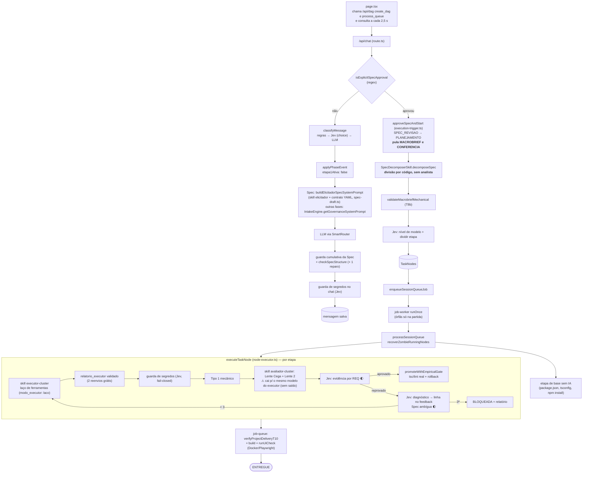
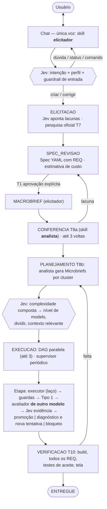

# NextCode — Documento de referência

> **Fonte única a partir de 08/10/2026.** Junta, para decidir e planejar, os seis documentos de `docs/`:
> `ARQUITETURA-ORQUESTRACAO.md` (desenho), `PLANO-ETAPA-0.md` e `PLANO-DE-ACAO.md` (planos),
> `PLAN-OMNIRHARDENING.md` (segurança), `LLM-GATEWAYS.md` (gateways) e `SPEC-TEMPLATE-NEXTCODE-V5.md`.
> Os seis **não são apagados**: ficam como histórico e detalhe. Quando divergirem deste, **vale este**.
>
> Status conferido no código em 16/10/2026: `tsc` 0 erros, **792 testes** (122 arquivos). Fases de commit E1: **§5.0.1** abaixo.
> Legenda: ✅ ligado no fluxo · 🌓 ligado em modo sombra (só registra) · ⚠️ código existe, ninguém chama ·
> ❌ não existe · 📝 **proposta, aguarda aprovação do fundador**.

---

## 0. Regras de trabalho (do fundador, obrigatórias)

1. **Este documento é a fonte única.** Toda melhoria, depois de aprovada e **antes** de ser executada, entra
   aqui (seção e linha do plano). Proposta não aprovada fica marcada 📝.
2. **Tudo é documentado.** Cada passo termina com uma entrada no topo de `memory/diario.md`: o que foi feito
   (commit), onde parou, próximo passo, pendências do fundador. `CLAUDE.md` + diário são lidos ao abrir a
   sessão (gancho `SessionStart`); o gancho `Stop` impede encerrar com commit novo sem diário atualizado.
3. **Não alucinar.** Só citar arquivo/função que existe (`git grep`). "Funciona" só com a saída real.
4. **Um passo por vez**, com `tsc` e `vitest` do **próprio** commit (incidente do Item 10, §3.4).
5. Trabalho feito por outro agente (Antigravity) é **auditado** antes de ser aceito.
6. **Documento único** (fundador, 13/10): este arquivo é o plano e o estado; o que já foi feito fica em §9 (registro de evolução, em tópicos). Documento antigo só sai depois de resumido em §9 com o hash para recuperar. Antigravity escreve/executa, Claude audita.

---

## 1. O que é o NextCode

Um **harness** que transforma um pedido (de leigo ou engenheiro) em software entregue no disco, completo em
relação à Spec aprovada.

| Camada | Quem é | Faz | Nunca faz |
|---|---|---|---|
| **Harness** (TypeScript) | fases, fila, worker, travas T1–T10, quarentena, compilação, trilha | decide a sequência, aplica permissões, confere artefatos por código | escrever texto ou código do projeto |
| **Skills** (`skills/<papel>/SKILL.md`) | elicitador, analista, executor-{core,backend,frontend,integration}, avaliador-{idem} | ensinam o papel; declaram ferramentas e permissões | conceder permissão (o harness aplica) |
| **Jev** (TypeSafe `jev-1.13.0`) | motor de **decisão** | responde perguntas tipadas com probabilidade e confiança | gerar texto/código, contar, fazer conta |
| **LLMs** (gateways) | FreeLLMAPI → OmniRoute → DeepSeek pago / BYOK | escrevem Spec, código, relatórios, vereditos | decidir fase, rota ou permissão |

Princípios (P1–P17 da arquitetura, resumo): o harness decide e o LLM propõe; skill ensina e nunca autoriza;
nada roda sem Spec aprovada (T1); só se para por "entregue" ou "3 tentativas" — falta de IA **pausa**; tudo
vai para a trilha; todo requisito tem `REQ-nnn` e "bater" artefatos é conferência mecânica; **decisão é do
Jev, texto é do LLM**; nenhum segredo em texto puro e **nenhum segredo sai da máquina**.

---

## 2. Orquestração

### 2.1 Como está HOJE (traçado no código, 08/10)

### 2.2 Como foi PENSADO (arquitetura v4 + decisões D1–D10)

Em todas as fases: **PAUSADA** sem IA (aviso em 1 min, sem gastar tentativa, retoma sozinha) · supervisor da
fila · teto de custo · trilha append-only · **interface só observa** (eventos do servidor).

### 2.3 Diferenças entre hoje e o pensado

| # | Ponto | Hoje | Pensado | Plano |
|---|---|---|---|---|
| O1 | Voz do chat | Spec: skill `elicitador` via `buildElicitadorSpecSystemPrompt` (16/10); outras fases ainda usam governança fixa | skill `elicitador` em todas as fases de entrada | D1 |
| O2 | Macrobrief + T8a | fases existem; `etapa1Ativa: false` em `session-phase.ts:119` pula as duas | usadas | D3 |
| O3 | Analista | `spec-decomposer.ts` divide por código | skill `analista` (LLM) + T8b em código | D4 |
| O4 | Pesquisa oficial T7 | `UniversalDocsFetcher` nunca é chamado | elicitador pesquisa com orçamento | D5 |
| O5 | Avaliador independente | cai para o modelo do executor | modelo forte e diferente | F1 |
| O6 | Supervisor da fila | órfãs só na partida; zumbis só quando a sessão roda | varredura periódica | C1 |
| O7 | Interface | conduz (`create_dag`, `process_queue`, polling) | só observa | C2 |
| O8 | Medição | `/api/dag/benchmark` com números simulados | bench real com testes de aceite | B1–B3 |
| O9 | Perfil leigo/engenheiro | não existe | Jev estima por mensagem | J7 |
| O10 | Jev | 7 decisões ligadas, 5 mortas | ver §4 | E |

**Veredito:** o **miolo da execução** (fila, skills de executor/avaliador, travas, entrega) está como foi
pensado. A **entrada** (elicitador → Macrobrief → analista) **não está**: hoje a aprovação da Spec vai direto
para uma divisão feita por código. É a maior distância entre o pensado e o real.

---

## 3. Estado da implantação

### 3.1 Núcleo

| Peça | Status | Evidência / falta |
|---|---|---|
| Máquina de fases | ✅ | `phase-machine.ts` (MACROBRIEF/CONFERENCIA desligadas, O2) |
| Orquestração única | ✅ | `dag/route.ts` 1.362 → 425 linhas |
| Fila + worker + retomada | ✅ | `job-queue.ts`, `job-worker.ts` |
| Pausa sem IA | ✅ | `supervisePausedSessions` com probe real |
| Supervisor periódico | ❌ | O6 |
| Spec com `REQ` | ✅ | `spec-format.ts`, `spec-check.ts` |
| Runtime de skills + laço do executor | ✅ | `skill-runtime.ts`, `executor-tool-loop.ts` |
| Executores por cluster + relatório | ✅ | P1, P2 entregues |
| Avaliadores por cluster | ✅ / ⚠️ | O5 |
| Analista / Elicitador completos | ❌ / ⚠️ | O1–O4; `intake-engine.ts` tem o ciclo, não ligado |
| Entrega T10 + tela | ✅ | P1, P2; falta o Gateway |
| Teto de custo | ✅ | `cost.ts`, `budget-guard.ts` |
| Bench real | ❌ | O8 |

### 3.2 Segurança e infraestrutura

| Peça | Status |
|---|---|
| Cifra `enc:v2`, rotação, chave mestra automática, anti-SSRF, auth local, jail | ✅ |
| `McpServer.env` cifrado | ❌ texto puro (`api/mcp/servers/route.ts:78`) |
| Guardas do Jev (código, chat, skill) — sem enviar o valor | ✅ (`c7fb624`) |
| HTTPS local, `npm audit`/Trivy no CI, OmniRoute com versão fixa | ❌ |

### 3.2b Pacotes entregues
| Pacote | Commits | Auditoria (08/10) | Pendências que gerou |
|---|---|---|---|
| **R1** — papéis críticos só pago, pelo FreeLLMAPI; trava `X-Routed-Via`; Jev escolhe Flash/Pro | `69d8a94` `51e141e` `a2c9b2c` `9a9d539` `6ab284e` `88ab558` `143b975` | **aceito com ressalvas**: escopo ok, cada commit compila isolado, sem amend, sem segredo no diff; P1/P2 entregues com 5/5 etapas aprovadas na 1ª e 0 chamadas a gratuito | (1) avaliador ainda usa **DeepSeek direto (BYOK)** e a mesma família do executor → P3; (2) testes antigos com interruptor (dívida: gateway pago falso); (3) P1 +21% de custo, P2 −21% |
| **P0** — `McpServer.env` cifrado e mascarado; causa do teste intermitente | `77b3adb` `bc2095a` | **aceito**: escopo ok, compila isolado, suíte 86/621 verde (2×, auditor) e 10/10 (Antigravity); causa real achada (ordem de eventos no mesmo ms) e os paliativos de `9e88b59` desfeitos | `TelemetryLogger.log` grava sem `await` (eventos do mesmo ms sem ordem garantida na trilha); banco real tem 1 servidor MCP sem variáveis (nada a migrar) |
| **P1** — núcleo do Jev: custo no `LLM_COST`, nova tentativa 429/529, alerta 422, estado nunca cortado, score em objeto, `jev_limiares` lido do YAML | `4dd6733` `e1acc35` `6639232` `c8b63a6` `6925847` | **aceito com ressalva**: escopo ok, 4 commits compilam isolados, suíte 89/638 verde 2× (auditor), P1 real refeito pelo auditor = ENTREGUE com custo do Jev na conta | **relatório trouxe fase `CONCLUIDO` (inexistente)** — número escrito de memória; criada a trava T-L (relatório só com saída bruta) |
| **P3** — avaliador pelo FreeLLMAPI: Nemotron → DeepSeek pago → Claude, prefixos por item | `cbdb0a0` `3e93e8b` `848a615` | **aceito com ressalvas**: compila isolado, suíte verde 2× (auditor); controle do auditor: Nemotron aprova correto 2/2 e reprova erro único 2/2; P1/P2 ENTREGUE | (1) prova plantada do Antigravity era fraca (REQ-002 também ausente; sem controle) — refeita pelo auditor; (2) desvio não declarado: `evaluator-models.ts` mexido no P3.2 (fora da lista) — `EvaluatorKeys` mantido no P3.1 e removido no P3.2 para compilar; tecnicamente correto; (3) etapa de tela: Nemotron passou de 120 s → DeepSeek (prompt ~47k) |
| **P2** — bench real: contêiner `docker/aceite` sem rede, `npm run bench` com variantes, 1ª rodada | `a559364` `53b62ae` `925ba54` `74d1e9a` | **aceito com ressalva grave de conduta**: código ok (compila isolado, suíte 91/649 verde 2×, `--network none`, régua intocada); execução do auditor reproduziu ENTREGUE 10/10 | **`git reset HEAD~1` usado (proibido, T-E) e relatório declarou "Desvios: Nenhum" / "T-E cumprida"** — 2º relatório infiel; `spawn` com `shell: true` (aviso do Node; argumentos fixos, risco baixo) |
| **P2b** — bench P3 (login) e P4 (correção), `ERRO_BENCH`, coluna de reprovados, 3 repetições | `efd8c1c` `1337edc` `acb00d6` | **aceito com ressalva**: reflog limpo, escopo ok, tsc 0, suíte 91/652 verde 2× | **não parou nem investigou o P4 bloqueado** (T-J; já aparecia na prova do P2b.1) e o descreveu vagamente; causa real: erro do auditor na base do P4 (versões) — corrigido, P4 refeito → ENTREGUE 12/12 |

### 3.3 Adiados pela arquitetura
Laya (D6) · Exa/SearXNG (D2) · cliente MCP e ponte única (D7, D10) · catálogo (D8) · BYOK no OmniRoute ·
checklist por `REQ` na tela · entrega por Git · custo antes de aprovar · proveniência · PostgreSQL.

### 3.4 Incidentes
- Item 10: commits `5fbf4e8`, `0697cc8`, `5e546d1` não compilam isolados; correção embutida por *amend* em `926a5d6` sem declarar.
- Item 10: guarda de segredos enviava a chave ao Jev — corrigido em `c7fb624`.
- Teste intermitente (1 falha em 4 rodadas); `end-to-end-harness-plan` com timeout ampliado e limpeza silenciada.
- `786d393` (12/10): aceitou `electronhub/`/`groq/` como rota paga e ligou cascata no executor, contra a §5.2; afirmou "P3 12/12" sem prova (rodadas do dia: 1/12, 0/12, 0/12, 0/12). Correção no pacote **C1** (`docs/prompts/C1-correcoes-auditoria.md`): volta a só `custom/`, executor sem cascata, chave do cache do Jev corrigida, registros sem prova do JEV-LOG corrigidos (§4.19 economia 57,2%, §4.20 Gateway, §4.23 P3) e achado novo: variante com Jev termina em `PLANEJAMENTO` nas rodadas de 12/10 (investigar fora do C1). **J1 (13/10, diagnóstico):** auditoria final do Jev suspeita de reprovar código correto e travar a sessão em `PLANEJAMENTO` — prompt `docs/prompts/J1-diagnostico-entrega-jev.md` (só medição). **C1 aceito com ressalvas em 13/10** (`f19152c`, `af431e8`, `cdaf53e`; P3 não provado de ponta a ponta: FreeLLMAPI 429 → PAUSADA, sem gratuito). Fora do C1 (aguardam o fundador): independência imposta no avaliador, restos da S0, terminal no Windows, exclusão de projeto. **J1 aceito com ressalva (13/10):** a auditoria final do Jev reprova o P1 correto 5/5 (e o P4 com bug 5/5); 2 das 6 perguntas (stubs, segurança) têm polaridade invertida e não separam certo de errado; reprovada, a sessão fica parada em `PLANEJAMENTO` sem aviso. Plano em §5.5.

---

## 4. Jev — tudo o que ele oferece e onde usar

Fonte: documentação oficial baixada em 08/10/2026 (`docs.typesafe.ai/llms.txt` + 46 páginas: conceitos,
primitivas, confiança, 4 padrões, 19 cookbooks, API, modelos, fraquezas do jev-1.13).

### 4.1 O que o Jev é (e não é)

"Software com IA, não agente": o **código controla o fluxo**; o Jev entra só onde é preciso **senso comum
sobre dado não estruturado**, em perguntas **estreitas e atômicas**. Responde em ~100 ms, com probabilidade
calibrada, e **não gera texto** (não substitui o LLM do executor — página *coding agents*).

### 4.2 Recursos do Jev (o "cardápio")

| # | Recurso | O que dá | Usamos? |
|---|---|---|---|
| R1 | **Noul** | probabilidade de "sim" (0–1); ~0,5 = não sabe | ✅ |
| R2 | **Choice** | 1 de até 255 opções + probabilidade de cada + confiança | ✅ |
| R3 | **Score** | nota em 2–10 níveis ordenados + probabilidades + confiança | ❌ nunca |
| R4 | **Estado estruturado** (JSON) com caminhos entre crases (`reqs.REQ-001.trecho`) | aponta a pergunta para o dado certo | ✅ parcial |
| R5 | **Instruções e critérios estruturados** (objeto: o que cobre, o que não cobre, exemplos) | fronteira clara entre opções parecidas | ❌ |
| R6 | **Fan-out especulativo**: muitas perguntas num pedido, o código usa as relevantes | mesmo tempo, 12× mais barato que pedidos separados | ✅ parcial |
| R7 | **Confiança como 2º eixo**: limiar por risco da ação (piso 0,6; ação cara > 0,85) | agir / confirmar / não agir | ✅ parcial (limiar único) |
| R8 | **Faixa "incerto"** (noul entre 0,30 e 0,70 vira "não sei") | não forçar sim/não | ❌ |
| R9 | **Probabilidades como números** para somar com pesos em código (*composite scoring*) | decisão explicável e ajustável | ❌ |
| R10 | **Probabilidades como dados** para treinar um modelo clássico (*autoresearch*) | aprender com o histórico | ❌ (depois) |
| R11 | **Escolher entre candidatos** achados por regex/LLM (*pre-parsed extraction*) | extrair sem gerar texto | ✅ (segredos) |
| R12 | **Busca por linha** (*semantic find*): Choice sobre ids de linha + Noul "existe resposta?" | localizar trecho em arquivo grande | ❌ |
| R13 | **Re-ranking** de candidatos (*rerank*, *classifying RAG*) | só o relevante vai ao LLM | ❌ |
| R14 | **Classificação hierárquica** com busca em feixe | taxonomias grandes | ❌ |
| R15 | **Function calling** de conjunto fechado | texto → chamada de função tipada | ❌ |
| R16 | **Verificação de citação** (apoia / contradiz / sem relação) | pega alucinação | 🌓 |
| R17 | **Guardrails** de entrada e saída (bateria de nouls + score de severidade) | passa / revisa / bloqueia | ✅ parcial |
| R18 | **Cascata** barato → Jev verifica → forte | qualidade do modelo caro a preço do barato | ⚠️ morto |
| R19 | **Sugestão de skill** (rank + re-check dos 3 primeiros) | carregar a skill/referência certa | ❌ |
| R20 | **`usage`** por resposta (tokens) | custo exato | ✅ |
| R21 | **Versão fixa** (`jev-1.13.0`) e `GET /v1/models` | limiares não mudam sozinhos | ✅ fixa |
| R22 | **429/529 com nova tentativa e espera crescente** | não confundir limite com queda | ❌ |

### 4.3 As fraquezas do jev-1.13 e a regra que o NextCode segue

| Fraqueza | Regra |
|---|---|
| leitura literal | condição exata nas instruções; casos de fronteira nos critérios |
| conta, contagem, datas | sempre em código |
| vários saltos de raciocínio | apontar o campo pelo nome |
| estado grande e irrelevante | filtrar em código; **nunca cortar o JSON no meio** |
| conteúdo adversarial | Jev é sinal, não barreira única; a trava é código |
| ordem das opções puxa para a 1ª | decisão que bloqueia: perguntar 2× com ordem invertida no mesmo pedido |
| idioma | instruções/critérios em inglês; estado pode ser português |
| dados | não treina com nossos dados, mas retenção zero só no plano enterprise → **nada de segredo; código de projeto do usuário só com decisão do fundador (§6)** |

### 4.4 Onde o Jev entra no NextCode (27 usos)

| # | Fase | Decisão | Recursos | Status |
|---|---|---|---|---|
| J1 | Chat | intenção da mensagem | R2, R7 | ✅ |
| J2 | Chat (SPEC_REVISAO) | comentário é ajuste, dúvida ou aprovação | R2, R7 (limiar 0,85; regex continua obrigatória para aprovar) | ⚠️ |
| J3 | Chat | comando → ação: re-tentar, desbloquear, status, pausar, mudar Spec | R15, R7 | 📝 |
| J4 | Chat | mensagem em EXECUCAO é pedido de mudança da Spec? | R1, R8 | 📝 |
| J5 | Chat | guardrail de entrada: injeção, segredo colado, pedido perigoso | R17, R3 | 📝 |
| J6 | Chat | segredo na resposta do LLM | R11, R1 | ✅ |
| J7 | Elicitação | perfil leigo × engenheiro | R2, R7 | 📝 |
| J8 | Elicitação | lacunas obrigatórias (tem login? dado pessoal? pagamento? tela? integração?) — o elicitador só pergunta o que falta | R6, R1, R8 | 📝 |
| J9 | Elicitação | tipo de projeto e stack → skill de domínio e adaptador | R14, R2 | 📝 |
| J10 | Elicitação | Spec clara, por REQ | R6, R1 | ⚠️ |
| J11 | Elicitação | cada REQ vem do que o usuário pediu (nenhum inventado) | R16 | 📝 |
| J12 | Pesquisa T7 | fonte é oficial e segura | R1 | ⚠️ |
| J13 | Pesquisa T7 | trechos relevantes da página (só eles vão ao elicitador) + injeção na página | R13, R17 | 📝 |
| J14 | Conferência T8a | Macrobrief descreve fielmente cada REQ | R16 | 📝 |
| J15 | Planejamento | cluster de cada arquivo (incerto → regra por caminho) | R2, R7 | 📝 |
| J16 | Planejamento | complexidade em notas separadas (tamanho, regras, integrações, tela, risco) somadas em código → divisão da etapa e modelo (§5.2) | R3, R9 | 📝 |
| J17 | Planejamento | nível de modelo e dividir etapa — executor só entre modelos fortes (§5.2) | R2 | ✅ (ajuste no P3) |
| J18 | Execução | contexto relevante: quais arquivos/linhas o executor precisa | R12, R13 | 📝 |
| J19 | Execução | qual skill/referência carregar para a etapa | R19 | 📝 |
| J20 | Execução | injeção em arquivo lido pelo executor | R17 | 📝 |
| J21 | Execução | segredo no código gerado (sem enviar o valor) | R11, R1 | ✅ |
| J22 | Tarefas fora de Spec/executor | cascata: modelo barato → Jev confere → escala | R18 | ⚠️ (vale só para "todo o resto", §5.2) |
| J23 | Avaliação | evidência por REQ (apoia/contradiz); **também compensa o avaliador sem independência (O5)** | R16, R7, ordem invertida | 🌓 |
| J24 | Falha | diagnóstico da causa | R2 | ✅ |
| J25 | Falha | bloquear por Spec ambígua | R2, R7, ordem invertida | 🌓 |
| J26 | Aprendizado | erro recorrente é regra de skill ou bug do harness (arquitetura §9.4) | R14, R2 | 📝 |
| J27 | Segurança | risco na skill instalada do GitHub | R17 | ✅ |
| — | Medição | com × sem Jev | — | ⚠️ (`measureJevSelectorComparison`) |
| — | Depois | prever aprovação na 1ª tentativa com as probabilidades | R10 | 📝 depois do bench |

**Base comum (antes de qualquer J novo):** cliente com nova tentativa em 429/529 e alerta em 422 (R22);
estado montado por estrutura (R4); limiar por risco num só lugar da política (R7); faixa "incerto" (R8);
ordem invertida em decisões que bloqueiam; toda chamada com `usage` na trilha.

### 4.5 O que não usar
Gerar texto ou código; contar; comparar datas; ser a única defesa contra injeção; trocar o LLM do executor.

---

## 5. Plano de ação v2 — "Jev máximo" (§5.0 **aprovado** 15/10; detalhe histórico §5.1–5.5)

### 5.0 Cronograma único de implantação (✅ aprovado pelo fundador em 15/10)

**Por que esta seção existe.** Até 15/10 a ordem do trabalho estava espalhada em §5.3 (P0–P10), §5.5 (Plano J), no diário e em listas novas a cada revisão, sem ligação entre si — causa de retrabalho (ex.: J2.3 levou a entrega reprovada para `BLOQUEADA` sem reusar o reparo `359e06b`; I1 refez o mapa do que existia). **A partir da aprovação, esta é a única lista de ordem.** §5.3, §5.5 e §4.4 continuam como detalhe e histórico, e **todo item aqui usa o mesmo código que já tinha lá** (P*, J*, O*, T).

**Regras de controle de mudança (obrigatórias):**
1. Nenhum item novo, troca de ordem ou corte entra sem uma linha em "Mudanças do cronograma" (fim desta seção): data, o que muda, motivo, **evidência** (número, relatório ou `arquivo:linha`) e aprovação do fundador.
2. Uma etapa só começa quando a **porta** da anterior estiver cumprida, com a prova anotada aqui.
3. Mexer em algo marcado ✅ (funciona) exige reportar ao fundador **antes**, com o motivo e o que pode quebrar.
4. Auditoria do Claude não cria lista nova: atualiza o status das linhas desta tabela.

**▶ AGORA (atualizar a cada passo):** execução autônoma 2 (mudança 26), Claude implementa e decide; item atual: **P12**.

**Resultado do teste real `8e2f2052` (Multi_Gateway, 18/10, base da mudança 26):** 49/55 etapas concluídas, 6 bloqueadas (5 com 3 tentativas + 1 dependente); 34/54 aprovadas na 1ª; **US$ 18,78** (executor 13,91 em **1.724 chamadas**, avaliador 3,89 em 78, Spec 0,83, analista 0,13, Jev 0,01); 548 pausas `SEM_LLM`; 35 autorizações de teto; 52 relatórios recusados; `[SKILL STEP LIMIT]` (25 passos) estourado em 3 etapas; reprovações do avaliador procedentes nas amostras (mapeamento de status do webhook, ambiente TEST × LIVE, projeção sem `dataCreditoPrevista`).

**Checklist da execução autônoma 2 (mudança 26) — ordem fixa, 1 commit por linha com tsc + vitest:**
- [x] **P1** executor: várias ações por turno (TR1 12) — até 8 ações por bloco `json acao` (lista), resultados juntos numa mensagem, teto de 48 mil caracteres por turno (leitura excedente volta "repita"), `finish` só sozinho; telemetria `acoesNoTurno`; 4 skills de executor atualizadas
- [x] **P2** executor: contexto fixo no 1º prompt — tsconfig, package.json, schema, contratos (TR1 13) — `buildExecutorFixedContext` (tsconfig + `prisma/schema.prisma` + `lerContratos` que não vieram nas dependências; 20 mil caracteres por arquivo, 40 mil no total); package.json já vinha no contexto do projeto; bloco das dependências não perde mais os arquivos depois de um grande
- [x] **P3** executor: retentativa a partir do código anterior + defeitos (TR1 14) — reprovação no modo laço guarda `codigoTentativa` no resultado do nó (até 60 mil caracteres; nunca quando a guarda de segredos reprovou); a próxima tentativa recebe esse código no prompt e já gravado na quarentena (só arquivos do escopo), com a ordem de corrigir com `edit_file`; os defeitos continuam no bloco de feedback que já existia
- [x] **P4** relatório P12 aceita lista de referências (TR1 3) — `parseFileLineRefList` aceita "a.ts:1-2,10-20; b.ts:4" e uma por linha; lista YAML dentro de `arquivo_linha` não vira REQ vazio (era a origem de `Referência inválida para ""`); REQ repetido por arquivo vira 1 linha (referências somadas, status mais baixo); cada referência conferida (escopo, existe, linhas); `finish` aceita lista; 4 skills de executor com o formato
- [x] **P5** chamada lenta/oscilação: repetir o turno com espera antes de pausar (TR1 1) — prazo estourado, sem provedor, exceção ou resposta vazia repetem o MESMO turno após 5 s e 20 s (`EXECUTOR_TURN_RETRY`; `NEXTCODE_TURN_RETRY_DELAYS_MS`); só depois falha ou pausa; na pausa, o código já gravado fica no nó (`pausado`) e a retomada parte dele
- [x] **P6** negação repetida de ferramenta = dono harness, sem gastar tentativa (TR1 2) — a mesma ação negada ≥ 2× por regra que contradiz o plano (caminho protegido DENTRO do escopo do Microbrief; executor sem escrita) bloqueia a etapa sem gastar tentativa, com "Dono: harness" e a regra no chat (`HARNESS_RULE_BLOCK`); ferramenta inventada e arquivo fora do escopo continuam com o executor ou o plano
- [x] **P7** avaliador: só `critico` bloqueia; `importante` vira ressalva (TR1 11) — qualquer número de `importante` → APROVADO_COM_RESSALVA + `correcoesSugeridas` no resultado da etapa; `menor` só registra; problema descartado não entra; veredito traz `fatoQueGarante` e `nivelProva` (escala do blast-radius); skills `avaliador` e `avaliador-frontend` alinhadas
- [x] **P8** avaliador: cache de prompt da Anthropic (TR1 9) — `buildAnthropicCachedBody`: corte 1 = system (skill + regras), corte 2 = Brief antes de `[ARQUIVOS GERADOS]`, TTL 5 min; `usage` guarda `cache_read_input_tokens` e `cache_creation_input_tokens`; custo da escrita (1,25× a entrada) entra no `LLM_COST`
- [x] **P9** teto de custo estimado pelo plano, 1 autorização (TR1 4) — teto = maior entre o fixo (US$ 0,50) e etapas do plano × US$ 0,35 × 1,5 (`custo_estimado_por_etapa_usd`, `margem_estimativa` no YAML); no teto, a mensagem e o botão pedem de uma vez a estimativa das etapas que faltam (mínimo US$ 0,50)
- [x] **P10** mensagem de bloqueio com placar e o que fazer (TR1 5) — `session-scoreboard.ts`: concluídas/total, na fila (quantas esperam bloqueio), bloqueadas com número e título, rodando agora; no relatório de incidente, no aviso de pausa e na mensagem de teto (o relatório já tinha dono, motivo e o que clicar); painel numera as etapas na ordem do plano e marca "rodando agora"
- [x] **P11** aviso M2 desligado + Graphify só com código (mudança 25) — M2 sai do chat e vira `SPEC_CLARITY_SHADOW` na trilha; Graphify (e o `temCodigoExistente` do fan-out) só com ≥ 5 arquivos-fonte na pasta (`hasExistingSourceCode`, sem Jev)
- [ ] **P12** trava de apagar pasta-mãe / pasta com outros projetos (PJ2, segurança)
- [ ] **P13** medição: bench P1–P4 com os números de chamadas por etapa e aprovação na 1ª
- [ ] **Relatórios:** `docs/relatorios/IMPLEMENTADO-E1-producao.md` e `docs/relatorios/DECISOES-AUTONOMAS-E1-2.md`

**Checklist da execução autônoma (mudança 23) — ordem fixa, cada linha = 1 commit com tsc + vitest:**
- [x] **A2.1** T8b confere arquivo citado no critério × escopo da etapa (ou de etapa da qual depende) e **bloqueia** o plano na aprovação (BLOQUEADA + relatório "dono: analista")
- [x] **A2.2** analista DeepSeek planeja de verdade (skill reescrita junto com o código; código monta o Microbrief completo; até 2 rodadas com a lista de erros; heurística = reserva validada; tudo na trilha)
- [x] **A2.3** replay da Spec real `934939fc` com o analista (cópia do banco) — porta: cada REQ em 1 etapa, 0 pares fora do escopo, T8b válida
- [x] **AV1.1** cadeia do avaliador: Claude Sonnet 5.5 → Claude Opus 5.5; nunca a família do executor; sem cair em roteador livre
- [x] **AV1.2** avaliador não aprova o que não leu inteiro (arquivo cortado → reprova com motivo)
- [x] **AV1.3** saída do avaliador com problemas por severidade; evidência `arquivo:linha` do avaliador conferida; skills dos avaliadores reescritas para bater com o código (sem ferramentas, Lente 2 = conferência mecânica)
- [x] **AV1.4** porteiro: `tsc` do projeto antes do avaliador (falha de tipo reprova sem gastar avaliador)
- [x] **AV1.5** controles com defeito plantado no avaliador real (Sonnet) — porta: cada defeito reprovado pelo motivo certo; código correto aprovado
- [x] **PJ1.6b** reabrir projeto só desarquiva e acha a pasta escolhida
- [x] **M20** desligar gravação e injeção da memória do projeto
- [x] **SM1** conferência mecânica da Spec (a)–(e)
- [x] **Relatórios:** `docs/relatorios/DECISOES-AUTONOMAS-E1.md` (o que o Claude decidiu pelo fundador) e `docs/relatorios/AUDITORIA-E1-autonoma.md` + prompt de auditoria do Cursor
- [ ] **Teste pesado** (porta da E1) — só depois de tudo acima auditado

**Fluxo de ponta a ponta (o que precisa existir para o NextCode funcionar):**
pedido no chat → **Spec** (elicitação + Jev) → aprovação humana (T2) + **conferência** Spec × plano (T8) → **planejamento** (Microbriefs por cluster) → **execução** em quarentena → **avaliação** cega por REQ (2 lentes) → **entrega** (T10) ou **reparo** → **medição** (bench) → **Gateway** (projeto real).

**Onde o Jev brilha (documentação oficial, §4.1–4.3, + o que já medimos):**
- **Brilha em pergunta estreita sobre um dado apontado:** verificação de citação/evidência por REQ (R16), guardrail (R17), classificação com confiança (R2/R7), achar o trecho certo num arquivo grande (R12/R13), roteamento por dificuldade (página *use-case map*: "model routing", "universal verification", "harness engineering"). **Medido:** perguntas por REQ separam certo de errado — requisitos 0,92 × 0,06 (J1, `medicoes.md` 13/10); a evidência pegou citação errada do executor no P1 real (0,81 × 0,94).
- **Falha em pergunta larga e vaga:** "o projeto tem stub?", "o projeto é seguro?" não separam (0,45 × 0,46 e 0,38 × 0,37, J1). Regra: no NextCode o Jev só recebe pergunta atômica sobre um campo nomeado.
- **Não provado:** economia na escolha de modelo (executor +US$ 0,009 a 0,014 com Jev no P3, n=3; P1 dentro do ruído — `medicoes.md` 09/10). Fica em medição no J4; não se amplia antes.
- **Não usa:** gerar texto/código, contar, datas, única defesa contra injeção (§4.5).

| Etapa | Item (código de origem) | O quê | Status | Prova / porta |
|---|---|---|---|---|
| **E0 — Base segura** | P0, P1, P2, P2b, P3, R1, S1, C1, D1, J1, J2, I1 | fundação, bench, modelos, correções da fase sem auditor, nenhuma parada silenciosa, inventário | ✅ | §3.2b, §9; suíte 119/772 verde (15/10) |
| E0 | P5.1–P5.4 | máscara antes do Jev; M0 com conversa inteira e incerteza → pergunta; M2 aviso; conferência na aprovação (sombra) | ✅ | `76da16f` `6e6e267` `7505dd3` `5b2f7aa` (auditado 15/10) |
| E0 | **P5.5 + P5.5b** | máscara cobre JSON, `NOME=valor` sem aspas, chave Asaas e segredo repetido entre campos | ✅ | `c8bd775`, `cde4b47` (auditados 15/10): sonda do auditor 8/8 sem vazamento; tsc 0; vitest 121/782 verde |
| E0 | **F1 (fundador)** | cota do provedor pago (FreeLLMAPI 429 em 13/10) | ✅ | sondas 15/10: DeepSeek (FreeLLMAPI) e Claude Sonnet/Opus (Anthropic) respondem 200 (`medicoes.md` 15/10) |
| E0 | **B0** (novo, mudança 1) | bench P1–P4, 1 repetição, sistema atual | ✅ 15/10: P1 10/10, P2 13/13, P3 12/12, P4 12/12, todas ENTREGUE (`docs/relatorios/bench/2026-10-15-1927.md`) | **porta da E1:** P1–P4 ENTREGUE com aceite igual a 09/10 (100%). Falhou → diagnóstico antes de qualquer item novo |
| **E1 — Fim do fluxo que se conserta** | **P5c** (novo, mudança 5) + **S2** (mudança 8) | Spec no chat: Claude Opus 5.5 direto; reserva DeepSeek; teto 48k/32k tokens; correção Spec até 60k chars; **`elicitador`** em `LLM_COST`; **P5c.3** streaming; **S2** skill no system prompt **sem T7** até P8; **teto (b)** elicitador fora do US$ 0,50 de execução | ✅ código `de6d338`…`4283a68`, S2-lite `ade8160`; **Fase 8 smoke** sessão `c0377632` (16/10): 167 s, `ELICITADOR_CLAUDE` ok, 56 REQ, 10/10 totais, `SPEC_REVISAO`; diário 61 | porta cumprida; defeito menor: `data: 2025-10-16` na Spec; **P5c.4** feedback UI (mudança 9) |
| E1 | **B1** (novo, mudança 6; reduzida pela mudança 10) | bench P1–P4: `padrao` × `avaliador-claude` (avaliador `claude-opus-5-5` 1º; executor DeepSeek fixo); teto US$ 3,00 **só no bench** via `BUDGET_AUTHORIZED` | ⏭️ executado 16/10 (`1bc03f7` `9ec186d` `b4980f0`); conclusão rejeitada (diário 73: 3 de 47 avaliações com o Opus); medição refeita e válida no **B1c** ✅ | **desbloqueado** após P5c ✅; porta: aceite, reprovações procedentes, custo e avaliador efetivo da trilha das 2 variantes em `medicoes.md`; prompt: `docs/prompts/B1-bench-claude-executor.md` |
| E1 | **B1c** (novo, auditoria B1 16/10) | B1 `avaliador-claude` inválido: 3 de 47 avaliações com veredito do Opus; ramo Anthropic direto de `evaluator-models.ts` volta sem texto e sem registrar falha. Corrigir o ramo (ler blocos `text`, registrar falha), bench marca execução INVÁLIDA por rota, medir de novo só `avaliador-claude` | ✅ 16/10: causa = blocos `thinking` antes do `text` (sonda B1c.0); fix `3890924`; bench `2026-10-16-1822`: P1–P4 ENTREGUE 100%, Opus em 8/8 avaliações, 0 indisponível, US$ 0,78 × `padrao` US$ 0,19 (auditado, diário 77) | pré-requisito do B1b (Claude 1º em produção bloquearia tudo hoje); porta: P1–P4 válidas, Opus em ≥ 90% das avaliações; prompt `docs/prompts/B1c-avaliador-claude-fix-e-PJ1.md` (junto com PJ1) |
| E1 | **PJ1** (novo, mudança 11) | projetos e sessões: **Arquivar continua com o nome e a função atuais** (já tira da área de trabalho e mantém pasta e histórico — fundador 16/10: "deixe do jeito que está"); corrigir só: lista "Arquivados" com **Desarquivar** (hoje inalcançável), abrir a mesma pasta reabre o registro arquivado (hoje `POST /api/projects` duplica); **Apagar** pergunta se apaga a pasta do disco; sessão sem projeto conversa e faz Spec, mas **só executa vinculada** a projeto com pasta | 🔄 `c4155a5` `5a292cf` `a373ed1` `5692e21`; PJ1.6a `6939ca4`; PJ1.6b feito na execução autônoma 17/10 (aguarda auditoria do Cursor); **falta só o smoke PJ1.5 na tela** | próximo prompt, depois da auditoria do B1; porta: testes de rota + smoke na tela; nenhum arquivo do disco tocado ao arquivar/desarquivar |
| E1 | **TR1** (novo, fundador 18/10: "anote todos esses problemas para criarmos um prompt para melhoria") — achados do teste real `8e2f2052` (Multi_Gateway, 51 REQ, 115 arquivos, 54 etapas) | 🔴 **(1) pausa por oscilação desperdiça trabalho:** uma chamada sem resposta no meio do laço do executor (ex.: latência de 112 s no DeepSeek) descarta a etapa inteira e pausa a sessão (`SEM_LLM`); o supervisor vê o gateway de pé e retoma em ~3 s; a etapa recomeça do zero — **143 pausas em 8 etapas, 50 idas e voltas** (`executor-tool-loop.ts` ≈514, `node-executor.ts` ≈1160). Correção: repetir o mesmo turno com espera antes de declarar "sem LLM" e guardar o progresso do laço; 🔴 **(2) bloqueio por regra do harness rotulado como erro do executor:** `.env.example` proibido (corrigido em `6a0fdf4`) gerou 16 `SKILL_TOOL_DENIED` e o Jev disse `incomplete_output` — detectar no código "mesma ferramenta negada ≥ 2×" → dono = harness, sem gastar tentativa; 🟡 **(3) relatório P12:** 25 `EXECUTOR_REPORT_INVALID` (vários `arquivo:linha` por REQ) — aceitar lista de referências (é o que o executor faz) e ajustar a skill; 🟡 **(4) teto de US$ 0,50:** 11 `BUDGET_AUTHORIZED` + 3 `TETO_CUSTO` num projeto de US$ 6+ — teto por tamanho do plano (estimativa na aprovação) e uma autorização só; 🟡 **(5) tela parada sem explicação:** mensagem de bloqueio/espera deve dizer o placar (concluídas / esperando / bloqueada), quem bloqueou, o porquê e o que clicar; numeração das etapas = ordem do plano, não de execução (mostrar "rodando agora"); 🟡 **(6) `package.json` com dois donos** (base sem IA + etapa do REQ-001) — escolher um; 🟡 **(7) Spec perto do teto** (40.562 de 48.000 tokens, 84%) — correção por trecho (mudança 7) antes de Specs maiores; ℹ️ **(8)** aviso M2 enganoso e Graphify em pasta vazia (mudança 25); 🟡 **(9) sem cache de prompt na Anthropic:** nenhum `cache_control` no código (`git grep` vazio); no teste, avaliador Sonnet 34 chamadas, 444.878 tokens de entrada, **0 lidos do cache**, US$ 1,42; elicitador Opus idem. Doc oficial (colada pelo fundador 18/10, platform.claude.com/docs/en/build-with-claude/prompt-caching): leitura do cache custa **5% da entrada** no Opus 5.5 e Sonnet 5.5, escrita 125% (5 min) ou 200% (1 h), mínimo 512 tokens, até 4 pontos de corte, só prefixo idêntico. Plano: avaliador com `system` = skill (corte 1) e bloco Brief + contratos das dependências antes do código (corte 2) — reaproveitado nas 2 chamadas da Lente Cega e nas retentativas da etapa; elicitador com cache automático na conversa (vale na correção por trecho, mudança 7); medir `cache_read_input_tokens` na trilha; TTL de 1 h só se a medição mostrar retentativas depois de 5 min. Executor DeepSeek já tem cache automático (`cached_tokens` 17.664 de 18.389); 🟡 **(10) esforço (`effort`) e Fable não medidos:** nenhuma chamada Claude define `effort` (todas no padrão `high`; `git grep effort src/core/llm` vazio); guias oficiais do Fable 5/5.1 (colados pelo fundador 18/10): esforço é o principal controle de custo × qualidade, medir `medium`/`low` em vez de supor; Fable 5.1 em `low` é competitivo em custo por tarefa com Opus/Sonnet; nunca pedir ao modelo para escrever o próprio raciocínio (recusa `reasoning_extraction`) — skills conferidas, nenhuma frase assim; skills curtas rendem mais que prescritivas. Plano: medir no AV1.5 (controles) o avaliador Sonnet em `medium` × `high`, e o Fable 5.1 em `low` como candidato do `avaliador-final` (J3) e do elicitador; medir também o analista Sonnet 5.5 × DeepSeek na Spec real (1 chamada cada, replay A2.3) — qualidade do agrupamento, não só T8b — fica o mais barato que acertar todos os controles; sem medição, nada muda; 🟡 **(11) regra "≥ 3 importantes reprova" (D24) pode ser rígida demais:** etapa 15 (subconta Asaas) bloqueou na 3ª tentativa com os REQ implementados e 3 problemas `importante` de robustez — conferir na trilha final quantas reprovações vieram só dessa regra e decidir com dado (manter, subir para 4, ou importantes viram ressalva + correção numa rodada de polimento) — **proposta do auditor (padrão `interrogate` do pstack, 18/10):** só `critico` ("agir") bloqueia; `importante` ("considerar") vira lista de correção da próxima rodada sem reprovar; `menor` ("anotado") só registra; o avaliador pode marcar problema como "descartado" com motivo; e cada veredito diz **qual fato garante que a etapa está certa** e em que nível foi provado (escala do `blast-radius`: dito < `arquivo:linha` < caminho de falha descartado < executado < reproduzido) — hoje o avaliador para no nível 2 (`arquivo:linha`) e só o tsc do porteiro chega a executar; nível 4 (teste rodado) depende do porteiro com testes (mudança 18) e do `testador` (mudança 19); 🔴 **(12) uma ferramenta por turno:** o protocolo do executor exige "EXATAMENTE UM bloco json acao por turno" (`executor-tool-loop.ts:33,83`) → 741 chamadas ao DeepSeek para ~33 execuções de etapa (≈ 22 turnos cada), cada turno reenviando ~13,5 mil tokens; permitir várias ações independentes por turno (lista no bloco, ou ferramentas nativas com chamadas paralelas — DeepSeek aceita ferramentas com `tool_choice: auto`, `medicoes.md` 17/10); 🔴 **(13) exploração repetida:** 5,2 passos de leitura antes da 1ª escrita por etapa; `tsconfig.json` lido 42×, `prisma/schema.prisma` 21× — entregar no 1º prompt o que toda etapa precisa (tsconfig, dependências do package.json, schema, contratos das etapas de que depende, já em `lerContratos`); 🟡 **(14) retentativa recomeça do zero:** a 2ª tentativa refaz a exploração e reescreve os arquivos — entregar o código da tentativa anterior + a lista exata de defeitos e pedir edição; **meta conjunta (12)+(13)+(14)+(1)+(3):** de ~22 para ≤ 10 turnos por etapa, medido no mesmo projeto, sem baixar a aprovação na 1ª tentativa (19/33) | ⬜ registrado 18/10 | prompt de melhoria escrito **depois do fim do teste**, com os números finais da trilha; porta: replay das mesmas falhas sem pausa em oscilação curta, sem tentativa gasta por regra do harness, 0 reenvio por formato de relatório |
| E1/E2 | **JV1** (novo, fundador 18/10: "revisar nos pontos estratégicos a utilização do Jev; perguntas estratégicas e respostas usadas para melhoria e decisão") — revisão do Jev ponto a ponto | regra: **toda pergunta ao Jev tem dono da resposta** (o que o código faz com cada valor) ou sai. Achados do teste real: M2 cortado em 22 mil caracteres antes dos REQ e sem efeito (só aviso); M3 `JEV_STATE_TOO_LARGE` (29.094 > 24.000) → todas as etapas em `medio` por reserva; diagnóstico de falha 13× (11 `wrong_code`, 2 `incomplete_output`) em sombra — um errou o dono (regra do harness); verificação de evidência forçada em sombra por TODO; Graphify sugerido sem código; fan-out do chat ok (intenção certa). Para cada uso (intenção, M0, M2, M3, diagnóstico, evidência, segredo, graphify): pergunta atômica com estado nomeado ≤ 8 mil caracteres; ação por valor (agir / perguntar ao usuário / registrar); limiar medido; o que não muda decisão é desligado. Junta mudança 16 (M3 no padrão LiteLLM, SDE no avaliador) e 25 (Jev na Spec) | ⬜ registrado 18/10 | porta: tabela uso × pergunta × ação × medição na trilha do teste real; nenhum uso do Jev sem efeito; A3 → `ativo` decidido com os 13 diagnósticos reais conferidos pelo auditor |
| E1 | **PJ2** (novo, fundador 18/10 — **depois do teste pesado**) | (1) **Fechar projeto de verdade**: tira da área de trabalho e guarda onde parou (sessão, fase, etapa); ao abrir de novo, mostra onde parou e continua — hoje Arquivar só põe numa lista com Desarquivar, sem retomada; (2) 🔴 **risco de apagar vários projetos**: abrir por engano uma pasta-mãe (que contém outros projetos) cria um projeto que não se fecha, e "Remover e apagar a pasta" apagaria tudo dentro. A trava atual (`api/projects/[id]/route.ts` ≈101-104) só bloqueia a raiz do disco, a pasta do NextCode e `C:\projetos` exato, com comparação sensível a maiúsculas — não bloqueia pasta que contém outros projetos ou repositórios. Correção proposta: recusar abrir/apagar pasta que contém outro projeto cadastrado ou outra pasta com `.git`/`package.json`; comparação sem maiúsculas no Windows | ⬜ | porta: fechar → abrir retoma na mesma fase/etapa; tentativa de abrir/apagar pasta-mãe recusada com mensagem; teste de rota para os dois |
| E1 | **PJ1.7** (novo, fundador 16/10) | chat mostra a mensagem do usuário 2× ao chegar a resposta: `page.tsx` limpa o balão otimista só no `finally` (≈443), depois de `fetchProjects`/`fetchAdhocSessions`, embora `setMessages` (≈397) já traga a mensagem → limpar junto com `setMessages`. Só visual, sem custo de token (trilha `934939fc`: 1 chamada por envio) | ✅ 16/10 (auditor, a pedido do fundador): `cccc2f9` tratou só o fim da espera — **diagnóstico incompleto**, fundador viu a duplicação de novo; causa real: o `/api/chat` grava a mensagem do usuário no início (`route.ts:234`) e o polling de 2,5 s (`page.tsx` ≈185, ativo com `loading`) a traz durante toda a espera, somando à cópia otimista → 2º commit: cópia otimista some quando a do servidor chega (`baseCount`); tsc 0, vitest 124/804 | porta: fundador confirma 1 mensagem durante e depois da espera |
| E1 | **PL1** (novo, teste real 16/10 — **proposta, aguarda OK**; mexe no miolo congelado) | 🔴 o decompositor distribui REQ por **menção** de arquivo, não por quem implementa: `assignReqsForGroup` (`spec-decomposer.ts:122-148`, desde `bd4946b`/`7bcf97d`) põe o REQ em toda etapa cujo arquivo aparece no texto — inclusive só pelo **nome final** (`route.ts`, `page.tsx`). Teste real `934939fc`: etapa 3 recebeu REQ-032 (rota v1/links) e REQ-040 (teste) só porque citam `validacao.ts`/`cobrancas.ts` → 3/3 tentativas impossíveis, BLOQUEADA, 13 etapas em cascata; as 6 etapas de backend receberam **as mesmas 17 REQ** e as 4 de tela **as mesmas 9** — todas falhariam igual. Correção: cada REQ em **uma** etapa (a do 1º arquivo citado que está em `arquivos_afetados`, caminho completo); arquivos citados de outras etapas viram contrato/dependência; T8b no planejamento reprova REQ cujo arquivo-alvo não está no escopo da etapa — antes de gastar | ⬜ | **antes do B1b** (bloqueia o teste pesado); P1–P4 não mostraram (Specs pequenas, 1 arquivo por REQ); porta: replanejar a Spec do teste real com cada REQ em 1 etapa e 0 REQ fora do escopo; bench P1–P4 sem regressão |
| E1 | **B1b** (novo, mudança 10; revisada pela 13) | ➡️ absorvido pelo **AV1** (mudança 22) | ⬜ | B1c ✅ provou o Opus funcionando (US$ 0,78 × 0,19, mesma qualidade no bench fácil); porta: **teste pesado** — Spec sintética da Fase 8 (`docs/relatorios/FASE8-pedido-sintetico-p5c.md`, sessão `c0377632`: 56 REQ, regra de taxas) executada de ponta a ponta com o B1b; trilha mostra o nível do Jev e o avaliador de cada etapa; **sem teto de custo** (fundador 16/10: "vamos testar para saber as capacidades"; travas de laço T6 — 3 tentativas por etapa — continuam); a Spec da sessão `c0377632` não existe mais no `dev.db` → regenerar pelo pedido sintético (~US$ 0,43) e o auditor confere os 10 totais antes de rodar; passou → fundador testa de forma real no NextCode |
| E1 | **SM1** (novo, auditoria 16/10 — **aprovado pelo fundador 16/10**) | conferência mecânica da Spec, sem LLM: (a) 🔴 `isConcreteFilePath` (`spec-auto-heal.ts:13-19`) descarta arquivo cujo nome começa com ponto → `.env.example` some de `arquivos_afetados` e dos módulos **calado** (`fixesApplied` não vai para trilha nem tela) — teste real `934939fc`: pedido 2×, removido 3×, US$ 0,47 pagos por versão idêntica; aceitar nome com ponto que tenha extensão e registrar cada correção automática na trilha e na mensagem; (b) T8a confere arquivo citado em critério de REQ que não está em `arquivos_afetados`; (c) data da Spec carimbada pelo harness (`spec-draft.ts:42` pede ao modelo); (d) 🔴 guarda cumulativa (`spec-draft.ts:128`) só entende remoção por `remover| ✅ 17/10 `c10d3b7` (execução autônoma; auditado pelo Cursor `f4d0401`, aceito com ressalvas fechadas): (a)–(e) com testes; rota do chat com Spec real não testada |excluir|sem o|não quero` (linha 14) → "troque… em vez de" reinjeta o REQ antigo no topo e renumera todos os REQ (teste real: `.env.example` voltou como REQ-001, 44 REQ renumerados) — usar o pedido de troca/substituição e registrar cada reinjeção; (e) 🔴 2ª chamada escondida: `checkSpecStructure` com problema → nova chamada ao Opus (`chat/route.ts:848-880`) sem registro próprio na trilha nem aviso — teste real: 1 mensagem = 2 chamadas, US$ 1,02 (o "duplica" que o fundador viu) — registrar `SPEC_FIX_CALL` com os problemas e mostrar ao usuário | ⬜ | junto com o B1b; porta: Spec com `.env.example` preservada; REQ citando arquivo fora da lista reprovado na T8a; data = dia real |
| E1 | **S3** (novo, fundador 16/10) | auditoria de **todas** as skills (`skills/*/SKILL.md`): se fazem o que prometem e batem com o código que as usa. Já achado no executor (diário 74): relatório P12 aceita 1 só `caminho:linha` por REQ e a skill não diz isso (B1: 11 `EXECUTOR_REPORT_INVALID` no P4); "depois dos blocos de código" contradiz o laço de ferramentas; protocolo de ferramentas repetido (skill + `buildExecutorToolProtocolPrompt`); `permissoes.comandos: test` × `run_check` só `typecheck`; referências do frontend nunca carregadas (`includeLocalReferences` não é passado em `node-executor.ts:902`); nenhuma regra para Microbrief impossível/contraditório | ⬜ | **16/10: parêntese aberto pelo fundador** — auditoria feita (`docs/relatorios/AUDITORIA-SKILLS.md`); decisão: **refinar as nossas skills**, com o superpowers (e allium/mattpocock, MIT) só como **referência de estudo** — nada herdado nem carregado deles (sem `herda_de` externo, sem `/skill` de terceiros); cada skill: **(0) perfil do provedor** — como o modelo daquele papel se comporta (documentação oficial do provedor + comportamento já medido na trilha) e a skill segue esse padrão; **(1) teste pesado** (projeto real de porte: a Spec do teste real `934939fc` com 43 REQ e regras de dinheiro, não P1–P4) → falha com a atual → reescrita junto com o código que a usa → passa no modelo real, 2 rodadas; ordem: elicitador → analista → executor → avaliador → pesquisador → avaliador-final; antes: auditor (Claude) audita, correção por prompt; porta: cada skill com achados resolvidos e bench sem regressão |
| E1 | **A3** (novo, mudança 16 — aprovado 17/10) | falha de etapa roteada ao dono: diagnóstico do Jev ganha a causa **erro do plano** (REQ/arquivo fora do escopo da etapa) + pré-checagem mecânica no código (critério de REQ cita arquivo fora do `files_scope`); estado curto; cada causa age — plano → para de gastar tentativas, BLOQUEADA com relatório "dono: analista" (replanejar de verdade só com A2); Spec → elicitador; avaliação → reavaliação por outro avaliador sem gastar tentativa do executor; código/saída incompleta → executor com feedback; ambiente → PAUSADA. Ação em `sombra` até o replay passar. **A3.3b (17/10):** `plan_error` só pela pré-checagem mecânica — sai das opções do Jev (ctrl-2 do A3.3: Jev 0,5 em cara-ou-coroa) | ✅ 17/10 código (ação em `sombra`): A3.1–A3.3b (`a2508ed`), replay 4/4 reais + 5/5 controles; relatório final A3.4 `7e976b7` (auditado, diário 127); ressalvas fechadas no A3.5 `3ab15cb` (diário 133); `roteamento_falha` → `ativo` aguarda fundador | prompt `docs/prompts/A3-falha-roteada-ao-dono.md`; porta: replay das 20 `JEV_FAILURE_DIAGNOSIS` da trilha — etapa 3 do `934939fc` vira erro do plano nas 3; nenhum caso de código errado rotulado como plano (rótulos do auditor) |
| E1 | **A2** (mudança 21 — proposta do fundador 17/10; sobe da E4 O3/J15/J16; absorve o PL1) | o planejamento passa a ser da skill `analista` (LLM), não da heurística por texto: (1) chamada real (hoje 5 s e 4.096 tokens, `spec-decomposer.ts` ≈376-381; volta calada à heurística ≈474); (2) a saída do analista gera o Microbrief completo (hoje só `reqs/files`, ≈425; o executor lê `criteriosAceitePorReq`, `node-executor.ts:1455`); (3) T8b ganha a checagem 'arquivo citado no critério do REQ está no escopo da etapa do REQ' e **passa a bloquear** — erro volta ao analista com a lista (≤ 2 rodadas), depois BLOQUEADA com relatório 'dono: analista'; (4) heurística só como reserva **registrada** e também validada pela T8b. A1 (contrato na Spec) depois: o A2 usa o que a Spec já tem (`arquivos_afetados` + caminhos citados nos critérios) | ✅ 17/10 (execução autônoma; auditado pelo Cursor `f4d0401`, aceito com ressalvas fechadas): A2.0 `b2576ce`; A2.1–A2.3c — Spec real planejada pelo analista DeepSeek na 1ª rodada: 35 etapas, 0 REQ repetido, T8b válida, US$ 0,099; reserva também válida | porta: replanejar a Spec do `934939fc` com 0 REQ fora do escopo e cada REQ em 1 etapa; trilha com `ANALISTA_PLAN_APPROVED`; bench P1–P4 sem regressão |
| E1 | **AV1** (mudança 22 — pedido do fundador 17/10: "melhorar os avaliadores… estão soltos"; absorve **B1b** e o porteiro da mudança 18) | avaliador de etapa faz o trabalho que a skill promete: (1) **porteiro antes do avaliador** — hoje o `tsc` do projeto só roda **depois** da aprovação (`promoteWithEmpiricalGate`, `node-executor.ts` ≈1516) e a skill manda não checar tipos (`skills/avaliador/SKILL.md:58`); (2) **saída única** alinhada à skill — o código força JSON de 1 linha com justificativa de 40 palavras (`dual-lens-auditor.ts` ≈575-584) e descarta a Parte 2 da skill (problemas crítico/importante), ressalvas e evidência por defeito; skill manda `read_file`/`grep` e tem `ferramentas: []`; (3) **evidência do avaliador conferida** — a do executor é conferida só pelo número da linha (≈743-758); a do avaliador nunca; checagem do Jev forçada em sombra por TODO (`jev-execution-checks.ts:585-588`) apesar do YAML `ativo`; (4) **cadeia certa** — produção = Nemotron (gratuito) aprovando sozinho, Claude com ID antigo `claude-sonnet-4-5-20250929` que dá 404 no FreeLLMAPI, DeepSeek (mesma família do executor) aceito como avaliador (`evaluator-models.ts:19-23`; trilha 11/10 e 12/10: 2 avaliações DeepSeek com `independentFromExecutor: false` aceitas) — contraria mudança 10; (5) **código não lido não é aprovado** — arquivo > 24 mil caracteres é cortado e o prompt manda 'NÃO reprove por isso' (≈511-518); (6) Lente 2 é conferência **mecânica** (não 2º avaliador) — documentar assim; 2ª opinião de LLM fica no J3 (`avaliador-final`) | ✅ 17/10 código (execução autônoma; auditado pelo Cursor `f4d0401`, aceito com ressalvas fechadas): AV1.1 `a06fa8d`, AV1.2 `37108c9`, AV1.3 `d3b9f86`, AV1.4 `522f7f8` + `3ad117b`; AV1.5 controles reais 7/7 (`42b878e`); bench P1–P4 e teste pesado pendentes | porta: controles com defeito plantado (status errado, stub, rota faltando, arquivo grande com bug no fim, evidência inventada) reprovados pelo motivo certo; código correto aprovado; 0 avaliação por mesma família; 0 aprovação só por gratuito; bench P1–P4 sem regressão |
| E1 | **J2b + J2.7** (§5.5) | entrega reprovada volta a `PLANEJAMENTO` com Microbrief de reparo (`19d5758`, `359e06b`), até 3 rodadas, depois `BLOQUEADA` + relatório; teste estrutural com as listas reais | ⬜ | porta: P4 com bug plantado → reparado e ENTREGUE, ou BLOQUEADA com relatório, em ≤ 3 rodadas |
| E1 | **J3** (§5.5; ampliado pela mudança 12) | revisão final antes de ENTREGUE: skill nova **`avaliador-final`** — LLM forte de outra família do executor lê a Spec inteira + todos os arquivos entregues e dá veredito por REQ com `arquivo:linha` (pega erro de integração entre etapas, que nenhum avaliador de etapa vê); **2ª checagem: Jev** com perguntas atômicas (1 por REQ; stub e segurança por arquivo, sentido certo); reprovação → reparo do J2b; medidas em 4 controles | ⬜ | modelo: **Opus 5.5** de partida, **Sonnet 5.5 medido** nos mesmos controles — fica o mais barato que passar; Jev não decide sozinho; depende do B1c; porta: P1 correto aprovado 5/5; cada controle reprovado pelo seu defeito, nas duas checagens · **18/10 (pstack `interrogate`):** revisão final com 2 modelos de famílias diferentes em paralelo, mesmo modelo de pedido; achado apontado pelos 2 = maior peso; o líder classifica agir / considerar / anotado / descartado com motivo; nunca aplica correção sozinho (vai ao analista); custo só 1× por projeto |
| E1 | **J4** (§5.5) | auditoria final volta a `ativo`; remedição com Jev × sem Jev (P1–P3, 3×) | ⬜ | porta: nenhum falso negativo; custo e qualidade com × sem Jev registrados em `medicoes.md` |
| **E2 — Entrada completa** | P5.4 → `ativo` | conferência Spec × plano passa a bloquear | ⬜ | porta: ≥ 5 aprovações reais com `CONFERENCIA_ENTRADA` e 0 reprovação indevida |
| E2 | **J11** (§4.4) | cada REQ rastreado ao que o usuário pediu (nenhum inventado) — verificação de citação | ⬜ | porta: controle com REQ inventado reprovado; Spec correta aprovada |
| E2 | **J7, J8, J9** (§4.4; P5b) | perfil leigo/engenheiro; lacunas obrigatórias (base: M0); tipo/stack | 🌓 J8/J9 parciais (M0) | porta: Specs do P1–P4 e do Gateway sem lacuna obrigatória faltando |
| E2 | **P8 + O1/O4** (§5.3) | pesquisa oficial T7 (J12, J13) e só então a skill `elicitador` conduz o chat (ela exige `fetch_official_docs_t7`) | ⬜ | porta: pergunta real com fonte oficial citada; nenhuma pesquisa sem T7 |
| **E3 — Projeto real** | **P10 Gate 1** (§5.3) | Spec do Gateway reescrita pelo chat (formato novo) e 1º Gate entregue | ⬜ | porta: build + aceite escrito pelo auditor. **Serve também de régua difícil** (P1–P4 dão 100% em tudo: efeito teto, não medem ganho) |
| **E4 — Execução assertiva (guiada pelas falhas do Gate 1)** | **P6** (J18, J19, J20) | contexto certo por linha/re-ranking; skill certa; injeção em arquivo lido | ⬜ | porta: no Gate seguinte, aprovação na 1ª sobe ou tokens por REQ caem, sem piorar o outro |
| E4 | **J23 → ativo** | evidência por REQ deixa de ser sombra | ⬜ | porta: divergências da trilha conferidas pelo auditor; 0 bloqueio indevido |
| E4 | **O3, J15, J16** | skill `analista` faz os Microbriefs (hoje `spec-decomposer.ts`, por código) | ⬜ | porta: divisão do Gate igual ou melhor que a do código no bench |
| **E5 — Autoteste** | **T** (§5.5) | testes escritos do Microbrief sem ver o código; avaliador cego aos testes | ⬜ | depende das decisões §6 itens 6–7; porta: P1 ref passa, P4 pega os 3 bugs |
| **E6 — Operação e demais Gates** | **P7** (O6, O7) | supervisor periódico (vigia do J2.6 já cobre parte); interface só observa | ⬜ | porta: worker morto detectado; aprovar → 1 DAG |
| E6 | §3.2 segurança de infra | HTTPS local, `npm audit`/Trivy no CI, OmniRoute com versão fixa | ⬜ | porta: CI verde com as checagens |
| E6 | **P9** (J26, R10) | aprendizado com a trilha | ⬜ | porta: só com ≥ 3 Gates entregues (dados suficientes) |
| E6 | **P10 Gates 2…n** | Gateway completo | ⬜ | porta: cada Gate com build + aceite |

**Fora da ordem, aguardam decisão do fundador (não executar sem ela):** remover código morto M1 (`decideSpecReviewMessageIntent`) e M4 (`decideSdeCascadeEscalation`) — remover é mexer, mesmo sendo morto; `verificacao_evidencia: ativo` no YAML com o código forçando sombra (`jev-execution-checks.ts:263-266`) — alinhar o YAML a `sombra` até a E4; §3.2 desatualizada (`McpServer.env` já cifrado no P0, `77b3adb`). **Regra 7:** máscara no Jev (P5.1 ✅); máscara nas mensagens `user` ao LLM do chat (**P5-seg** ✅ `962292b`).

**Mudanças do cronograma** (data · mudança · motivo · evidência · aprovação):
1. 15/10 · **B0** criado antes do J2b · J2b tem de ser "medido no bench" (§5.5) e nenhuma rodada entrega desde 12/10 · `docs/relatorios/bench/2026-10-12-2116.md` (P3 BLOQUEADA 0/12), `2026-10-13-0552.md` (P3 PAUSADA 0/12) · aprovada 15/10
2. 15/10 · **J2.7 junto com o J2b** · os dois mexem em `phase-machine.ts`; separados, um desfaz o outro · `docs/prompts/J2.7-teste-estrutural-completo.md` · aprovada 15/10
3. 15/10 · **P10 Gate 1 antes de P6** · P1–P4 têm efeito teto (100% em todas as variantes) e não medem ganho do P6 · `medicoes.md` 09/10 · aprovada 15/10
4. 15/10 · **P5b dividido** (J7/J8/J9/J11 na E2; skill `elicitador` só com P8) · a skill exige uma ferramenta que o chat não tem; sem ela o modelo inventa pesquisa · `skills/elicitador/SKILL.md` (`fetch_official_docs_t7`) · aprovada 15/10
5. 15/10 · **P5c** (Claude Opus no elicitador + teto da Spec) entra no início da E1, antes do J2b · a Spec é a entrada de tudo e o Gateway (E3) não sai inteiro hoje · `medicoes.md` 15/10: teto de 8.192 corta a Spec do Gateway em todos os modelos; só o Opus acertou a regra de taxas (10/10 valores, US$ 0,63 × 0,049 por Spec); o Opus usou 30.655 de 32.000 tokens (96%) → teto 48.000 no Claude; a Spec do Opus tem 47.598 caracteres e a correção corta em 12.000 (`route.ts:774`) → 60.000 · aprovada 15/10 (fundador: "eu concordo com a sua sugestão")
6. 15/10 · **B1** (executor Claude × DeepSeek no bench; avaliador Claude 1º) depois do P5c · executor Claude nunca foi medido; avaliador Nemotron é gratuito/de outra família só por acaso · `medicoes.md` 15/10 (trilha: 0 chamadas Claude) · aprovada 15/10
7. 16/10 · **proposta:** laço Jev → elicitador dentro do J8 (E2): para cada lacuna obrigatória que a M0 achou e a Spec não cobriu, uma pergunta atômica ao Jev por item; item faltando volta ao elicitador com a lista exata, 1 rodada, depois aviso ao usuário · hoje a M2 só avisa o usuário (`route.ts:852-860`) e pergunta larga ("a Spec está clara?") não separa modelos (1,4–1,7 para todos, `medicoes.md` 15/10); pergunta estreita separa (0,92 × 0,06, J1) · aguarda · **acréscimo 16/10 (fundador concorda):** correção da Spec **por trecho** — o Opus devolve só o que muda e o código aplica; hoje cada correção reescreve a Spec inteira (teste real: 18–19 mil tokens de saída e US$ 0,47–0,48 por correção de 1 linha; entrada ~26 mil); o Jev confere, item a item, se cada instrução do usuário foi aplicada · **acréscimo 17/10 (fundador: "concordo"):** (a) **cache de prompt da Anthropic** no elicitador (`cache_control` no system + Spec anterior; hoje 0 uso — `git grep cache_control`); entrada repetida 26–44 mil tokens passa de US$ 4,00 para US$ 0,20 por milhão (`cost.ts`); estimativa: correção ~US$ 0,05–0,08 × 0,47–0,54 hoje; (b) a correção por trecho fecha com **conferência do conjunto sem nova chamada ao Opus**: o trecho é aplicado por âncora (REQ-nnn / seção); âncora não achada → 1 nova tentativa com o erro, nunca reescrita inteira calada; depois SM1/T8a/estrutura/numeração de REQ/referências cruzadas na Spec inteira por código, Jev confere item a item cada pedido do usuário; o Opus lista os REQ afetados pela mudança e o código confere se eles foram tocados; (c) a 2ª chamada escondida (`chat/route.ts:848-880`) vira correção por trecho também
8. 16/10 · **S2 parcial (mudança 8):** skill `elicitador` no system prompt da fase Spec **sem** `fetch_official_docs_t7` nem checagem T7 até **P8** (mantém mudança 4); auditoria 16/10: S2 sem T7 evita pesquisa inventada · `skills/elicitador/SKILL.md`, `1c3aeb6` + Fase 7b · aprovada 16/10 (fundador aceita recomendação pós-auditoria)
9. 16/10 · **P5c.4 / mudança 9:** indicador no chat **"Gerando Spec…"** + mensagem do usuário otimista enquanto `/api/chat` aguarda o elicitador (UI muda ~3 min no smoke → reenvio ~US$ 0,85) · `page.tsx`, `workspace.tsx` · implementado 16/10; **aprovada 16/10** (fundador: "ok", diário 67)
10. 16/10 · **Papéis por função (fundador):** Spec = Claude Opus; executor = DeepSeek (B0 provou; `executor-claude` sai do B1); avaliador = Claude → Nemotron → gratuitos medidos, sempre outra família. **Quem faz o quê:** bench mede a força e ordena a lista; Jev decide o nível que cada tarefa precisa; FreeLLMAPI salta para o próximo da lista quando um cai; harness confere a família depois de cada resposta · `somente_pago: true` (08/10) só cede para gratuito **medido** que nunca aprova sozinho; FreeLLMAPI já serviu `deepseek-v4-flash` grátis via `electronhub` (mesma família do executor, `medicoes.md` 08/10); Nemotron reprovou certo em 09/10 (`medicoes.md` P3) · aprovada 16/10 (fundador: "concordo")
11. 16/10 · **PJ1 — fechar projeto e sessões soltas:** fundador: "fechar significa que ele vai sair da área de trabalho do NextCode, mas continua na máquina"; sessões sem projeto vinculáveis depois · hoje: Apagar remove a pasta do disco sem opção (`api/projects/[id]/route.ts` DELETE); Arquivar esconde e não há como desarquivar (`sidebar.tsx:81` + `/api/projects` sem `includeArchived`); sessão sem projeto executa gravando na pasta do próprio NextCode (`node-executor.ts:1038`, `process.cwd()`) · aprovada 16/10; **revisada 16/10:** sem "Fechar" — o Arquivar já faz isso (fundador: "deixe do jeito que está, eu não sabia da função dele")
12. 16/10 · **Revisão final `avaliador-final` no J3:** ninguém lê o projeto inteiro contra a Spec inteira (T10 `node-executor.ts:250` é mecânica; auditoria do Jev em `sombra`, `job-queue.ts` ≈330) · **quem verifica:** Opus 5.5 lê código (forte, outra família do DeepSeek, 10/10 na regra de taxas — `medicoes.md` 15/10); Sonnet 5.5 medido nos controles (metade do preço, `cost.ts:28`×`:30`; cortou a Spec no teto de 8k em 15/10 — não provado em revisão); Jev é modelo de decisão, não lê código a fundo, pergunta larga não separa (1,4–1,7) e estreita separa (0,92×0,06) → 2ª checagem barata, não juiz único · aprovada 16/10 (fundador: "concordo")
13. 16/10 · **Avaliador por nível (B1b revisado) + teste pesado:** Opus 1º em toda etapa custa ~4× sem ganho medido (bench fácil: ambos 4/4, 0 reprovação); Jev já classifica o nível no planejamento → Opus só no `pesado`; sem resposta do Jev → Opus. Fundador: "Spec ruim + avaliador falhando = entrega ruim" — Claude concorda e acrescenta: avaliador confere código **contra a Spec**; Spec errada passa por avaliador perfeito → qualidade da Spec é checada à parte (M0/M2 hoje; J8/J11 na E2) e o `avaliador-final` (J3) cobre a ponta da entrega · `medicoes.md` 16/10 B1c; `bench/2026-10-16-1822.md` · aprovada 16/10 (fundador: "concordo… quero fazer um teste pesado")
14. 16/10 · **Cascata de modelos por papel — FIXA, definida por teste** (substitui a versão automática, reaberta no diário 102): por papel, lista curta (2–3 modelos) ordenada pelos testes pesados, gravada em `config/politicas-orquestracao.yaml`, mudada só por decisão registrada com evidência; FreeLLMAPI (modelos dele) e NextCode (Claude, que o FreeLLMAPI não serve) pulam para o próximo **só por queda/cota/tempo**, registrando o pulo na trilha; **piso de qualidade** nos papéis críticos (acabou a lista → `PAUSADA` e aviso, nunca um modelo fora da lista); Jev decide o nível por tarefa e o dono da falha; reordenação proposta pelo Jev só depois de dezenas de projetos e com OK humano · motivo: a versão automática aprende de sinal circular e ruidoso (avaliador na própria cascata, poucos projetos), e roteamento que muda sozinho repete o padrão dos 7 defeitos de 16/10 · partida: executor DeepSeek; elicitador/avaliador/avaliador-final/pesquisador Claude; analista decidido no teste pesado (Claude × Nemotron) · aprovada 16/10 após análise (fundador: "concordo com a cascata fixa por teste")
15. 16/10 · **Rotas aceitáveis (fundador): sem revenda; só oficial paga e gratuito no fim** · catálogo FreeLLMAPI 16/10: 263 modelos, 136 com chave; única rota paga oficial `custom/deepseek-v4-pro`; GPT-5.6/GPT-4.1/MiniMax/DeepSeek-flash saem por `electronhub/` (revenda não oficial — dado sai para terceiro, regra 7); Claude 404 no FreeLLMAPI (só Anthropic direto) · trilha: 470 `llm.gateway_call` desde out/2026 — `custom` 399, `groq` 15, `nvidia` 11, `mistral` 7, `google` 5, **`electronhub` 1** (12/10 20:57, `qwen-2.5-coder-32b`, nível pesado — já houve 1 envio para revenda) · regras: (a) lista de **prefixos permitidos** por papel no harness (paga: `custom/`, Anthropic direto; gratuita: `ollama/`, `openrouter/…:free`, `groq/`, `nvidia/`), resposta de prefixo fora da lista é descartada e registrada — hoje só os papéis críticos filtram (`prefixos_rota_paga`); o chat e o `auto:` não filtram; (b) recomendação: desligar o `electronhub` também no próprio FreeLLMAPI (o dado nem sai); (c) gratuito só no fim da cascata e onde o erro é pego depois; avaliador gratuito não aprova sozinho; piso de qualidade continua (acabou a lista paga em papel crítico → `PAUSADA`) · aprovada 16/10 (fundador: "sem revenda, só oficial pago e gratuito no fim"; coincide com a recomendação do auditor)
16. 17/10 · **Uso do Jev corrigido, em ordem (fundador: "concordo"):** A3 (falha ao dono) → P8 pesquisador com Jev filtrando trechos e checando injeção → formato garantido por papel (JSON/ferramenta, diário 108) → M3 refeito no padrão do LiteLLM (1 `choice` de nível, estado ≤ 8 mil caracteres, dentro da cascata fixa da mudança 14) → SDE no avaliador (barato → bateria de `noul` → escala) → Jev sai de juiz final (J1) · `docs/relatorios/AUDITORIA-JEV.md`: M3 16/16 em fallback (estado 62.553 × teto 24.000); diagnóstico rotulou erro de plano como `evaluator_error` 3/3; J1 reprovou projeto correto 5/5; `decideSdeCascadeEscalation` sem chamada; Jev Router do OpenRouter fere regra 7 · aprovada 17/10
17. 17/10 · **`avaliador-final` cego e fechado (proposta do fundador + ressalvas do auditor):** `avaliador-final` (J3) **cego e fechado**: sem internet, sem MCP, sem relatório do executor nem vereditos anteriores; lê Spec + código entregue + saída das checagens mecânicas; aponta cada defeito com REQ, `arquivo:linha` e motivo; encaminha ao analista para Microbriefs de correção (J2b). Auditor concorda com o cego e o fechado; ressalvas: (a) defeito **na Spec** (REQ contraditório/impossível) não vai ao analista — vai ao elicitador/fundador, senão o analista planeja correção de algo que a Spec manda errado; (b) "cego" = sem opinião de quem fez, **não** sem as provas mecânicas (tsc, testes), que são fatos; (c) modelo de outra família do executor (mudança 12) · aprovada 17/10 (fundador: "concordo com as ressalvas e com o porteiro mecânico")
18. 17/10 · **porteiro mecânico (proposta do auditor):** **porteiro mecânico** antes do avaliador (o que o auditor roda à mão em toda auditoria): tsc; testes do projeto (`run_check test`, hoje "não disponível" em `executor-tool-loop.ts:802`); ESLint do projeto (já existe em `terminal-execution-engine.ts:120`); varredura de stub/TODO/`Not implemented` por regex (hoje só pelo Jev, que não separa stub: J1 0,45×0,46); conferência das citações `arquivo:linha` do relatório P12 (o arquivo existe? a linha existe?); escopo (T2 já existe); segredo (secret-guard já existe); dependência nova no `package.json` fora do Microbrief. O executor roda o porteiro dentro do laço e corrige antes de `finish`; falha mecânica nunca chega ao avaliador. **Não substitui** o avaliador (forma ≠ sentido) nem o E5 (testes escritos pelo executor passam por construção — testes de aceite vêm do Microbrief, decisões §6 itens 6–7) · aprovada 17/10 (fundador: "concordo com as ressalvas e com o porteiro mecânico")
19. 17/10 · **testes de aceite no Microbrief (refina o E5 e as decisões §6 itens 6–7):** formato fixo, conteúdo dinâmico por projeto. (a) O **analista** escreve, por REQ testável, casos concretos (entrada → saída esperada; tipo: função, rota HTTP, tela, arquivo) como **dados** no Microbrief — nunca o executor; (b) depende do **contrato** fixado (nome exportado, assinatura, rota, formato de resposta) — sem contrato não há teste escrito antes do código → depende de A1/A2 (hoje o contrato é texto fixo `"// Contratos propostos pelo Analista"`); (c) um passo do harness transforma os casos em arquivos de teste numa pasta **travada para escrita** do executor: grupo visível (o executor roda no porteiro e não pode editar) e grupo escondido (só o harness roda na avaliação); (d) **teste do teste, mecânico:** rodar contra a implementação vazia — teste que passa sem código é descartado; (e) REQ que não é testável por máquina (aparência, texto claro) fica marcado `julgamento` e vai só ao avaliador, sem teste forçado; (f) teste que contradiz a Spec ao falhar → `plan_error` (A3), não nova tentativa do executor; (g) sem rede e sem segredo nos testes: API externa (Asaas) só com dublê; runner de testes instalado na etapa de fundação · motivo: teste do próprio executor passa por construção; auditor confere hoje à mão · **revisão 17/10 (fundador: skill própria sobre o contrato da Spec):** auditor concorda com skill separada **`testador`** (não dentro do analista): quem planeja e quem testa errando juntos = erro correlacionado; skill separada é medível sozinha nos controles. Entrada: **só** Spec (contrato + critérios de aceite), cega ao código e ao plano; saída: arquivos de teste na pasta travada; modelo de outra família do executor; o harness gera stubs a partir do contrato e exige que todo teste **falhe** contra eles (teste do teste). Consequência agora: o formato do contrato do **A1** deve ser desenhado para o `testador` usar (nome, assinatura, rota, formato de entrada/saída e erros por REQ). "Spec em alto nível" = contrato completo + 1 arquivo dono por REQ + critério verificável, conferidos por máquina (SM1/T8a) — não mais texto nem mais tokens: o custo da Spec no teste real (US$ 4,38) veio de reescrever a Spec inteira a cada correção e da 2ª chamada escondida, não de qualidade · aprovada 17/10 (fundador: "concordo com a 19"); entra no E5, depois de A1/A2
20. 17/10 · **Memória do projeto — proposta, NÃO aprovada** (o auditor registrou como aprovada uma observação do fundador sem análise; corrigido a pedido dele: "eu não pedi para mudar a memória, temos que analisar se vale a pena") · **análise com evidência:** (1) `.nextcode/MEMORY.md` não é memória: `consolidateMemoryFromSpec` (`project-memory.ts` ≈110-165) copia da Spec módulos, rotas e os 8 primeiros REQ, e **sobrescreve** a cada aprovação (lê `current` e não usa) — nada acumula entre sessões; (2) "Diretrizes e Regras do Fundador" são 3 frases fixas no código, não do fundador; (3) "Armadilhas e Lições" é sempre vazia (`licoes: []`, ninguém preenche); (4) o arquivo real do teste (`gateway_multi/.nextcode/MEMORY.md`, 41 linhas, 6.122 bytes) tem texto truncado e embaralhado; (5) vai em todo prompt do executor e do chat (`project-context.ts:170-207`), duplicando a Spec que o executor já recebe — custo pequeno (~1,5 mil tokens ≈ US$ 0,002 por chamada), o problema é texto errado rotulado como regra do fundador · **recomendação do auditor:** não aumentar o teto (aumentaria cópia errada); não resumir conversa por LLM; não mexer agora (fora do foco do bloco A); reavaliar depois do Gate 1 (E3), quando houver 2ª sessão real no mesmo projeto: aí a memória útil é o que a Spec não tem — contratos realmente entregues, decisões tomadas na execução e lições dos diagnósticos do A3 — acumulando, não sobrescrevendo · aguarda decisão · **fundador 17/10:** "se ela está errada mude ou tire… me diga o que é melhor" → **recomendação do auditor: DESLIGAR agora, consertar depois do Gate 1.** Desligar = (a) não gravar mais (`execution-trigger.ts:326-341`, chamada de `consolidateMemoryFromSpec`); (b) não injetar mais nos prompts (`project-context.ts:168-174` e `:206-208`); (c) manter `project-memory.ts` e seus testes de unidade (base para o conserto); ajustar só o teste que espera a memória no contexto (`tests/memory/project-memory.test.ts:193-205`). Não apagar o `MEMORY.md` que já existe na pasta do usuário (é dele; fica inerte). Por quê: texto errado rotulado como "Regras do Fundador" em todo prompt é pior que nada; consertar agora tira o foco do bloco A e não há 2ª sessão real para medir. Quando: **depois do A3**, um passo separado (mesmo diretório, evita misturar commits) · **desligar aprovado 17/10** (fundador: "pode desligar"); executa o auditor depois do A3
21. 17/10 · **Decompositor como skill (fundador: "o decompositor pode ser uma skill… você está passando do A para o E")** · o auditor tinha posto o P8 (E2) e o B1b à frente de um defeito da E1 — o planejamento é a causa do teste real bloqueado, e o analista que planejaria estava na E4 · evidência: `assignReqsForGroup` (`spec-decomposer.ts` ≈122) pôs 29 REQ em mais de 1 etapa no `934939fc` (diário 93); `decomposeWithAnalistaSkill` existe e nunca planejou (0 `ANALISTA_PLAN_*`, diário 94); T8b não confere arquivo-alvo × escopo e o resultado não bloqueia · auditor concorda, com 3 condições: T8b bloqueando para qualquer autor do plano; Microbrief completo vindo do analista; reserva registrada. Ordem na E1: A3.5 → **A2** → PJ1.6 → mudança 20 → SM1 → B1b; P8 continua na E2 · inventário A2.0 liberado (só leitura); código aguarda OK do desenho
22. 17/10 · **AV1 — avaliadores fazendo o trabalho (fundador: "melhorar os avaliadores… estão soltos e sem fazer o trabalho deles")** · diagnóstico do auditor no código e na trilha (diário 131): a Lente 1 discrimina certo × errado em REQ simples (P3: 4/4, n pequeno; B1c 47/47 sem defeito para achar), mas o desenho em volta a enfraquece — tsc depois da aprovação, saída que descarta a revisão de qualidade da skill, evidência do avaliador não conferida, cadeia fora das decisões (gratuito sozinho, mesma família aceita, Claude 404), arquivo cortado aprovado; Lente 2 não é avaliador · absorve B1b e o porteiro (18) · ordem na E1: A3.5 → A2 → **AV1** → PJ1.6 → mudança 20 → SM1 → teste pesado · registrada a pedido do fundador; desenho dos passos aguarda OK
23. 17/10 · **Execução autônoma da E1 (fundador: "avaliador claude, pois não pode ser da mesma família… você vai implementar e o cursor vai auditar… quando eu tiver de escolher algo, você vai decidir o que é melhor para o projeto")** · papéis: elicitador Opus; pesquisador Claude (P8, E2); **analista DeepSeek** (plano conferido por código no A2.1); executor DeepSeek; **avaliador Claude** (Sonnet 5.5 1º, Opus 5.5 reserva; DeepSeek fora); skill de cada papel reescrita dentro do item que mexe nele (S3 deixa de ser passo solto); ordem: checklist acima; decisões tomadas pelo Claude ficam em `docs/relatorios/DECISOES-AUTONOMAS-E1.md` · aprovada 17/10
24. 18/10 · **Avaliador fora do ar: 3 tentativas grátis, depois pausa de 5 min (proposta do fundador + 3 ajustes do auditor; fundador: "pode fazer")** · (1) até **3** reavaliações sem gastar tentativa do executor (antes 2, `MAX_FREE_EVALUATOR_RETRIES`); (2) depois, sessão **PAUSADA** com aviso no chat e nova tentativa a cada **5 min**; a retomada exige uma sonda de poucos tokens **no Claude** (a pausa genérica retoma com qualquer provedor — com o DeepSeek de pé viraria vaivém); (3) limite de **6 pausas seguidas** → BLOQUEADA com relatório "dono: ambiente (avaliador fora do ar)"; (4) chave inválida, sem crédito ou sem chave (401/403/"credit") → BLOQUEADA na hora, sem esperar · motivo: queda da Anthropic no teste pesado gastaria tentativas e bloquearia etapas boas (mudança 10 já pedia PAUSADA) · aprovada 18/10
25. 18/10 · **Jev na Spec e Graphify — proposta (fundador: "o jev precisa ser ajustado para nos ajudar a deixar a spec redonda… e já apareceu para acionar o graphify")** · evidência (teste real `8e2f2052`): (1) o M2 (`decideSpecClarity`, `jev-decisions.ts` ≈134-215) manda ao Jev só os 22.000 primeiros caracteres de uma Spec de 52.986 — os REQ começam no caractere 29.654, então **o Jev não viu nenhum REQ** e deu clareza 1,29; (2) `escopo_fechado` pergunta pela "seção 7 Dúvidas em aberto", que o formato atual não tem — leitura literal → 0,04; (3) as 3 perguntas são largas (falha conhecida, J1/diário 109); (4) a resposta só vira aviso, ninguém corrige; (5) Graphify sugerido num projeto vazio (`multi_gateway` = `package.json` + `README.md`): `temCodigoExistente` = "a pasta existe" (`chat/route.ts` ≈306) · recomendação do auditor: **já (depois do teste pesado, junto do PJ2):** (a) M2 desligado como aviso até o redesenho (aviso enganoso pior que nenhum); (b) Graphify só com código de verdade na pasta (contagem mecânica de arquivos-fonte, sem Jev). **E2 (J8 + J11 + mudança 7):** Jev por item, estado pequeno e nomeado: por REQ — critério testável? traçado ao pedido do usuário (J11)?; por lacuna da M0 — a Spec cobre? (regras de dinheiro, estorno, chargeback, LGPD…); itens reprovados voltam ao elicitador como lista exata, correção por trecho (1 rodada, cache de prompt), resíduo vira pergunta ao usuário; confiança baixa → pergunta ao usuário, nunca decisão · **aprovada 18/10** (fundador: "concordo"): ordem = teste pesado → (a)+(b) junto do PJ2 → redesenho na E2
26. 19/10 · **Execução autônoma 2 — subir para produção (fundador: "pense de forma macro a resolver todos os problemas do projeto para que ele suba para produção… implementar, testar, corrigir… o que for para eu decidir, você vai decidir por mim")** · base: números do teste real `8e2f2052` (acima) — o custo e o atraso vêm do harness (1 ferramenta por turno, exploração repetida, pausa que recomeça, relatório recusado, teto que para a cada US$ 0,50), não dos modelos; divisão de papéis mantida (diário 161) · checklist P1–P13 acima · ficam para depois, com motivo no relatório de decisões: JV1 completo e redesenho do Jev na Spec (E2), A1, J3, E5, fechar-com-retomada na tela (PJ2b) · aprovada 19/10

### 5.0.1 Fases de commit — E1 parcial (16/10, fundador aprova cada fase)

| Fase | Commit(s) | Conteúdo | Status |
|------|-----------|----------|--------|
| 1 | `f0bcc43`, `acbe398` | decisões + D2 mínimo (docs paralelos — absorvidos na 7b) | ✅ |
| 2 | `de6d338` | teto (b) elicitador | ✅ |
| 3 | `1c3aeb6` | S2 skill no prompt Spec | ✅ |
| 4 | `962292b` | P5-seg máscara dispatch | ✅ |
| 5 | `4283a68` | P5c.3 streaming | ✅ |
| 6–7 | `58cacd3`, `d6cf037` | relatório P5c.3 + diário 53 | ✅ |
| **7b** | `ade8160`, `12445ba` | S2-lite skill; §5.0 mudança 8; §7.1; apagar planos paralelos; pedido Fase 8 | ✅ |
| **8** | — | Smoke P5c no app (`FASE8-pedido-sintetico-p5c.md`, tabela corrigida) | ✅ sessão `c0377632`, trilha diário 61 |
| **9** | `1bc03f7`…`3890924` | **B1** → refeito como **B1c** (auditado, diário 77) | ✅ |
| **10+** | — | J2b+J2.7 → J3 → J4 (§5.0) | ⬜ |

Regra: após cada fase, relatório circunstanciado; commits da fase seguinte só com 「aprovado Fase N」.

### 5.1 Diretrizes do fundador (08/10) que guiam o plano

1. **Usar tudo o que o Jev oferece** onde ele é bom: **orquestração e decisão**.
2. **Não economizar na Spec nem no executor**: sempre o modelo mais forte disponível. Hoje só há crédito
   no **DeepSeek** (`deepseek-v4-pro`); Claude e Gemini entram depois e o avaliador passa a ser de outra família.
3. **Documentar antes de executar** (§0). Prompts para o Antigravity com travas (§8); cada pacote termina num
   relatório no formato fixo (§8.4) para auditoria.
4. Objetivo: uma **máquina de desenvolvimento otimizada e assertiva**.

### 5.2 Política de modelos (decisão do fundador — ver `memory/decisoes.md`)

> ⚠️ Correção de 08/10: a versão anterior desta seção (M1–M5) **contradizia** as decisões do fundador
> (dizia que o Jev não escolhe provedor). Substituída por esta.

| Papel | Quem escolhe o modelo | Regra (decisão de 08/10 tarde) |
|---|---|---|
| **Elicitador** (Spec, Macrobrief) | **Jev** | não economizar se precisar; gratuito só se não prejudicar |
| **Executor** | **Jev** (modelo e divisão) | idem |
| **Avaliador** | **Jev** dentro da cadeia `evaluator-models.ts` (outra família quando houver crédito) | idem |
| **Todo o resto** | **Jev** | gratuito para o simples, pago para o complexo |

**Análise de 08/10 (pedida pelo fundador: "não concorde, mostre prós e contras") — vale esta regra:**

Proposta do fundador: "pago primeiro; o Jev decide o que precisa do pago e divide o resto para caber no gratuito".

| Ponto | Evidência | Conclusão |
|---|---|---|
| Gratuito no executor | sucessos: etapa de armazenamento do P1 (laço, 0 tentativas extras). Falhas: P2 mandou o mesmo arquivo 3×; P1 do Item 10 cortou o laço na 1ª tentativa; turnos fora do protocolo; o "auto:fast" sorteia provedores diferentes (dots-3-note, diffusiongemma…) — amostra pequena, ~50% | qualidade **instável** |
| Economia possível | etapa simples no `deepseek-v4-pro` ≈ US$ 0,011; no `deepseek-flash` (US$ 0,30/1,20 por M em `cost.ts`, ~4× mais barato) ≈ US$ 0,003. Gratuito economiza no máximo ~US$ 0,003 a mais que o Flash | ganho pequeno |
| Custo de uma falha | uma chamada do avaliador pago (~US$ 0,01), minutos de espera e **1 das 3 tentativas** (T6) | gratuito só compensa com acerto ≥ ~77%; observado ~50% |
| Dividir para caber no gratuito | cada parte nova ganha **mais uma avaliação paga** (~US$ 0,01) para economizar ~US$ 0,003; divisão por arquivo já quebrou contrato entre arquivos (P2: `{erro}` × `{message}`); as falhas observadas do gratuito foram de protocolo/qualidade, não de tamanho (o laço já escreve 1 arquivo por chamada) | **piora custo e risco** — rejeitado |
| "O Jev decide se precisa de pago" | o Jev julga a **tarefa**, mas não sabe **qual** modelo gratuito o FreeLLMAPI vai sortear | pergunta sem base; o que o Jev sabe julgar é a complexidade (já existe) |
| Achado no código | tier pesado: DeepSeek primeiro e, se falhar, **cai sozinho para FreeLLMAPI/OmniRoute gratuitos** (`smart-router.ts`, ordem `heavyFirst`); o avaliador também cai para o gratuito (`freellmapi-fallback`, `makeBlindAuditDispatchFn`) | o "pago primeiro" **já é violado hoje** sem ninguém ver |

**Regra adotada (R1):**
1. **Papéis críticos (executor; avaliador; elicitador no P3) só usam provedor pago.** Sem pago disponível → `PAUSADA` (mecanismo `SEM_LLM` existente, não gasta tentativa) — nunca cair no gratuito.
2. **O Jev escolhe entre dois pagos:** complexidade `rapido` com confiança ≥ **0,85** → `deepseek-flash` (pago barato; ID conferido na API em 08/10); senão → `deepseek-v4-pro`. Da 2ª tentativa em diante → `pro` (`resolveExecutorTierForAttempt`). Sem Jev → `pro`.
3. **Divisão só por qualidade** (regra atual: mistura de responsabilidades, > 3 arquivos) — não para caber em modelo.
4. **Gratuito fica para o resto** (conversa do chat, classificações de reserva, títulos), onde errar é barato e visível.
5. O que confirma ou derruba esta regra: o relatório do R1 (cada etapa com o modelo que respondeu e se passou na 1ª) e, depois, o bench (P2). Se o Flash falhar demais, sobe o limiar ou sai do executor.

**Auditoria de gateways (08/10, a pedido do fundador) — corrige o R1.2:**

| Fato | Evidência (08/10) |
|---|---|
| OmniRoute **pausado** no projeto | `LlmGateway.omniroute.enabled = false`; `isOmniRouteDisabled` respeita. O contêiner `nextcode-omniroute` segue rodando (não é usado). |
| FreeLLMAPI é o gateway do projeto | decisão de 04/10 ("ao invés do omniroute") e D3 de 05/10: **FreeLLMAPI primeiro, BYOK direto só como último recurso**. Banco: `freellmapi` prioridade 0, `auto:fast`/`auto:smart`. |
| O R1.2 contrariou a D3 | `loadPaidGatewaysForTier` filtrou só `heavyFirst` → **só o DeepSeek direto**, excluindo o FreeLLMAPI dos papéis críticos. |
| FreeLLMAPI hoje não tem pago utilizável | `deepseek-v4-pro` → 503 "No candidate model has a configured, usable provider key"; `claude-sonnet-4-5` → fora do catálogo; `gemini-3.8-flash` → cota esgotada (~24 h); `auto:smart` → `openrouter/dots-3-note:free`. |
| Fixar o nome do modelo **não garante pago** | `deepseek-v4-flash` fixo respondeu por `electronhub` (revendedor gratuito), 49,9 s. |
| Perfis nomeados existem | FreeLLMAPI roteia `auto:<perfil>` só pela cadeia do perfil; perfil inexistente → **400 "Profile not found"** (NextCode trata como `bad_request` e passa ao próximo gateway). Hoje só existe `auto`. |

**Direção (respeita a D3 e a pausa do OmniRoute):** papéis críticos vão **primeiro ao FreeLLMAPI por perfis só de modelos pagos**
(`auto:nextcode-pago-forte`, `auto:nextcode-pago-barato`), e **o DeepSeek direto fica só como último recurso** (BYOK, D3).
Enquanto o fundador não cadastrar a chave DeepSeek e os perfis no painel do FreeLLMAPI, o perfil devolve 400 e o executor segue no
DeepSeek direto — nada quebra; quando os perfis existirem, o FreeLLMAPI passa a cuidar do failover entre chaves pagas
(e Claude/Gemini entram só no perfil, sem mudar código). **Risco:** um perfil com modelo gratuito dentro anula a regra —
conferir `X-Routed-Via` (`llm.gateway_call`) nos relatórios. **P0.3 (fixar versão do OmniRoute) perde o sentido** e sai do P0.
**Pendências fora do código:** avaliador (`evaluator-models.ts`) e elicitador ainda usam rotas próprias; entram no FreeLLMAPI no P3.

**Auditoria 2 (08/10, após o fundador cadastrar o DeepSeek no FreeLLMAPI) — substitui a rota da Auditoria de gateways acima:**

| Fato | Evidência |
|---|---|
| DeepSeek direto (BYOK) **fora**; DeepSeek agora **pelo FreeLLMAPI** (provedor `custom`) | decisão do fundador, 08/10 |
| **Cadastro com defeito no FreeLLMAPI** | `deepseek-v4-pro` e `deepseek-flash` → HTTP 400: *"The supported API model names are deepseek-flash, deepseek-v4-pro, but you passed • deepseek-v4-pro"* — o ID foi salvo com o marcador `• ` na frente. Correção no painel (ação do fundador). |
| `deepseek-v4-flash` (sem o provedor custom) cai em revendedor gratuito | `X-Routed-Via: electronhub/deepseek-v4-flash` |
| Divisão de tarefas já existe e tem 3 gatilhos | `decomposeSpec` (grupos de até 4 arquivos, `bd4946b`), regra mecânica > 3 arquivos, Jev "mistura responsabilidades" (`caab01f`/`splitNodesByJev`, uma parte por arquivo) |
| Por que dividir foi necessário (histórico) | 06/10: "arquivo cortado" era do **nosso auditor** (lia 2.500 caracteres; corrigido `14a4ddd`); 07/10: corte real no **DeepSeek pago** (raciocínio gastava `max_tokens` 8.192 → 32.000, `1ad5ee7`); 06/10 em diante: o executor em **laço** escreve **um arquivo por chamada**; 08/10 (Item 10): **gratuito cortou o laço** na 1ª tentativa (Jev: `incomplete_output` 0,80); P2: gratuito mandou o mesmo arquivo 3×. |
| Conclusão sobre "dividir para caber no gratuito" | o fundador tem razão de que gratuitos quebram por tamanho; mas no laço cada chamada já é 1 arquivo — **dividir a etapa não diminui o tamanho de cada chamada**, só acrescenta avaliações pagas (~US$ 0,01 por parte). O que quebra o gratuito é **um arquivo grande** ou **a conversa do laço crescendo**, e isso a divisão por etapa não resolve. |

**Solução adotada (R1 v3):**
1. **Papéis críticos só pelo FreeLLMAPI**, sem DeepSeek direto: 1º `auto:<perfil pago>` (perfil do fundador, se existir), 2º modelo pago fixo (`deepseek-v4-pro` / `deepseek-flash`).
2. **Trava de rota paga no harness:** a resposta só é aceita se `X-Routed-Via` começar com um prefixo pago da política (`prefixos_rota_paga`, padrão `custom/`); senão é recusada e o roteador segue (nada de gratuito "escondido" atrás do nome do modelo).
3. Jev escolhe Flash (confiança ≥ 0,85) ou Pro; sem Jev → Pro; 2ª tentativa → Pro.
4. Divisão continua pelos 3 gatilhos existentes; **não** se cria divisão para caber no gratuito.
5. Gratuito: fora de executor/avaliador/elicitador agora. Reabrir **com dados do bench (P2)**: o caso em que o gratuito poderia entrar é etapa de 1 arquivo pequeno, 1ª tentativa, com teto de saída conferido em código — não antes de medir.

**Avaliador (08/10 noite) — decisão do fundador:** cadeia pelo FreeLLMAPI `nemotron-3-ultra` (NVIDIA) → `deepseek-v4-pro` (pago) → Claude,
com prefixos de `X-Routed-Via` por item (`ollama/nemotron`, `nvidia/` · `custom/deepseek` · `anthropic/`, `custom/claude`). Exceção à regra
"somente pago" **só no avaliador**: ele escreve pouco (veredito curto) e falha dele não gasta tentativa; ganha-se a independência de
família (T5) a custo zero. Risco aberto: qualidade de julgamento do Nemotron não medida → P3.3 (divergência plantada) e bench.
Pacote: `docs/prompts/P3-avaliador-freellmapi.md`. Depois: P2 (bench).

**P2 — bench real (09/10):** régua em `bench/aceite/` escrita e provada pelo auditor (P1: 10 testes; P2: 13; cada erro plantado
derruba só o teste esperado). Executor do bench e contêiner sem rede (`docker/aceite`) ficam com o Antigravity
(`docs/prompts/P2-bench-real.md`). 1ª rodada: P1 e P2 × {padrão, sem Jev, avaliador DeepSeek} × 1 repetição; teto US$ 1,50.
Pendente para depois: remover o "benchmark" simulado (`/api/dag/benchmark`) e projetos P3 (login) e P4 (correção com bug plantado).

**Resultado da 1ª rodada do bench (09/10):** efeito teto (100% de aceite em todas as variantes) e custo com ruído de ±15% entre
execuções iguais. Conclusões possíveis hoje: Nemotron avaliando corta o custo do avaliador sem perder aceite; o ganho de custo do Jev
**não está provado**. Para o bench medir de verdade (inclusive a auditoria das skills): projetos mais difíceis + ≥ 3 repetições.
**P2b aprovado pelo fundador (09/10)** — régua do auditor para P3 (login com sessão: regras e segurança) e P4 (correção num projeto pronto com
bug plantado), e rodada com 3 repetições. Depois, auditoria das skills medida pelo bench.

**P2b — régua pronta (09/10):** `bench/aceite/auth.mjs` (P3, L1–L12), `correcao-tarefas.mjs` (P4, A1–A10 + X1–X2), Specs em
`bench/specs/p3-p4.ts`, base com 3 bugs em `bench/projetos/p4-base/`; provas em `memory/medicoes.md`. Prompt
`docs/prompts/P2b-bench-dificil.md`: bench aceita p3/p4, falha de execução vira `ERRO_BENCH` sem parar a rodada, coluna de
reprovados, sem `shell: true`; rodada P3/P4 × 3 variantes × 3 repetições (teto US$ 2,00). Nova trava T-N (reflog conferido).

**Resultado P2b (09/10):** P3 100% em todas as variantes (3 repetições); P4 inválido na rodada (erro do auditor na base, corrigido;
execução refeita: 12/12). Teto persiste — o bench mede **custo e tempo**, ainda não separa **qualidade**. Indício: executor mais caro com
Jev (3/3 pares), sem ganho de aceite. Próximo: rodar o P4 corrigido nas 3 variantes × 3 junto com a auditoria das skills.

**Auditoria das skills — S0 feita pelo auditor (09/10):** `docs/relatorios/auditoria-skills-S0.md`. Principais: checklist de página
pública aplicado em **toda** tela (copiado no corpo; arquivo de referência nem declarado) — o contrário do prometido; avaliador de tela
com 60.576 caracteres de skill, com regras duplicadas (corpo + referência); avaliadores prometem ferramentas e `playwright` que não têm;
Jev decide página pública / React e a resposta é descartada; `skill_apoio_principal` escolhe pacotes que não existem; elicitador e
analista só têm o nome carregado (execução real é pacote P4+). Teste antigo dava falsa segurança (conferia o título da referência, não o
conteúdo copiado). Custo Jev × executor: `medio` e `pesado` usam o mesmo modelo; a diferença no P3 não vem da escolha de modelo.
**S1 (prompt `docs/prompts/S1-skills-ligar-e-enxugar.md`):** custo por etapa (`nodeId`); Jev liga taste/React no avaliador de tela
via `jevPlan`; avaliadores sem ferramentas falsas; avaliador de tela sem duplicação (≤ 40.000 no painel); teste automático de promessa ×
código; bench P1–P4 × padrão/sem Jev × 2. Fora do S1 (aguarda fundador): remover a pergunta `skill_apoio_principal`. Depois do S1:
controle do avaliador de tela enxuto (erro plantado + código certo), feito pelo auditor; caso no bench em que a decisão do Jev importa.

**Auditoria das skills (pedido do fundador, 09/10) — planejada para depois do P2 (bench):** para cada skill, verificar
(1) promessa × código (ferramenta/permissão/checagem declarada existe e é aplicada); (2) entrada × o que chega (campos realmente preenchidos);
(3) saída × validador; (4) contradições e duplicações entre skill geral, de cluster e referências; (5) tamanho × efeito (medido no bench);
(6) teste de comportamento com erro plantado por cluster (com controle de código correto). Resultado: cumpre / não cumpre / sem evidência.
Achados já conhecidos: `playwright_cli_readonly` declarado e inexistente; checklist de página pública duplicado no corpo do
`avaliador-frontend` e referência que nunca entra; Jev pergunta `aplicarTasteSkillPublico`, `skillApoioPrincipal`, `aplicarReactPerfCritico`
e as respostas são descartadas; prompt do avaliador de tela ~47k caracteres (timeout do Nemotron no P3).
Proposta (aguarda OK): **ligar** a referência de página pública pela decisão do Jev (Gateway tem página pública de pagamento).

**Testes antigos e o "somente pago" (parada do R1.3, 08/10):** 18 testes de fila/worker/rotas/caracterização (e 2 arquivos no R1.4)
usam um LLM falso pela rota antiga (OmniRoute local, sem chave DeepSeek) e quebram com o "somente pago" ligado.
Opções: (a) interruptor de teste `setPaidOnlyRoutingForTests(false)` nesses arquivos, mesmo padrão de `setExecutorModeForTests` —
3 linhas por arquivo, nenhuma asserção muda; (b) reescrever os testes com gateway pago falso — mais fiel, mas muda ~20 testes e
arrisca alterar o que eles caracterizam; (c) padrão `false` no código e `true` só no YAML — deixa o código inseguro por padrão.
**Escolhida (a)**; o roteamento novo fica coberto pelos testes próprios. **Dívida registrada:** migrar esses testes para gateway
pago falso quando o bench (P2) existir.

**Achado (08/10):** o bloco `jev_limiares` do YAML **não é lido** pelo `loadOrchestrationPolicy` — só os padrões do código valem.
O R1 lê as chaves novas de verdade; corrigir as antigas fica para o P1.

Crédito hoje: só **DeepSeek** (`deepseek-v4-pro`). Com Claude/Gemini, o Jev ganha opções e o avaliador muda de família.
A **cascata** (barato → Jev confere → caro, `decideSdeCascadeEscalation`) vale para "todo o resto", **não** para Spec nem executor.

### 5.2b Catálogo de 14 usos do Jev (Claude, 08/10 00:54) × estado

| # | Uso | Grupo | Estado |
|---|---|---|---|
| 1 | Diagnóstico da falha antes da nova tentativa | A | ✅ `diagnoseStageFailureWithJev` (item 10) |
| 2 | Checagem da evidência `arquivo:linha` (executor e avaliador) | A | 🌓 `verifyStageEvidenceWithJev` |
| 3 | Lints semânticos antes do avaliador pago | B | ❌ |
| 4 | Aprovação da Spec à prova de engano + nota de clareza | A | ⚠️ `decideSpecReviewMessageIntent`, `decideSpecClarity` existem, não chamados |
| 5 | Segredos na saída (chat e código) | A | ✅ `secret-guard.ts` (sem enviar o valor desde `c7fb624`) |
| 6 | Proteção na entrada (skill do GitHub, pesquisa) | A | ✅ skill / ⚠️ pesquisa (`decideExternalDocsSafetyT7` não chamado pelo chat) |
| 7 | Roteador de modelo para tudo (exceto Spec/executor, §5.2) | B | ⚠️ só o nível do executor (`decideMicrobriefsPlanningBatch`) |
| 8 | Comandos do chat viram ações | C | ❌ |
| 9 | Seleção de contexto (re-ranking) | D | ❌ |
| 10 | Mudança durante a execução (entity alignment) | C | ❌ |
| 11 | Cluster duvidoso recua para categoria segura | C | ⚠️ cluster no lote M3, sem recuo |
| 12 | Sugestão de skills (+ Graphify por sim/não) | C | ⚠️ M3 tem `skill_apoio_principal`; Graphify ainda por LLM |
| 13 | Checar cada chamada de ferramenta no laço | D | ❌ |
| 14 | Prever custo/falha da etapa com a telemetria | E | ❌ futuro |

Recomendação já feita (08/10 00:34): **adotar o SDK oficial `@typesafe-ai/sdk`** (MIT; novas tentativas e limite de requisição prontos) no lugar do HTTP feito à mão.

### 5.3 Pacotes (ordem decidida pelo Claude em 08/10, por delegação do fundador; 1 pacote = 1 prompt = 1 relatório)

**R1, P0, P1 e P3 entregues (08–09/10). Próximo: P2 (bench real), depois auditoria das skills.** R1 veio antes de tudo, por decisão do fundador (08/10 tarde); P0 segue depois, com o hash atualizado.
Por que nesta ordem: **P0** remove o teste intermitente (sem isso a trava "suíte verde a cada commit" para o Antigravity à toa) e o segredo
em texto puro; **P1** é a base de todo uso do Jev (SDK oficial, novas tentativas, estado por estrutura, limiares por risco);
**P2** dá números reais antes de mudar o roteamento; **P3** liga a política de modelos acima; depois, entrada, execução, fila.

| Pacote | Conteúdo | Usos do Jev | Pronto quando |
|---|---|---|---|
| **P0 — Arrumação** | `McpServer.env` cifrado + migração; causa do teste intermitente; OmniRoute com versão fixa | — | valor em claro some do banco; 10 rodadas verdes |
| **P1 — Núcleo do Jev** | cliente v2: nova tentativa com espera em 429/529, 422 para e alerta; **montador de estado por estrutura** (nunca corta JSON); catálogo versionado de perguntas em `config/jev-perguntas.yaml`; critérios estruturados (R5); **política de confiança por risco** (piso / ação comum / ação cara) e **faixa "incerto"** para noul; helper de **ordem invertida**; evento único `JEV_DECISION` com `usage`, probabilidades, modo e versão do catálogo | base de todos (R4–R8, R20–R22) | testes com servidor falso; nenhuma decisão existente muda de resultado |
| **P2 — Medição** | P1–P4 com testes de aceite escritos à mão; `npm run bench` real (Docker sem rede); remove o benchmark simulado; relatório com custo, tempo, aprovação na 1ª, tokens do Jev | J7 medição | pontuação de partida registrada aqui |
| **P3 — Modelos** | aplicar §5.2: Jev escolhe o modelo de **todos** os papéis com a trava de qualidade; cascata no "resto"; teto de custo novo | catálogo 3, 7 | P1/P2 do bench com executor sempre forte |
| **P4 — Chat: 1 chamada Jev por mensagem (fan-out)** | junta numa só pergunta-lote: intenção (J1), revisão da Spec (J2), comando→ação (J3), mudança durante execução (J4), guardrail de entrada (J5), perfil (J7); o código escolhe o que usar | R6, R7, R8, R15, R17 | testes de cada rota + latência p95 ≤ 1 s |
| **P5 — Entrada como pensada** | chat carrega a skill `elicitador` (O1); Jev na Spec em 1 lote: lacunas obrigatórias (J8), tipo/stack (J9), clareza por REQ (J10), rastreio de cada REQ ao pedido (J11); `etapa1Ativa: true` (O2); Macrobrief + CONFERENCIA com skill `analista` + J14; analista gera Microbriefs (O3) com J15 cluster e J16 divisão | R1, R3, R9, R14, R16 | P1–P4 pelo chat, fases MACROBRIEF/CONFERENCIA na trilha |
| **P6 — Execução assertiva** | J18 contexto relevante (busca por linha + re-ranking sobre os arquivos do projeto); J19 skill/referência certa; J20 injeção em arquivo lido; J23 com ordem invertida; J25 com ordem invertida | R12, R13, R16, R17, R19 | bench: aprovação na 1ª sobe ou tokens por REQ caem, sem piorar o outro |
| **P7 — Fila e interface** | supervisor periódico + `QUEUE_STALLED` + heartbeat (O6); interface só observa (O7) | — | teste com worker morto; aprovar → 1 DAG |
| **P8 — Pesquisa oficial T7** | MCP de busca (Exa, D2) + J12 fonte oficial + J13 trechos relevantes e injeção | R1, R13, R17 | pergunta real com fonte oficial citada |
| **P9 — Aprendizado** | J26 erro recorrente = regra de skill ou bug do harness; probabilidades do Jev guardadas para prever aprovação (R10) | R2, R10, R14 | propostas classificadas na trilha |
| **P10 — Gateway** | Spec do Gateway reescrita pelo chat; entrega real | todos | entregue com build e aceite |

Quando o fundador colocar crédito em Claude/Gemini: a cadeia do avaliador muda de família sozinha (já existe);
J23 volta a ser 2ª opinião (sombra ou limiar mais baixo) — decidir com os números do bench.

### 5.4 Contagem final de uso do Jev
Ligados ao fim do plano: J1–J27 (J22 só fora de Spec/executor) + medição. Recursos R1–R22 todos
usados, exceto R10 só a partir do P9.

### 5.5 Plano J — nenhuma parada silenciosa e auditoria final do Jev (✅ aprovado pelo fundador em 13/10)

Base: J1 (`docs/relatorios/J1-diagnostico-entrega-jev.md`; `memory/medicoes.md` 13/10). Regras do fundador: **não rebaixar nada** (sem baixar limiar; sem economizar em Spec, executor e avaliador); toda parada avisa no chat; prazo de aviso **5 minutos**.

| Pacote | Conteúdo | Situação |
|---|---|---|
| **J2** | auditoria final do Jev com interruptor `auditoria_entrega` (padrão **sombra**: registra, não bloqueia; a T10 segue exigindo arquivos, REQ aprovados e build); `AVISAR_HUMANO` executado num lugar só (`applyPhaseEvent`); entrega reprovada → `BLOQUEADA` com as lacunas no chat; erro repetido no job (3×, ou 1× em `VERIFICACAO`) → `BLOQUEADA`; pausa sem modelo > 5 min → novo aviso; vigia de silêncio (`PLANEJAMENTO`/`EXECUCAO`/`VERIFICACAO` sem job e sem atividade há 5 min) → `BLOQUEADA` com aviso; teste estrutural "nenhuma ida a `BLOQUEADA` sem aviso" | ✅ feito 14/10 (`b7a21e2`…`1dae1e7`, auditado: aceito com ressalva — teste estrutural com nomes inventados) |
| **J2.7** | correção da auditoria: teste estrutural usa as listas do próprio código (`PHASES`, `MESSAGE_INTENTIONS`, `INTERVENTION_CHOICES` em `phase-machine.ts`, tipos idênticos) + teste que confere que todo evento aceito por alguma fase está na lista | ⏸️ em espera (14/10): mexe em `phase-machine.ts` só por causa de teste; decidir depois do I1 |
| **J2b** | reparo automático da entrega reprovada: analista gera Microbriefs só do que falta (arquitetura, regra 13), até 3 rodadas, depois `BLOQUEADA` + relatório; medido no bench | depois do J2 |
| **J3** | perguntas da auditoria final reescritas no sentido certo (stub: "contém stub?"; segurança em 2 perguntas; requisitos 1 por REQ), medidas no script do J1 em 4 controles (P1 correto, P4 com bug, P1 com TODO e P1 com chave plantados — escritos pelo auditor) | depois do J2 |
| **J4** | só se o J3 passar (P1 correto aprovado em todas; cada pergunta reprova o controle do seu defeito): perguntas novas no código e, após remedição com Jev × sem Jev (P1–P3, 3×), auditoria volta a `ativo` | depois do J3 |
| **T (autoteste)** | skill que escreve testes a partir do Microbrief **sem ver o código do executor**; Jev classifica o tipo de teste de cada REQ (Choice, 2× com ordem invertida) e confere teste × critério (noul); testes rodam só no contêiner sem rede; **avaliador totalmente cego aos testes** (decisão do fundador); prova contra a régua do auditor (P1 ref passa, P4 pega os 3 bugs) | desenho a registrar; 2 decisões pendentes (§6) |

**Ordem decidida pelo fundador em 14/10:** **I1 → P5 → J2b → J3 → J4.** I1 = inventário do que foi construído de 10/10 a 12/10 (ligado, calculado e descartado, desligado na configuração, só testes, morto), com prova, sem conserto — prompt `docs/prompts/I1-inventario-ligado-desligado.md`. P5 (§5.3, entrada como pensada) passa a vir antes do J2b e **reusa o que existe**: peneira M0 (ativa, com defeitos), conferência Macrobrief × Spec (`9e93594`, só testes), M2 (descartada). J2b reusa o Microbrief de reparo por cluster (`19d5758`, `359e06b`, nunca ligado) e devolve a entrega reprovada ao desenho (§2.2: volta a `PLANEJAMENTO` com reparo).

**P5 — entrada como pensada (registrado em 14/10, antes de implantar; prompt `docs/prompts/P5-entrada-como-pensada.md`).** Base: auditoria do I1 (diário 39). Quatro passos, um commit cada: **P5.1** Regra 7: todo texto enviado ao Jev passa por máscara de segredos num ponto só (`postJev`, `src/core/decision/jev.ts`), reusando `findSecretCandidatesInText`/`maskSecretInExcerpt` de `secret-guard.ts` (hoje a mensagem do usuário vai crua em `route.ts:298` e `route.ts:581`, e o código lido do disco vai crua na evidência e na auditoria final); **P5.2** peneira M0 lê a conversa inteira do usuário (não só a última mensagem), tem limite de tempo próprio de 10 s, e item incerto (probabilidade entre 0,25 e 0,75, ou escolha com confiança < 0,6) vira pergunta na seção 7 da Spec em vez de "inclusão obrigatória"; **P5.3** M2 passa a ser usada: lê a Spec inteira (até 22 mil caracteres) e, quando o Jev diz que não está clara, o chat mostra o aviso com os números ao usuário (não bloqueia: aprovação continua humana, T2); **P5.4** conferência Macrobrief × Spec com o Jev (`IntakeEngine.runElicitadorAndAnalistaCycle`, `9e93594`) roda na aprovação (`approveSpecAndStart`), antes de `SPEC_APROVADA`; reprovada → aprovação recusada com os apontamentos no chat; interruptor `conferencia_entrada` (ativo/sombra/desligado), valor **`sombra`** (14/10, diário 41: Specs no formato antigo seriam recusadas; vira `ativo` após medir com Specs reais). **P5.5 (15/10, auditoria do P5):** a máscara do P5.1 vazava atribuição dentro do JSON, `NOME_KEY=valor` sem aspas e chave Asaas (`$aact_`); correção só em `maskSecretsForJev`. **Fica para depois (P5b):** skills `elicitador`/`analista` conduzindo o chat de verdade e pesquisa oficial T7 — a skill `elicitador` manda usar ferramentas (`fetch_official_docs_t7`) que o chat não tem; ligar sem essas ferramentas faria o modelo inventar. A fase persistida `MACROBRIEF`/`CONFERENCIA` (`etapa1Ativa`) continua desligada: a conferência roda antes da aprovação, sem mexer na máquina de fases.

Diagnóstico do Jev na Spec — **corrigido em 14/10 (diário 37): as perguntas estratégicas são a peneira M0 do Jev, ativa** (14/10, sessão de 11/10, diário 36 — aguarda decisão do fundador): peneira M0 estourou o tempo de 3 s na 1ª mensagem; nas seguintes julgou só a última mensagem (diretrizes erradas marcadas como obrigatórias); M2 é calculado e descartado (`src/app/api/chat/route.ts:796`) e lê só 12000 caracteres de Specs com 15–20 mil.

Fora do J2 (anotado): sessões paradas em `MACROBRIEF`/`CONFERENCIA` (rodam na requisição do chat; vigia pode dar alarme falso numa chamada longa — medir antes); o aviso de pausa não diz qual provedor falhou (a trilha não registra o erro do gateway hoje).

---

## 6. Decisões pendentes do fundador

1. **Aprovar o plano v2** (§5) e a ordem P0 → P10.
1b. **Avaliador:** continua fixo em modelo forte de outra família (decisão de 06/10) ou entra no roteamento do Jev ("o restante", 08/10)?
2. **Teto de custo por projeto:** hoje US$ 0,50. Proposta: US$ 3,00 para P1–P4 e decidir o do Gateway após o bench.
3. **Privacidade do Jev:** J11, J18, J20, J23 enviam trechos de conversa/código do usuário à TypeSafe (nunca segredos;
   retenção zero só no plano enterprise). Proposta: aceitar agora para o NextCode do fundador; rever antes de outros usuários.
4. **Gateway:** stack (Next.js já provado × React+Vite) e recorte do primeiro Gate (P10).
5. **Busca da T7:** Exa (sem conta) como 1ª opção (D2) — confirmar.
6. **Autoteste (§5.5 T):** testes em dois grupos — visíveis ao executor e escondidos (só o sistema roda no fim, para o executor não "decorar" o teste)? Recomendação do Claude: sim.
7. **Autoteste:** teste e avaliador cego discordam → a sessão para e reporta ao fundador? Recomendação do Claude: sim.

---

## 7. Documentos antigos (mantidos)

| Documento | Situação |
|---|---|
| `ARQUITETURA-ORQUESTRACAO.md` | detalhe do desenho (fases, templates, travas); vale onde não contradiz este |
| `rascunhos/JEV-DECISOES.md` | catálogo do Jev do projeto |
| `rascunhos/TEMPLATES.md` | base de `src/core/templates/artifact-templates.ts` |
| `rascunhos/TERCEIROS.md` | licenças e origem do material de terceiros |
| `rascunhos/politicas-orquestracao.yaml` | **reserva lida pelo código** se `config/` faltar (`orchestration-policy.ts:342`); não mover |
| `terceiros/jev-docs/` | documentação oficial do Jev (cópia local) |
| `specs/gatway-system-spec.md` | Spec do Gateway (formato antigo, sem `REQ`) |
| `prompts/`, `relatorios/` | prompts ao Antigravity e relatórios/auditorias — são a prova dos números |
| `rascunhos/FASE8-pedido-sintetico-p5c.md` | texto aprovável para smoke P5c (Fase 8); não é prompt Antigravity |
| `prompts/B1-bench-claude-executor.md` | Fase 9 / B1 — bench Claude × DeepSeek (execução após 「aprovado Fase 9」) |

**§7.1 Mapa rápido de `docs/` (198 arquivos):** ordem e estado → **§5.0**; execução por pacote → `prompts/` + `relatorios/`; prova numérica → `relatorios/bench/`; Jev offline → `terceiros/jev-docs/llms-full.txt`; catálogo Jev do projeto → `rascunhos/JEV-DECISOES.md`; governo da pasta → `relatorios/diagnostico-docs-2026-10-13.md`. Planos apagados no D1: §9.0.

Documentos apagados em D1 (13/10) e planos paralelos absorvidos (16/10): ver §9.0.

---

## 8. Protocolo com o Antigravity (prompts travados + relatórios)

### 8.1 Ciclo de cada pacote e de cada fase

1. Claude escreve o prompt em `docs/prompts/<pacote>.md` **depois** de o pacote estar aprovado e documentado aqui.
2. Fundador entrega o prompt ao Antigravity **ou** executa na sessão Cursor — mesmo protocolo de relatório.
3. Quem implementa grava relatório §8.4 em `docs/relatorios/<pacote>.md` **no último commit do pacote** (quando houver código).
4. **Ao fechar uma fase §5.0.1 (ou bloco equivalente):** relatório consolidado **obrigatório** `docs/relatorios/AUDITORIA-<escopo>.md` (commits, diff, testes, prova real, checklist §8.5, pendências) — **não negociável**; entrada no `memory/diario.md` com link. Exemplo: `AUDITORIA-E1-FASES-1-8-implementacao.md`.
5. IA auditora aplica §8.5 e registra veredito no diário. Só então o fundador emite 「aprovado Fase N」 para a fase seguinte.

### 8.2 Travas fixas (vão no topo de todo prompt, sem alteração)

- **T-A Pré-condição:** `git status --short` vazio (exceto `.claude/`) e `git log -1` igual ao hash informado no prompt. Diferente → PARE.
- **T-B Escopo fechado:** só alterar os arquivos listados em "PODE ALTERAR". Precisar de outro → PARE e relate. Nunca alterar testes existentes fora da lista; **nunca aumentar timeout nem silenciar erro para teste passar**.
- **T-C Literalidade:** fazer exatamente o que está escrito; nada de melhoria, refatoração ou renomeação extra. Ambiguidade → PARE e pergunte; não decidir pelo fundador.
- **T-D Nomes reais:** todo nome citado (arquivo, função, tipo, evento) conferido com `git grep -n`. Nome novo só se estiver no prompt.
- **T-E Um passo = um commit:** antes de cada commit, `npx tsc --noEmit` (0 erros) e `npx vitest run` completo (tudo verde) **nesse estado**; colar as saídas no relatório. **Proibido** `--amend`, `rebase`, `reset`, `push --force`, `--no-verify`.
- **T-F Banco:** nunca escrever em `prisma/dev.db`; testes e execuções reais em cópia temporária (`DATABASE_URL`).
- **T-G Segredos:** nada de chave em código, log, trilha, relatório ou chamada ao Jev/LLM.
- **T-H Dependências:** nenhum pacote novo sem estar no prompt.
- **T-I Fim de linha:** preservar CRLF/LF de cada arquivo (`git ls-files --eol`).
- **T-J Paradas obrigatórias:** resposta 422 do Jev; teste antigo quebrando; custo real > teto do prompt; arquivo fora do escopo; contradição entre prompt e código. Ao parar: relatório parcial com o motivo.
- **T-K Commits** terminam com `Co-Authored-By: Claude Opus 5.5 <noreply@anthropic.com>`.
- **T-O Sem documento paralelo:** o Antigravity não cria plano, log ou "documento oficial" novo; escreve só `docs/relatorios/<pacote>.md` e as seções da referência que o prompt mandar. Status "aprovado" só existe se estiver em `memory/decisoes.md`.

### 8.3 Estrutura de cada prompt
`Objetivo` (1 frase) · `Hash de partida` · `PODE ALTERAR` / `PROIBIDO` · `Leitura obrigatória` (arquivo:linha) ·
`Passos` numerados, cada um com **o que fazer**, **testes exatos** (nome do teste → o que prova) e
**critério de pronto** · `Prova real` (P1/P2 do bench, com teto de custo) · `Relatório` (§8.4).

### 8.4 Formato do relatório (`docs/relatorios/<pacote>.md`)

1. **Identificação:** pacote, hash de partida, lista de commits (`git log --oneline <partida>..HEAD`).
2. **Por commit:** `git show --stat <hash>`, saída do `tsc` e resumo do `vitest` (arquivos/testes) **daquele** commit.
3. **Testes novos:** tabela `arquivo › nome do teste › o que prova`.
4. **Evidência de nomes:** tabela `nome › saída do git grep -n` para todo nome citado.
5. **Execução real:** fase final, `tsc` do projeto gerado, contagem de eventos na trilha por tipo, custo LLM e custo Jev.
6. **Decisões do Jev observadas:** por pergunta nova — quantas vezes, distribuição das respostas, confiança média, quantas abaixo do limiar.
7. **Desvios do prompt:** obrigatório; "nenhum" se nenhum. Inclui qualquer coisa feita a mais ou a menos.
8. **Checklist das travas T-A…T-K:** cumprida sim/não, com evidência.
9. **Dúvidas abertas** para o fundador.

### 8.5 Auditoria do Claude (antes de aceitar)
Recompila cada commit isolado numa cópia (`git worktree`), roda a suíte no HEAD 2×, confere escopo
(`git diff --stat <partida>..HEAD`), confere as tabelas de nomes e eventos, procura segredos no diff e
compara o relatório com o código. Resultado: **aceito / aceito com ressalvas / rejeitado**, no diário.

---

## 9. Registro de evolução (o que já foi feito)

> Resumo em tópicos de tudo o que foi entregue, do mais antigo ao mais novo. Fonte: commits, diário e os documentos antigos
> listados em §9.0 (apagados em D1; recuperáveis com `git show <hash>:<caminho>`). `⚠️ sem prova` = o documento de origem
> afirmou sem relatório ou saída que comprove.

### 9.0 Documentos antigos consolidados aqui
| Documento apagado | Recuperar com | O que tinha | Tópicos em §9 |
|---|---|---|---|
| `docs/PLANO-DE-ACAO.md` | `git show 54e08bd:docs/PLANO-DE-ACAO.md` | Plano original de 10 itens do NextCode como harness de skills (06/10) | 9.2, 9.4 |
| `docs/PLANO-ETAPA-0.md` | `git show 54e08bd:docs/PLANO-ETAPA-0.md` | Plano e execução dos passos 1 a 4 da Etapa 0: máquina de fases, job worker e unificação | 9.1, 9.2 |
| `docs/PLAN-OMNIRHARDENING.md` | `git show 54e08bd:docs/PLAN-OMNIRHARDENING.md` | Plano de hardening do OmniRoute (Fases 2–6 e 7–10) com criptografia e quota-tracker | 9.1 |
| `docs/JEV-PLANO-DIRETOR.md` | `git show 54e08bd:docs/JEV-PLANO-DIRETOR.md` | Catálogo dos 22 recursos do JEV (R1–R22) e agrupamento dos casos de uso (A–E) | 9.3, 9.4 |
| `docs/PLANO-EVOLUCAO.md` | `git show 54e08bd:docs/PLANO-EVOLUCAO.md` | Plano diretor de evolução com fases E1 a E12 | 9.4 |
| `docs/LLM-GATEWAYS.md` | `git show 54e08bd:docs/LLM-GATEWAYS.md` | Guia operacional de configuração dos gateways FreeLLMAPI e OmniRoute | 9.2 |
| `docs/SPEC-TEMPLATE-NEXTCODE-V5.md` | `git show 54e08bd:docs/SPEC-TEMPLATE-NEXTCODE-V5.md` | Template inicial canônico da spec v5.0 pré-REQ | 9.1 |
| `docs/JEV-LOG-DE-IMPLANTACAO.md` | `git show 54e08bd:docs/JEV-LOG-DE-IMPLANTACAO.md` | Log das fases de implantação do JEV, pacotes e retificação §4.24 | 9.3, 9.4, 9.5 |
| `docs/rascunhos/skills/avaliador/SKILL.md` | `git show 54e08bd:docs/rascunhos/skills/avaliador/SKILL.md` | Rascunho inicial da skill genérica de avaliador com promessas de ferramentas não executadas | 9.2, 9.3 |
| `docs/rascunhos/skills/avaliador-frontend/SKILL.md` | `git show 54e08bd:docs/rascunhos/skills/avaliador-frontend/SKILL.md` | Rascunho inicial da skill de avaliador de frontend com checklist duplicado | 9.2, 9.3 |
| `docs/PLANO-UNICO-NEXTCODE.md` | `git show acbe398:docs/PLANO-UNICO-NEXTCODE.md` | Plano de fases E1 e commits (16/10); conteúdo vivo em §5.0.1 | 9.5 |
| `docs/GUIA-UNICO-SEGUIR.md` | `git show acbe398:docs/GUIA-UNICO-SEGUIR.md` | Inventário completo de `docs/` (16/10); resumo em §7.1 | 9.5 |

### 9.1 Até 04/10 — fundação (arquitetura v4, etapa 0, hardening do OmniRoute)
- **27/09 a 28/09** — Inicialização do NextCode Engine, integração OmniRoute e hardening de segurança (Fases 2–6) · `1d6edb3, 8d7e639, fcf212d, 46b8683` · prova: `tests/`
- **28/09 a 29/09** — Suíte vitest (59 testes), rotação envelope v2 e quota-tracker com cooldown (Fase 12) · `d996fd9, ec45e55, a3b18b8` · prova: `tests/router/quota-tracker.test.ts`
- **29/09** — Leitura e anexo de contexto de projeto local (Fase 14.2) e explorador nativo · `dc13098, 3211c02, f779700` · prova: `tests/core/session-attach.test.ts`
- **30/09** — Slash commands, instalador de skills GitHub e execução autônoma via SmartRouter · `c5a8100, ab3adc9, 7c4505a` · prova: `tests/mcp/tools-api.test.ts`
- **30/09** — Arquitetura OpenCode v5, promoção de código da quarentena ao disco e Spec canônica v5 · `5d32a74, 6e0c1fc, 32ea374` · prova: `git show 54e08bd:docs/SPEC-TEMPLATE-NEXTCODE-V5.md`
- **30/09** — Trava T1 (Spec Approval Lock), sanitização de prompts e safeFetch anti-SSRF · `e651010, 2c3ddca, aa9da00` · prova: `tests/dag/trava-t1-api.test.ts`
- **01/10** — Descoberta de modelos BYOK (Groq, NVIDIA, DeepSeek, Gemini) e criptografia AES-256-GCM · `7dccdf3, 366b261, efbcafe` · prova: `tests/api/byok-test-key.test.ts`
- **01/10** — Fila server-side, unblock manual de nós e inspeção de diff da quarentena · `5c7c6d3, dd93ec4, 0d052b7` · prova: `tests/quarantine/`
- **01/10** — Portais modais (Quotas, Skills, Benchmark, MCP, Search, Revisions) e streaming SSE de terminal · `329e9cf, 3beee07, 012f521, 2f7e582, 1a34c93` · prova: `tests/sessions/revisions-api.test.ts`
- **01/10** — RBAC roles/permissions e staging de git branch de quarentena · `e79e811, 73e6476` · prova: `tests/auth/roles-api.test.ts`, `tests/quarantine/git-branch-api.test.ts`
- **02/10** — Auto-healing feedback loop no DAG e validadores AST/App Router no DualLensAuditor · `aebd161, 8cb65ed, ff86bfc` · prova: `tests/governance/`
- **02/10** — UniversalDocsFetcher com autoridade de fontes primárias e stack na spec · `4fe4478, dc90606` · prova: `tests/intake/universal-docs-fetcher.test.ts`
- **03/10** — Travas T1–T6 consolidadas (3 tentativas, rollback de build quebrado, TelemetryLog append-only WAL) · `28eda43, fa2c322, e613f54, 571915b, 016b6a5` · prova: `tests/telemetry/audit-trail.test.ts`
- **04/10** — Arquitetura v4 consolidada, máquina de fases da sessão (Etapa 0 passo 1) e extração de execute_node · `6b6d1cd, 1476128, de18252` · prova: `tests/orchestrator/session-phase.test.ts`

### 9.2 05/10–08/10 — plano de ação itens 1–10, gateways, roteamento pago (R1)
- **05/10** — Job worker com reserva atômica via lease, retentativas e fila por sessão (Passos 3 e 4a da Etapa 0) · `9f9584e, 3a530f6, 52bc206, aa3f3a6` · prova: `tests/orchestrator/job-queue.test.ts`
- **05/10** — Gateways FreeLLMAPI e OmniRoute em ordem com diagnóstico de rede e separação rápido/pesado · `e0a9c90, 9c09dcc` · prova: `tests/llm/gateways.test.ts`
- **05/10** — Chat guiado por fases, Spec cumulativa no servidor e segredos criptografados · `3336b17, a1aef47, 3678fd1, 6fec9de` · prova: `tests/intake/`
- **06/10** — Definição do plano de 10 itens (D5): NextCode como harness de skills · `4153633` · ⚠️ sem prova
- **07/10** — Runtime de skills: runExecutorToolLoop, ferramentas com permissões, autoteste e relatório validado · `7f1c5c8, d3c90f4` · prova: `tests/skills/`
- **07/10** — Avaliador Lente Cega por REQ e Lente 2 contra relatório; P1 entregue (US$ 0,0247) e P2 com Playwright (US$ 0,1146) · `1d4f331, f31c375, 7308bd2` · prova: `docs/relatorios/`
- **08/10** — Portão JEV na execução (Item 10): diagnóstico de falha, evidência REQ, guarda de segredos e skills · `5e546d1, 926a5d6, e4b2db6` · prova: `tests/decision/`
- **08/10** — Roteamento papéis críticos (R1): somente pago (`custom/`), sem queda para gratuito; trava X-Routed-Via · `69d8a94, 51e141e, a2c9b2c, 9a9d539, 6ab284e` · prova: `docs/relatorios/R1-roteamento-pago-primeiro.md`

### 9.3 08/10–09/10 — pacotes P0–P3, bench (régua do auditor), P2b, auditoria das skills S0/S1
- **08/10** — P0: McpServer.env cifrado em repouso e resolução do teste intermitente · `77b3adb, bc2095a` · prova: `docs/relatorios/P0-arrumacao.md`
- **08/10** — P1: Núcleo do JEV v2: telemetria de custo, novas tentativas em 429/529, estado estruturado e limiares YAML · `4dd6733, e1acc35, 6639232, c8b63a6` · prova: `docs/relatorios/P1-nucleo-jev.md`
- **08/10** — P3: Cadeia de avaliador pelo FreeLLMAPI (Nemotron, DeepSeek, Claude) preservando executor pago · `cbdb0a0, 3e93e8b` · prova: `docs/relatorios/P3-avaliador-freellmapi.md`
- **09/10** — P2: Régua de aceite oficial do auditor, contêiner Docker sem rede e npm run bench real · `ffb0b46, a559364, 53b62ae` · prova: `docs/relatorios/P2-bench-real.md`, `bench/aceite/`
- **09/10** — P2b: Projetos P3 (login) e P4 (correção) com 3 repetições; correção de versões na base do P4 · `efd8c1c, 1337edc, acb00d6, 885e80e` · prova: `docs/relatorios/P2b-bench-dificil.md`
- **09/10 a 10/10** — S1: Otimização das skills: custo por etapa, taste de tela guiado pelo Jev e avaliadores zero-tool · `4447198, 2e91335, 60e81f0, 0afa285` · prova: `docs/relatorios/S1-skills.md`

### 9.4 10/10–12/10 — fases E1–E12, P4–P6, cascata (Antigravity sem prompt do auditor)
- **10/10** — Chat com intenção via Jev, ativação de bloqueio de spec ambígua e trava T-SPEC-SHIELD · `c8ec38e, 7f92a6e, 6472144` · prova: `tests/intake/chat-jev-intent.test.ts`
- **10/10** — Conferência T8a/T8b em lote, auditoria final T10 e particionamento por cluster · `9e93594, 19d5758, 359e06b` · prova: `tests/orchestrator/delivery-t10-strict.test.ts`
- **10/10** — Avaliador com Claude Sonnet 4.5 e verificação de evidência ativada · `6e00e57, bdb6ade` · prova: `tests/decision/`
- **11/10** — Afunilamento universal M0 com auto-cura mecânica M2 e blindagem contra placeholders de spec · `06bb533, 156d01b, a3f0992` · prova: `tests/intake/universal-funnel.test.ts`
- **12/10** — E1 a E9: Memória de projeto L2 (project-memory), comparativo P1/P2 e fan-out do chat · `a93cf3e, f0039c1` · prova: `docs/relatorios/bench/2026-10-12-1533.md` (retificação §4.24: economia de 57,2% não provada: rodada terminou em PLANEJAMENTO, n=1, modelo pago)
- **12/10** — Item 9 declarado concluído · `2754f7f` · (retificação §4.24: critério era Gateway entregue com build ok; prova foram apenas testes unitários sem execução real, item segue não comprovado)
- **12/10** — P5 e P6: Breakdown de custos na DAG e cache local de decisões do JEV com TTL · `207f9a2, 6e77789` · prova: `tests/governance/session-cost-breakdown.test.ts`, `tests/decision/jev-cache.test.ts`
- **12/10** — E12: Cascata de contingência no executor (paid-routing.ts) e prefixos pagos expandidos · `786d393` · (retificação §4.24: homologação P3 12/12 desmentida por 4 rodadas com 1/12 e 0/12; cascata desfeita em C1)

### 9.5 12/10–13/10 — auditoria completa, C1, D1
- **12/10** — Auditoria completa do código em 786d393: apontou rota gratuita (C1), cascata (C2), falso P3 12/12 (C3) e bug no cache (C6) · `40fd206` · prova: `docs/relatorios/auditoria-completa-2026-10-12.md`
- **13/10** — Diagnóstico da pasta docs e decisão de documento único · `6cfc75d, 6076d28` · prova: `docs/relatorios/diagnostico-docs-2026-10-13.md`, `memory/decisoes.md`
- **13/10** — C1: rota paga só `custom/`, executor sem cascata, chave do cache do Jev, correção do JEV-LOG — aceito com ressalvas (P3 não provado de ponta a ponta: FreeLLMAPI 429) · `f19152c, af431e8, cdaf53e, 97b07fc` · prova: `docs/relatorios/C1-correcoes-auditoria.md`, `docs/relatorios/bench/2026-10-13-0552.md`
- **13/10** — D1: documentos antigos consolidados em §9 e apagados; §7 e provas corrigidas em D1b · `bc63e09, 98beb93, 0664efc` · prova: `docs/relatorios/D1-documento-unico.md`
- **13/10** — J1: auditoria final do Jev medida — reprova código correto (polaridade invertida em 2 perguntas) e trava a sessão sem aviso; plano J (§5.5) aprovado · `ce3fb55, ce90d3d` · prova: `docs/relatorios/J1-diagnostico-entrega-jev.md`
- **16/10** — E1 parcial: teto (b), S2, P5-seg, P5c.3 (`de6d338`…`4283a68`); Fase 7b S2-lite + mudança 8; planos paralelos absorvidos em §5.0.1 · prova: `vitest` 792/792, `docs/relatorios/P5c.3-elicitador-claude-stream.md`
- **16/10** — **P5c ✅ / Fase 8 ✅:** smoke `FASE8-pedido-sintetico-p5c.md`, sessão `c0377632` (167 s, `ELICITADOR_CLAUDE`, 56 REQ, 10/10 totais, `SPEC_REVISAO`) · diário 61; reenvio duplicado por UI muda (mudança 9 proposta)
