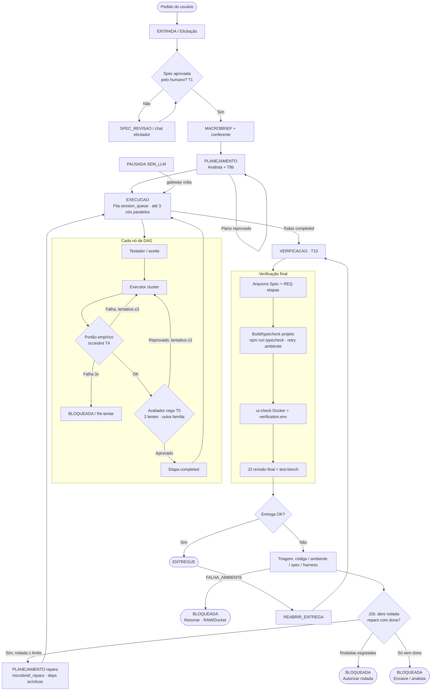

# NextCode — Documento Único de Referência (o que foi feito e o que falta fazer)

> **Fonte única do projeto NextCode (`C:\projetos\nextcode`).**
> Consolidado em 23/10/2026 a partir do commit `cabc2d7`. **Atualizado 30/10/2026:** a §3 está em ordem de relevância (o que ainda muda uma entrega vem primeiro). O A1 do analista, o F1, o 5a–5c e o dono de infra no plano já estão no código. O primeiro rascunho foi feito pelo Antigravity, lendo os 270 arquivos de `docs/`. A auditoria do Claude corrigiu os nomes de arquivo, função e evento conferindo cada um com `git grep` / `git ls-files`.
> - Toda melhoria aprovada entra **aqui antes** de ser executada (regra 1 do `CLAUDE.md`).
> - Os documentos antigos saíram da pasta e continuam recuperáveis com `git show cabc2d7:<caminho>` (lista na §10).
> - Registro de cada passo: `memory/diario.md`. Decisões do fundador: `memory/decisoes.md`. Números medidos: `memory/medicoes.md`.

## Índice
1. Visão geral, regras e estado atual
2. O que foi feito (linha do tempo)
3. **O que falta fazer (fila por relevância)**
4. Arquitetura (fases, travas, papéis, organograma, fluxo)
5. Uso do Jev
6. Templates e memória do projeto
7. Benchmarks e o Gateway real
8. Terceiros e licenças
9. Protocolo: o Antigravity implementa, o Claude audita (+ prompt TESTE-E5)
10. Documentos consolidados e como recuperar

---

## 1. Visão geral, regras e estado atual

### 1.1 O que é
Harness que transforma um pedido (de leigo ou de engenheiro) em software entregue. Ele funciona assim:
1. Uma Spec com `REQ-nnn` é aprovada pelo humano.
2. A máquina de fases (`src/core/orchestrator/phase-machine.ts`) e a fila persistente em SQLite (`job-queue.ts`, `job-worker.ts`) conduzem o trabalho.
3. O escopo de arquivos é fechado por etapa, a quarentena e o portão empírico (`tsc`/ESLint) verificam o código, e o avaliador é independente.
4. No fim, a revisão final usa uma bancada de testes em contêiner sem rede.

Cada papel é uma skill em `skills/<nome>/SKILL.md`, e o harness aplica as travas.

### 1.2 Regras do fundador (obrigatórias — `CLAUDE.md`)
1. Fonte única é este documento; melhoria aprovada entra aqui antes de executar.
2. Tudo documentado: entrada no diário a cada passo. Fase de implementação fecha com relatório de auditoria.
3. Não alucinar: só citar arquivo/função conferido com `git grep`; "funciona" só com saída real colada.
4. Documento antigo só sai resumido aqui, com hash para recuperar (§10).
5. Um passo por vez; um commit por passo, com `tsc` e `vitest` daquele commit.
6. Discordar com veredito técnico quando a ideia estiver errada.
7. Nenhum segredo em texto puro e nenhum segredo sai da máquina (máscara `maskSecretsForJev` em `src/core/governance/secret-guard.ts`; cifra `enc:v2` em `src/core/security/crypto.ts`).
8. Papéis críticos só em modelo pago; o avaliador nunca é da família do executor; gratuito só no fim e nunca aprova sozinho.

### 1.2.1 Conversa longa (agente / fundador)
- Se o thread ficar **muito longo** (muitas rodadas, Gateway, vários bloqueios), **resumir** objetivo macro, estado da sessão (id, fase, último bloqueio) e **abrir chat novo** com esse resumo — reduz confusão e “alucinar” contexto antigo.
- O resumo operacional da sessão continua no **SQLite** (fases, DAG, telemetria), não só no chat.

### 1.2.2 Documentação: um só referencial
| Mantém | Papel |
|---|---|
| **`docs/NEXTCODE-REFERENCIA.md`** | **Única referência** de arquitetura, fila, travas e melhorias aprovadas |
| `memory/diario.md`, `memory/decisoes.md`, `memory/medicoes.md` | Diário operacional (não substituem a referência) |
| `config/politicas-orquestracao.yaml` | Política executável (comentários apontam para §4 aqui) |
| `skills/*/SKILL.md` | Contrato de cada papel |

| Não manter como referência paralela | Ação |
|---|---|
| `docs/PROMPT-AUDITORIA-*.md`, `docs/ENTREGA-TRIAGEM.md`, `docs/relatorios/*`, `docs/arquitetura-pipeline.html`, `memory/MEMORIAL-GATEWAY-ENTREGA.md` | Conteúdo **resumido neste doc** (§2.9); arquivo **apagado** (§10); histórico no git; HTML exportado fica cópia local do fundador |
| Specs/planos duplicados fora da Spec canônica da sessão | Não criar; pedido = Spec aprovada no servidor |

Melhoria aprovada entra **só** em `NEXTCODE-REFERENCIA.md` **antes** de codar (regra 1).

### 1.3 Retrato de 23/10/2026 (HEAD da época `cabc2d7`)
Estes números são daquela data. O estado conferido em 30/10 está na §1.4.
- **Suíte:** 162 arquivos / 1045 testes no `vitest`; `tsc` 0; `next build` ok. Versões: Next `^15.0.3`, Prisma `^5.22.0`, Vitest `^2.1.9`.
- **Dependências:** `npm audit --omit=dev` → 0 vulnerabilidades (restam 13 só em desenvolvimento).
- **Bench P1–P4 (J4, 22/10):** 8/8 ENTREGUE, aceite 47/47. Com Jev o custo foi US$ 0,75; sem Jev, US$ 1,00. Arquivos: `bench/2026-10-22-1538`, `-1628`, `-1835`.
- **Gateway real (`4d019f00`):**
  - 65 REQ; 41 etapas mais a base; depois, rodadas de reparo.
  - Defeitos provados por teste, por revisão: 8 → 1 → 7 → 6 → 5.
  - A rodada 8 (23/10) terminou `BLOQUEADA` sem relação com o código: o DeepSeek pelo FreeLLMAPI ficou sem cota ("All models exhausted… reset ~24h").
- **Papéis e modelos:**
  - Elicitador: Claude Opus 5.5 direto (`src/core/llm/elicitador-claude.ts`).
  - Analista: `deepseek-v4-pro`, via FreeLLMAPI `custom/`.
  - Executor: `deepseek-v4-pro`, ou `deepseek-flash` no nível `rapido` com confiança ≥ 0,85.
  - Avaliador da etapa, testador e revisão final: Claude Sonnet 5.5, com Opus 5.5 de reserva (`src/core/llm/evaluator-models.ts`).

### 1.4 Estado conferido em 30/10/2026
Último commit auditado: `d1c0045` (diário 263). Itens 4 e 6 implementados na working tree (diário 264), ainda sem commit. A árvore de trabalho segue suja; isso é esperado e não entra nesta lista. Versões no `package.json`: Next `^15.0.3`, Prisma `^5.22.0`, Vitest `^2.1.9`. A contagem de testes de 23/10 não foi remedida nesta data.

O que o código faz hoje, conferido arquivo a arquivo:
- Spec aprovada entra em `MACROBRIEF` (`etapa1Ativa: true` em `session-phase.ts`). Com a flag falsa, o código iria direto a `PLANEJAMENTO`.
- O analista, quando há roteador, escreve o plano e o contrato. Sem roteador, ou com o modelo desligado em teste, `decomposeWithAnalistaSkill` ainda devolve a heurística. A função interna `fallback` está definida e não é chamada.
- `renderContractTs` grava o contrato; a etapa gera `src/contracts/conformidade/`; `validateContract` roda no executor (`CONTRACT_VALIDATION_FAILED`) e, se o payload tem `planoStages`, usa o grafo inteiro, não uma etapa isolada.
- `importante` com arquivo e linha reais reprova a etapa (F1.2). `critico` também. `menor` não muda o veredito.
- Apagar a pasta do projeto passa por `checkFolderSafeToDelete`, que recusa a pasta sem o arquivo `.nextcode` na raiz. A rota só chama `fs.rmSync` depois dessa recusa.
- `NEXTCODE_DISABLE_JEV=1` faz `readJevKey` devolver vazio (`jev.ts`). Em 23/10 essa variável não existia.
- O chat da tela não publica `reasoning_content`. `extractAssistantTextFromCompletion` também não lê esse campo: `content` vazio devolve vazio; `candidates` e `choices[0].text` continuam (diário 263).
- A triagem da entrega roda depois de `tryStartDeliveryRepair`. Lacuna só de ambiente ou harness volta antes, com `FALHA_AMBIENTE`, e não abre reparo.
- T8b conta no máximo 4 arquivos de código por etapa; `Dockerfile`, compose e `prisma/migrations` atribuídos pelo plano não entram nessa conta (diário 264).

---

## 2. O que foi feito (linha do tempo)

### 2.1 Fundação (27/09–05/10)
- **Segurança:** cofre `enc:v2` (`src/core/security/crypto.ts`), anti-SSRF (`src/core/security/safe-fetch.ts`), autenticação local (`local-auth.ts`), chave mestra gerada sozinha.
- **Travas T1–T6:**
  - quarentena (`src/core/governance/quarantine-manager.ts`);
  - portão empírico (`empirical-gate.ts`);
  - Tipo 1 mecânico (`dual-lens-auditor.ts`);
  - 3 tentativas (Trava T6 / D-RANHO, `incident-reporter.ts`);
  - trilha `TelemetryLog`, só acrescenta.
- **Etapa 0:** máquina de fases, fila com reserva atômica e lease (`job-queue.ts`), worker com retomada, gateways FreeLLMAPI e OmniRoute (`src/core/llm/gateways.ts`). Esta fase está nos commits `1476128`, `9f9584e`, `52bc206` e `e0a9c90`.

### 2.2 E0 — base (06/10–15/10)
| Pacote | O que ficou | Commits |
|---|---|---|
| Runtime de skills, laço do executor, 2 lentes | `skill-runtime.ts`, `executor-tool-loop.ts`, Lente Cega por REQ + Lente 2 | `7f1c5c8`, `d3c90f4`, `1d4f331` |
| R1 — papéis críticos só pagos | `paid-routing.ts`, trava `X-Routed-Via` (`prefixos_rota_paga: "custom/"`), Flash só com confiança ≥ 0,85 | `69d8a94`…`88ab558` |
| P0 | `McpServer.env` cifrado (`src/core/security/mcp-env.ts`); causa do teste intermitente (ordem no mesmo milissegundo) | `77b3adb` |
| P1 — núcleo do Jev | custo do Jev em `LLM_COST`, nova tentativa em 429/529, alerta em 422, `JEV_STATE_TOO_LARGE` sem cortar JSON, 14 limiares lidos do YAML (`src/core/decision/jev.ts`) | `4dd6733`…`c8b63a6` |
| P2/P2b — bench real | `scripts/bench.ts`, contêiner `docker/aceite` sem rede, régua `bench/aceite/` (P1 10, P2 13, P3 12, P4 12 testes) | `a559364`, `53b62ae`, `efd8c1c` |
| P3 | cadeia do avaliador pelo FreeLLMAPI (depois trocada por Claude na mudança 23) | `cbdb0a0`, `3e93e8b` |
| S0/S1 — skills | custo por `nodeId`; Jev liga referências do avaliador de tela; avaliadores sem ferramentas falsas | `4447198`, `2e91335`, `60e81f0` |
| C1 | desfez a cascata não aprovada de `786d393`; chave do cache do Jev (`jev-cache.ts`, `stableStringify`) | `f19152c`, `af431e8` |
| D1/D1b | primeira consolidação de documentos | `bc63e09`, `98beb93`, `0664efc` |
| J1/J2 | J1 mediu que a auditoria final do Jev reprovava código correto (0/5); J2: aviso num lugar só (`human-notice.ts`), `FALHA_REPETIDA`, pausa longa, vigia de silêncio | `ce3fb55`, `b7a21e2`…`3cbcde1` |
| I1 | inventário ligado/desligado/morto | `7de28df` |
| P5/P5.5/P5.5b | máscara de segredo antes do Jev (duas passadas), peneira M0 com a conversa inteira, conferência Macrobrief × Spec (sombra) | `76da16f`…`cde4b47` |

### 2.3 E1 inicial (15/10–18/10)
- **P5c/P5c.3/P5c.4:** elicitador Opus direto, com streaming, teto de 48 mil tokens e indicador "Gerando Spec…". Commits `95f6c23`, `ba893ce`, `4283a68`, `ed803ff`. Smoke da Fase 8 na sessão `c0377632`: 56 REQ, 10/10 totais certos.
- **B1/B1c:** o avaliador Claude direto lia só o bloco `thinking`. Corrigido (`3890924`); o bench passou a P1–P4 ENTREGUE com o Opus avaliando.
- **PJ1:** arquivados com Desarquivar, abrir a mesma pasta reabre o projeto, Apagar pergunta pela pasta, sessão sem projeto não executa. Commits `c4155a5`…`5692e21`. Smoke na tela feito em 20/10.
- **A3:** `plan_error` detectado só mecanicamente (`detectPlanErrorMechanically` em `src/core/decision/jev-execution-checks.ts`). O roteamento ao dono fica em `roteamento_falha: sombra`. Commits `5f8fbf5`…`a2508ed`.

### 2.4 Execução autônoma 1 — mudança 23 (17–18/10)
- **A2 — o analista planeja de verdade:**
  - `decomposeWithAnalistaSkill` em `src/core/skills/spec-decomposer.ts` faz o plano;
  - a T8b confere o escopo (`plan-scope-check.ts`), e um plano impossível dispara `PLANO_REPROVADO`;
  - no replay da Spec real foram 35 etapas, 0 REQ repetido, US$ 0,10.
  - Commits `3ea5ef9`, `801864b`, `f404648`.
- **AV1 — avaliador:**
  - Claude Sonnet → Opus, recusando a família do executor;
  - lê o arquivo inteiro (até 60 mil caracteres por arquivo e 200 mil por etapa);
  - aponta problemas por severidade e tem a evidência conferida;
  - o porteiro roda `tsc`+ESLint antes dele;
  - controles: 7/7.
  - Commits `a06fa8d`…`42b878e`.
- **Outros itens:**
  - M20 desligou a memória do projeto (`324a586`);
  - SM1 confere a Spec mecanicamente e carimba a data (`c10d3b7`);
  - M24: avaliador fora do ar dá 3 tentativas grátis, depois pausa de 5 min com sonda no Claude.

### 2.5 Execução autônoma 2 — mudança 26 (19–20/10)
Passos P1 a P13, um commit cada, de `fbda610` a `835e98f`:
- **Executor:**
  - até 8 ações por turno;
  - contexto fixo no 1º prompt;
  - a nova tentativa parte do código anterior (`codigoTentativa`);
  - o relatório aceita lista de `arquivo:linha` (`parseFileLineRefList`);
  - oscilação repete o turno e a pausa guarda o progresso;
  - regra do harness vira "Dono: harness".
- **Avaliação:**
  - só `critico` reprova (regra da época; desde o F1.2, `importante` com arquivo e linha reais também reprova, §3.6);
  - cache de prompt no avaliador (`buildAnthropicCachedBody`).
- **Custo e controle:**
  - teto pelo plano: max(US$ 0,50; etapas × 0,35 × 1,5);
  - placar (`session-scoreboard.ts`);
  - M2 só na trilha; Graphify só com ≥ 5 arquivos-fonte;
  - trava de pasta-mãe (`src/core/project/folder-safety.ts`).
- **Resultado:** bench P1–P4 ENTREGUE com no máximo 4 chamadas do executor por etapa. Duas correções saíram do bench: D41 (Lente 2 com lista) e D42 (prazo do gateway no turno).

### 2.6 Execuções autônomas 3 e 4 — mudanças 27–42 (20–22/10)
- **Mudanças 28–34:**
  - 28 (SUP1): a sonda só considera gateways pagos;
  - 29: cache no elicitador;
  - 30: prazo do analista de 600 s;
  - 31: rota `custom` no FreeLLMAPI com 300 s;
  - 32: `DATABASE_URL` no compose;
  - 33: `resolveTscBin` (caminho falso do `tsc` dentro do `next dev`);
  - 34: `recheckFinalBuild` (a entrega julga o projeto final).
- **Mudanças 35–36:** `tsc` que falha sem nenhuma linha `error TS` é tratado como `FALHA_AMBIENTE`. O aviso diz a ação certa e tem o botão Retomar (`resume_session`).
- **G1–G3:** leitor de ação tolerante, motivo do descarte do avaliador na trilha, culpado certo do bloqueio (`blocked-culprit.ts`).
- **J2b + J2.7:** reparo automático da entrega (`delivery-repair.ts`), até 3 rodadas; as listas `PHASES`/`MESSAGE_INTENTIONS` agora vêm do código (`f37c08f`).
- **J3:** revisão final cega e fechada (`src/core/governance/final-reviewer.ts`, skill `avaliador-final`), controles 8/8 (`471ef92`, `57c3d44`).
- **TS1:** fim dos timeouts aumentados nos testes e2e (`dbacd91`).
- **Mudanças 40–42:**
  - 40: reabrir a entrega (`REABRIR_ENTREGA`, `scripts/retomar-sessao.ts --reabrir`);
  - 41: client do Prisma regerado e erro do `next build` atribuído à etapa dona;
  - 42: pausa que pisca vira `SEM_LLM_PERSISTENTE`.
  - Commits `8a8b52a`, `b3ab02a`, `b6b5077`.
- **Teste independente:** relatório `TESTE-E1-4-antigravity.md`, aceito com ressalvas.

### 2.7 Mudança 43 — revisor com bancada de testes (22/10)
- **Bancada:** `src/core/execution/test-bench.ts`, imagem `nextcode-test-bench:2` (`docker/test-bench`). A instalação usa rede num volume de cache; os testes rodam sem rede e com o projeto só leitura.
- **Revisor:** reproduz cada suspeita com um teste (`src/core/governance/defect-reproducer.ts`).
- **Reparo:** recebe o teste como contrato (`run_check test`).
- **Aviso:** sai pela saída do revisor, com "Autorizar mais uma rodada" (`REPAIR_ROUND_AUTHORIZED`).

### 2.8 Execução autônoma 5 — mudanças 44 e 45 (22–23/10)
Commits `1f5234f`…`bacbd2e`; relatórios `AUDITORIA-E5`, `IMPLEMENTADO-E5`, `DECISOES-AUTONOMAS-E5` (E5-D1…D35).
- **Reparo e prova:**
  - **44.1:** o reparo alcança todos os arquivos citados (`codeFilesCitedIn`, `escopoExtra`).
  - **44.2:** a entrega é decidida pela prova (`splitDefectsByEvidence` em `delivery-diagnosis.ts`). As provas anteriores são re-rodadas (`rerunPriorProofs`, `src/core/orchestrator/prior-proofs.ts`). Regressão no portão (`attachRegressionProofs`). Revisão final que não rodou → `FALHA_AMBIENTE`.
- **Correções e medições:**
  - **44.4 F10:** `sessionId` em `llm.gateway_failure`.
  - **44.5:** `effort` medido; o padrão foi mantido (efeito teto).
  - **44.6 J4:** com × sem Jev (§1.3).
- **Jev e projetos:**
  - **44.7 JV1:** M3 em lotes (`chunkPlanningInputs`); `verificacao_evidencia` e `auditoria_entrega` desligadas por medição (15/15 divergências falsas; o estado nunca coube no limite).
  - **44.8 PJ2b:** fechar/reabrir projeto (`project-lifecycle.ts`, `OPEN_PROJECT_SESSION`).
  - **44.9 S3:** skills alinhadas ao código; papel desconhecido falha fechado; M1/M4 removidos.
- **44.10 E2 — entrada completa:**
  - P8/T7: pesquisa oficial (`src/core/intake/official-docs-research.ts`, limiar de injeção 0,80);
  - J11: origem por REQ (`req-origin-check.ts`);
  - J8: lacunas obrigatórias (`mandatory-gaps.ts`);
  - J7: perfil;
  - TR1 (7): correção da Spec por trecho (`spec-patch.ts`).
- **Testes, segurança e operação:**
  - **44.11 E5:** skill `testador` escreve testes de aceite sem ver o código (`src/core/governance/acceptance-tests.ts`). Há testes visíveis e escondidos; a trava `presumedTechnology` impede tecnologia não pedida.
  - **44.12 J20:** marca injeção em arquivo lido (`src/core/governance/injection-scan.ts`).
  - **44.13 E6:** CI (`.github/workflows/ci.yml`, ainda não publicado), imagens fixadas por digest, OmniRoute em `127.0.0.1`, produção com 0 vulnerabilidades.
- **Mudança 45:** o escritor de testes da revisão final consulta a documentação oficial antes de transformar uma dúvida de integração em pergunta (`buildWriterPrompt` com `docsOficiais`).

### 2.9 Entrega, triagem, T10 e bench Gateway (Out/2026)

**Princípio:** melhorar o **motor NextCode**; o **Gateway** (`C:\projetos\gateway_multiplataforma`) é bancada real — patch manual no Gateway não substitui correção do harness.

**Triagem da entrega** (`src/core/orchestrator/delivery-triage.ts`): após a T10 falhar, classifica lacunas em `ambiente` | `codigo` | `harness` | `spec`; emite `DELIVERY_TRIAGE_SUMMARY`; Jev `triagem_entrega` em **sombra** (`config/politicas-orquestracao.yaml`). O resumo sai em `job-queue.ts` **depois** de `tryStartDeliveryRepair`. Se a lacuna é só ambiente ou harness, o código volta **antes** do reparo, grava `DELIVERY_REPAIR_ROUND_CREDITED` e emite `FALHA_AMBIENTE`. Telemetria útil: `DELIVERY_REPAIR_NO_OWNER`, `FINAL_BUILD_RECHECK`, `JEV_DELIVERY_TRIAGE_SOMBRA`. **Operação:** ler o bloco *Triagem da entrega* no aviso; **Retomar** se dominante `ambiente`; não tratar todo “sem dono” como “Dono: analista”.

| Classe | Sinais típicos | Ação preferida |
|---|---|---|
| ambiente | TS2307/7016, módulos ausentes, install | Harness install + **Retomar** |
| codigo | defeitos J3 com prova, etapa dona | J2b + microbrief do dono |
| harness | `src/contracts/conformidade`, sem dono no DAG | Microbrief analista / contrato |
| spec | perguntas da revisão final | Responder no chat / patch Spec |

**Harness T10 / ambiente:** `project-verification-env.ts`; `empirical-gate.ts` / `terminal-execution-engine.ts` preferem `npm run typecheck`; recheck com retry (`final-build-recheck.test.ts`). UI-check: `docker/ui-check/run.sh`, Playwright ~1.63.6. T10 após 30/30 etapas em `EXECUCAO` (`job-queue.ts`).

**Reparo J2b (Out/2026):** `delivery-repair.ts` — reparo **parcial** quando só parte das lacunas é `semDono`; `pathsCitedInDefect`; dependências acíclicas (`acyclicRepairDependencies`); testes `j2b-reparo-entrega.test.ts`. Dono de reserva: Dockerfile e compose procuram etapa com `package.json`; PostCSS e `globals.css` procuram etapa com CSS/Tailwind ou `src/app`; Prisma e `.env.example` procuram etapa com schema, seed ou `.env`. O microbrief sintético `encaixe-infra` só nasce para Dockerfile, compose e `prisma/` (§3.6). Sem essa etapa, PostCSS e `.env.example` continuam `semDono`.

**Encaixe 5a (29/10):** lacuna `semDono` que cita Dockerfile, compose ou `prisma/migrations` abre uma etapa `*-encaixe-infra-reparoN` com microbrief mecânico (diretriz de infra). Não usa o aviso genérico `**Dono:** analista`. Etapa com `package.json` continua dona do Dockerfile; etapa com `prisma/schema.prisma` continua dona das migrations e recebe o Dockerfile no escopo extra. Lacuna sem arquivo de infra segue bloqueando com `Dono: analista`.

**F1 — junção de contrato (aprovado 29/10):** F1.1, F1.2 e F1.3 aceitos com ressalvas (diário 250, 251 e 253). O plano é inválido quando uma etapa consome um `export` que nenhuma dependência produz, ou produz com outra declaração. `importante` com arquivo e linha reais não convive com requisito `implementado`. `menor` que cita símbolo de `interfacesConsome` entra no Microbrief da etapa seguinte (`secaoMenoresConsumidos`). Porta em teste, sem sessão Gateway.

**Motor 27/10 (entrega Gateway + harness):** T8b `validateFinalPlan(..., arquivosAfetados)` no trigger; `recheckFinalBuild` com `next build` após `tsc` ok (`NEXTCODE_FINAL_NEXT_BUILD=0` na vitest); nós `HUMAN_RESUME_SKIP` não contam REQ na T10; reparo aprovado sem `reqVerdicts` usa `reqsAlvo` do microbrief. No Gateway (disco): tarifas sem top-level await (`garantirTarifasCarregadas`); rotas Next 15 com `params: Promise<…>` — prova `typecheck` + `build` verdes no disco.

**Sessão Gateway registrada até 30/10** (não relida no banco nesta data): `ba675f79-30f3-4937-9712-44daade9bc66`. Ocorrências anotadas: `FALHA_AMBIENTE`; ciclo DAG em nós `reparo6` (correção ops one-off `scripts/tmp-fix-reparo6-cycle.ts`); `REPARO_ESGOTADO` / `BLOQUEADA` com J3 + lacunas sem dono (Dockerfile/migrations). Esses commits do harness não reabrem essa sessão. Operação, se ela ainda estiver bloqueada: **Retomar** ambiente, **autorizar rodada** para código, responder REQ no chat (ex. REQ-009, REQ-080).

**UI:** timestamps no chat (`src/components/layout/workspace.tsx`).

**Auditorias Fases A–C (25/10):** o caminho com roteador usa o analista; a heurística só volta sem roteador ou com modelo desligado. Bench P1–P4 e replay Gateway: detalhe numérico em `bench/resultados/` e `memory/diario.md`. Prompts de auditoria apagados de `docs/` (§10).

---

## 3. O que falta fazer (fila por relevância)

Atualizado em 30/10 (diário 264). A ordem é o efeito numa entrega real, não a data em que o item nasceu. Um item por vez, até a porta. Item novo só entra com data, motivo e evidência. O que já está no código fica na §3.6 e não se reabre.

O contrato do analista (o antigo A1) **já existe**: `renderContractTs` grava `src/contracts/`, cada etapa gera conformidade e o `tsc` confere, e divergência de contrato no avaliador é `critico`. A reserva sem analista ainda grava uma frase fixa (`spec-decomposer.ts`, heurística). Isso não justifica refazer o A1. Os itens 1, 2 e 3 da fila anterior estão no código (diário 263). O que o harness ainda não pega: citação de uma linha real de código errado, e critério da Spec escrito em prosa, sem `nome(arg1, arg2)` na mesma linha.

### 3.1 Muda o que sai como pronto
Vazio nesta data. Os três itens desta seção passaram para a §3.6.

### 3.2 Trava a sessão (não entrega código errado)
Vazio nesta data. Itens 4 e 6 passaram para a §3.6 (diário 264).

Infra que a Spec **não cita** continua só no encaixe depois da T10 (5a). Isso é de propósito. Não é item de correção.

### 3.3 Prova (não é correção de código)
| # | Item | Quando |
|---|---|---|
| 7 | **TESTE-E5:** relatório `7869124`; saneamento `619193c`; decisões fundador 30/10 — **D21** aceite estrito; **D2/D4** importante ancorado sem prova não `ENTREGUE` (`delivery-diagnosis`, `job-queue`). **Aberto:** re-baseline passo 2 (`vitest` 2×), passos 5–6, achados J20/fixtures fechados no código | Gate 1 (item 8) depois |
| 8 | **Gate 1 do Gateway:** sessão nova com a mesma Spec do `4d019f00`, quando houver cota. A sessão antiga fica como comparação. Porta: `ENTREGUE` com 0 defeito provado; parar se os provados não caírem em 2 rodadas | os itens 1 e 2 já estão aceitos (diário 263). Continua bancada, não correção do harness |

**DG1** está fechado (diário 221): dos 6 defeitos provados, 5 são de integração; 6/6 aprovados como `implementado`; em 2 o avaliador escreveu o defeito e aprovou (efeito antigo do P7, já coberto pelo F1.2 quando há arquivo e linha).

### 3.4 Higiene (não muda a entrega)
| # | Item | Porta |
|---|---|---|
| 9 | Citações de documento apagado em comentários de código e no `CLAUDE.md` | feito e auditado (diário 264): `docs/LLM-GATEWAYS.md` saiu de `gateways.ts`, `gateways.test.ts`, `smart-router.ts` e `jev-decisions.ts`. O JSON do J3 em `final-reviewer.ts` ficou como recuperação no git |
| 10 | Benchmark simulado em `/api/dag/benchmark` | feito e auditado (diário 264): menu Simulação, modal avisa que não é medida, resposta `simulado: true` |
| 11 | Aviso duplo do 5c | feito e auditado (diário 264): `deveAvisarTentativasEsgotadas` impede `reportBlockedNodeToHuman` quando o erro é `DEPENDENCIA_DESCONHECIDA` |

### 3.5 Sem código agora
| # | Item | O que falta |
|---|---|---|
| 12 | `conferencia_entrada: sombra` | ≥ 5 aprovações reais com `CONFERENCIA_ENTRADA` e 0 recusa indevida |
| 13 | `roteamento_falha: sombra` | mais sessões reais; hoje só o `plan_error` mecânico age |
| 14 | ~~Desligar `router9` e `electronhub` no painel do FreeLLMAPI~~ | **feito pelo fundador** (confirmado 30/10: `GET /v1/models` → 303 modelos, 0 ocorrências de `electronhub`/`router9`; `probeGateway` serviu por `custom/deepseek-v4-pro`) |
| 15 | Apagar a pasta vazia `C:\projetos\nextcode-43` | ação do fundador |
| 16 | Smoke da tela: Retomar, Reabrir entrega, Autorizar rodada, Fechar/Reabrir projeto, "Gerando Spec…" | ação do fundador |
| 17 | `git push` do CI | quando o fundador autorizar |

### 3.6 Já no código — não reabrir
| Item | Estado |
|---|---|
| A1 no fluxo do analista | `renderContractTs`, fatia por etapa, conformidade no `tsc`, violação = `critico`. A heurística sem analista ainda é placeholder |
| F1.1 junção | aceito com ressalvas (diário 250, `5e3ca69`, `00cb73a`). O nome `Json` do preâmbulo não é conferido |
| F1.2 portão | aceito com ressalvas (diário 251, `7e67329`, `2e60215`). `importante` com arquivo e linha reais reprova. Sem `req`, o primeiro `implementado` vira `parcial` e a etapa segue `REJECTED` |
| F1.3 ressalva na etapa seguinte | aceito com ressalvas (diário 253, `101d5e6`). O teste não cobre a chamada no executor |
| 5b crédito de rodada | aceito com ressalvas (diário 255, `7f051d8`). Ambiente ou harness não abre reparo. O `if` da fila não tem teste |
| 5c id inexistente e JSON ilegível | aceito com ressalvas (diário 256, `1234d3c`; JSON no `db449a1`). O `update` da fila não tem teste. O aviso de tentativas esgotadas não sai nesse bloqueio (`deveAvisarTentativasEsgotadas`) |
| 5a encaixe pós-T10 | aceito com ressalvas (diário 257, `a5c5465`). Dockerfile, compose, `prisma/migrations`. PostCSS e `.env.example` entram no encaixe pós-T10 (diário 264, mesma lista fechada que `isEncaixeInfraPath`) |
| Teto 4 arquivos + infra | diário 264. Contam só arquivos que não são `Dockerfile`, `docker-compose.yml`, `docker-compose.prod.yml` nem `prisma/migrations` atribuídos pelo plano. Cinco arquivos de código continuam inválidos |
| Dono no plano | aceito (diário 259, `5c16162`). Base sem Microbrief não é dona. Arquivo que já está só na base não é copiado; o T8b reprova o plano |
| Aprovação sem prova | aceito com ressalvas (diário 263, `d1c0045`). `nivelProva` `dito`, ausente ou `falha_descartada`, ou `fatoQueGarante` sem linha real, descarta a resposta quando o veredito interno seria implementado. Citar uma linha real de código errado continua passando |
| Assinatura da Spec | aceito com ressalvas (diário 263, `d1c0045`). `nome(arg1, arg2)` na linha do REQ exige esses identificadores em `contrato.funcoes[].assinatura`, senão `[CONTRATO ASSINATURA]`. Prosa sem parênteses não dispara. O mesmo `export` dos dois lados continua sem `[F1 JUNCAO]` |
| Raciocínio interno | aceito com ressalvas (diário 263, `d1c0045`). `extractAssistantTextFromCompletion` não lê `reasoning_content`. `content` vazio devolve vazio |
| Chat sem raciocínio | `db449a1`. A rota do chat usa `textoVisivelDaResposta`. Os outros papéis passam por `extractAssistantTextFromCompletion`, que também ignora `reasoning_content` |
| Apagar pasta | `checkFolderSafeToDelete` exige o arquivo `.nextcode` na raiz antes de `fs.rmSync` (`folder-safety.ts`, rota `projects/[id]`) |
| Política, bench, terminal, fase | yaml ausente cai em `DEFAULT_ORCHESTRATION_POLICY`; bench em `bench/resultados/`; terminal bloqueia `rd /s`, `del /s`, `Remove-Item -Recurse`, `Get-ChildItem env:`; `etapa1Ativa` está ligado |

### 3.7 Depois do Gate 1
| # | Item | Gatilho |
|---|---|---|
| 18 | Rito curto para correção pequena (1–3 arquivos, sem REQ novo): uma tela, um clique, uma etapa, sem analista LLM; T1 continua | depois do Gate 1 |
| 19 | `vitest` 5 e `tailwind` 4, com bench próprio | qualquer momento, fora da fila 3.1 |
| 20 | E6: Trivy no CI, HTTPS local | antes de expor na rede |
| 21 | Memória do projeto (M20): contratos, decisões e lições, sem copiar a Spec | 2ª sessão real no mesmo projeto |
| 22 | E4 J18/J19 (contexto por linha, skill sugerida) | só se o executor passar de 10 chamadas por etapa |
| 23 | P9 aprendizado (J26/R10) | ≥ 3 entregas reais |
| 24 | Gates 2…n do Gateway | depois do Gate 1 |
| 25 | Roteiro da arquitetura: checklist por REQ na tela, custo antes de aprovar, entrega por Git, proveniência, PostgreSQL/multiusuário, cliente MCP e catálogo, Laya, Exa | etapas 2–5 |

---

## 4. Arquitetura (documento único — antes `ARQUITETURA-ORQUESTRACAO.md`, consolidado aqui)

### 4.1 Princípios
O harness decide e o LLM propõe. Skill ensina, nunca autoriza. Os princípios práticos:
- contexto por artefato;
- menor privilégio por papel;
- nada sem Spec aprovada (T1);
- para por 2 motivos: Spec completa no disco, ou 3 tentativas esgotadas;
- falta de LLM pausa, não gasta tentativa;
- tudo vai para a trilha;
- rastreio por `REQ-nnn`;
- o Jev decide, o LLM escreve;
- uma só voz com o usuário (o elicitador);
- nenhum segredo em texto puro.

### 4.2 Fases (`PHASES` em `phase-machine.ts`)
`ENTRADA, CONVERSA, INTERVENCAO, ELICITACAO, ELICITACAO_CORRECAO, SPEC_REVISAO, MACROBRIEF, CONFERENCIA, PLANEJAMENTO, EXECUCAO, PAUSADA, BLOQUEADA, VERIFICACAO, ENTREGUE`.

Caminhos principais:
- Spec aprovada → `MACROBRIEF` (`etapa1Ativa: true` em `session-phase.ts`) → `CONFERENCIA` → `PLANEJAMENTO` → `EXECUCAO` → `VERIFICACAO` → `ENTREGUE`. Com a flag falsa, a Spec aprovada iria direto a `PLANEJAMENTO`.
- Entrega reprovada → reparo J2b (até 3 rodadas) → `BLOQUEADA` com aviso.
- `ENTREGUE` → `REABRIR_ENTREGA`.

### 4.3 Travas
| Trava | Garante |
|---|---|
| T1 | aprovação humana da Spec |
| T2 | escopo de arquivos por etapa |
| T3 | trilha `TelemetryLog`, só acrescenta |
| T4 | quarentena + `tsc`/ESLint + rollback |
| T5 | duas lentes (cega por REQ + conferência mecânica com o relatório); avaliador de outra família; `critico` reprova; `importante` com arquivo e linha reais também reprova (F1.2) |
| T6 | 3 tentativas, depois bloqueio + relatório ao humano |
| T7 | pesquisa só em fonte oficial, com guarda de injeção |
| T8a/T8b | Spec × plano: todo REQ coberto, nenhum inventado, escopo, sem ciclo |
| T9 | só o papel da fase age |
| T10 | entrega: arquivos, REQ, build do projeto final, revisão final com prova na bancada |

### 4.4 Papéis
- Elicitador (Opus 5.5) → Spec.
- Analista (DeepSeek) → plano; o código monta o Microbrief.
- Testador (Claude) → testes de aceite antes do código.
- Executores `executor-core|backend|frontend|integration` (DeepSeek) → código, no máximo 8 ações por turno.
- Avaliadores `avaliador-*` (Claude Sonnet → Opus) → veredito por REQ.
- `avaliador-final` (Claude) → revisão do projeto inteiro, com reprodução na bancada.

### 4.5 Organograma (spec original × NextCode Out/2026)

```
                    ┌─────────────────────────────────────────┐
                    │           Humano (Human-in-the-Loop)     │
                    │  Aprovar Spec · Retomar · Autorizar      │
                    │  rodada · Re-tentar · Responder REQ      │
                    └─────────────────┬───────────────────────┘
                                      │
┌─────────────────────────────────────▼─────────────────────────────────────┐
│  Orquestrador (código): phase-machine · job-queue · job-worker · triagem   │
└─────────────────────────────────────┬─────────────────────────────────────┘
                                      │
     Fase 1 — Concepção                │                Artefatos
     ─────────────────                 │                ─────────
     Elicitador (skill) ──────────────┼──► Spec canônica (REQ-nnn)
     [Macrobrief + Conferente] *      │    Macrobrief (opcional; ver *)
     JEV (peneira, clareza — sombra)  │
                                      │
     Fase 2 — Plano                   │
     ───────────────                  │
     Analista (skill) ────────────────┼──► Plano → N etapas (DAG)
     T8b plan-scope-check             │    Microbrief por etapa/cluster
     Contrato projeto **             │    `src/contracts/` + conformidade por etapa
                                      │
     Fase 3 — Por etapa (DAG)        │
     ─────────────────────           │
     Testador (aceite) ──────────────┼──► Testes de aceite / repro
     Executor (cluster) ─────────────┼──► Código (quarentena + escopo T2)
     Autoteste harness ──────────────┼──► tsc/ESLint empírico (T4)
     Avaliador cego (2 lentes) ──────┼──► Veredito por REQ (T5, família ≠ executor)
     T6: máx. 3 tentativas/etapa     │
                                      │
     Fase 4 — Entrega (T10)          │
     ─────────────────────           │
     Build/typecheck projeto final   │    `.nextcode/verification.env` (runtime T10)
     ui-check (Docker)               │    Bancada test-bench (sem rede)
     Avaliador final (J3) ───────────┼──► Defeitos + perguntas Spec
     Triagem entrega                 │
     Reparo J2b (≤3 + autorizadas)   │    Microbrief reparo; dono por arquivo/REQ/infra
     [Encaixe analista]              │    Infra sem dono → microbrief `encaixe-infra` (§3.6)
                                      │
     ENTREGUE · BLOQUEADA · PAUSADA  │
```

\* **`etapa1Ativa: true`** (`session-phase.ts`): Spec aprovada entra em `MACROBRIEF`. A flag falsa é que pula para `PLANEJAMENTO`.  
\** **Contrato do analista** já está no código (§3.6). O que falta nessa fronteira é a §3.1. **Encaixe de infra** sem dono abre microbrief na rodada de reparo só para Dockerfile, compose e `prisma/` (§3.6).

### 4.6 Fluxo lógico atualizado (Mermaid)

Substitui o diagrama da “Especificação de Arquitetura” original, com fila persistente, T10 e reparo J2b.



### 4.7 Tabela: spec original → implementação NextCode

| Spec original | NextCode (código / skill) | Diferença importante |
|---|---|---|
| Spec + Macrobrief | `elicitador` → Spec; em seguida `MACROBRIEF` e `CONFERENCIA` (`etapa1Ativa: true`) | A flag falsa pularia o Macrobrief e iria a `PLANEJAMENTO` |
| Skill Conferente + JEV | skill `conferente-macrobrief` no intake; JEV `macrobrief_coverage_conference` em **sombra** | A skill pode devolver a fase (`CONFERENCIA_FALHOU`). O Jev dessa conferência não decide |
| Contratos globais | **A1** do analista grava `src/contracts/` e a conformidade da etapa (§3.6) | O furo que resta é contrato e etapas com o mesmo export errado (§3.1 item 2). A heurística sem analista ainda é frase fixa |
| 4 clusters | `cluster` + roles `executor-*` / `avaliador-*` | Mesma ideia; plano = **DAG de etapas**, não só 4 caixas |
| Autoteste cluster | `empirical-gate` + testes de aceite (`acceptance-tests`) | Harness **mecânico** antes do avaliador |
| Avaliador cego 2 lentes | `dual-lens-auditor` | Lente REQ + leitura de código; família ≠ executor |
| Avaliação final | `verifyProjectDeliveryT10` + `final-reviewer` (J3) + `test-bench` + `ui-check` | **T10** inclui ambiente Docker e typecheck do **projeto inteiro** |
| 3 tentativas finais → Analista | **J2b:** 3 rodadas de reparo de entrega (+ `autorizar rodada`); analista gera **microbrief_reparo** (diretriz LLM ou fallback mecânico) | Contador é **rodada de entrega**, não só “tentativa final” abstrata |
| Escala humano 3x | T6 por etapa + `BLOQUEADA` + `human-notice` (`Retomar`, `autorizar rodada`, `reparo_encaixe`) | Causa no aviso (ambiente vs código vs Spec) |
| — | `delivery-triage`, `FALHA_AMBIENTE`, reparo **parcial** se parte sem dono, dono **infra** (Dockerfile, compose, prisma) | Melhorias **Out/2026** (motor genérico) |
| — | Fila SQLite, supervisor órfão, PAUSADA crédito LLM | Não estava no spec original |

### 4.8 Ações humanas (painel / chat)

| Situação | Ação | Spec muda? |
|---|---|---|
| Ambiente (tsc/ui-check/Docker/memória) | **Retomar** | Não |
| Código com dona, rodadas esgotadas | **Autorizar rodada** | Não |
| Código no disco já corrigido | **Reverificar entrega** / Retomar (BLOQUEADA) | Não |
| Lacuna sem dono / encaixe | Dockerfile, compose e `prisma/` abrem `encaixe-infra`. PostCSS e `.env.example` só ganham dono se já houver etapa compatível (§3.2 item 6) | Não |
| Mudar produto | Responder o que ajustar na Spec | Sim |
| ENTREGUE revalidar | Reabrir entrega | Não |

---

## 5. Uso do Jev (`jev-1.13.0`)

- **Adaptador próprio:** `src/core/decision/jev.ts`, chamando `POST https://api.typesafe.ai/v1/systemone`. Não usa SDK.
- **Proteções do adaptador:** máscara de segredo antes de enviar, nova tentativa em 429/529, alerta em 422, recusa de estado grande (`JEV_STATE_TOO_LARGE`) e custo registrado em `LLM_COST`.
- **Primitivas:** `choice`, `score` e `noul`.
- **Regras da documentação oficial:** instruções em inglês, leitura literal, sem conta nem contagem, estado pequeno, viés para a 1ª opção. Por isso as perguntas são feitas com as opções em ordem invertida.
- **Sem Jev:** o bench mede a variante `sem-jev`, que tira a chave na cópia do banco.

| Uso (`purpose`) | Onde | Estado |
|---|---|---|
| `m0_peneira_afunilamento_universal` | `src/core/intake/universal-funnel.ts` | ativo (lê a conversa inteira; incerto vira `[A CONFIRMAR]`) |
| `m2_clareza_spec` | `jev-decisions.ts` | só trilha (`SPEC_CLARITY_SHADOW`) |
| `m3_planejamento_microbriefs_lote` | `jev-decisions.ts` | ativo, em lotes |
| `m5_seguranca_pesquisa_t7` | `jev-decisions.ts` | ativo na pesquisa oficial |
| `j8_lacunas_obrigatorias` | `src/core/intake/mandatory-gaps.ts` | ativo |
| `classificacao_mensagem`, `p4_chat_fanout` | `message-intent.ts`, `jev-decisions.ts` | ativo |
| `jev_graphify_eligibility` | `jev-decisions.ts` | ativo (com ≥ 5 arquivos-fonte) |
| `failure_diagnosis` | `jev-execution-checks.ts` | ativo; roteamento em sombra (A3) |
| `evidence_check` | `jev-execution-checks.ts` | desligado (`verificacao_evidencia`, JV1) |
| `final_project_delivery_audit` | `jev-execution-checks.ts` | desligado (`auditoria_entrega`, JV1); papel feito pelo J3 |
| `macrobrief_coverage_conference` | `jev-execution-checks.ts` | sombra (`conferencia_entrada`) |
| `skill_install_guard` | `jev-execution-checks.ts` | ativo |
| `secret_guard`, `secret_guard_chat` | `secret-guard.ts` | ativo (`limiar_segredo_noul: 0.70`) |

O que não usar: o Jev Router do OpenRouter, porque o pedido inteiro sairia da máquina (fere a regra 7). Também não usar o Jev para texto, conta ou juízo final de código.

---

## 6. Templates e memória do projeto
- **Templates (`src/core/templates/artifact-templates.ts`, origem `TEMPLATES.md`):** Spec, Macrobrief, Microbrief, Relatório do Executor (mesmo molde do Microbrief) e Veredito. Todos são YAML + Markdown. Os campos `medido_pelo_harness` são preenchidos pelo código, nunca pelo modelo.
- **Memória `.nextcode/MEMORY.md` (formato de `MEMORIA-DO-PROJETO-FORMATO.md`):** escrita pelo código (`src/core/memory/project-memory.ts`), hoje desligada (M20). Tem 3 seções:
  1. Diretrizes e Regras do Fundador;
  2. Decisões de Arquitetura e Contratos;
  3. Armadilhas e Lições.
  
  O teto é de 50 linhas e 6.000 bytes, e o corte é sempre avisado.

---

## 7. Benchmarks e o Gateway real

### 7.1 Bench P1–P4 (relatórios em `git show cabc2d7:docs/relatorios/bench/<arquivo>`)
| Data / arquivo | O que mediu | Resultado |
|---|---|---|
| `2026-10-09-0713` | 1ª rodada P1/P2 × 3 variantes | 100% aceite (efeito teto) |
| `2026-10-09-1358` | P3/P4 × 3 variantes × 3 | P3 100%; P4 BLOQUEADA 9/12 (erro na base, corrigido) |
| `2026-10-10-1020` | S1, P1–P4 × 2 × 2 | 16/16 ENTREGUE |
| `2026-10-12-1533` … `-2116` | código do `786d393` | P3 1/12, 0/12 — cascata desfeita no C1 |
| `2026-10-15-1927` | B0 | 4/4 ENTREGUE |
| `2026-10-16-1658` / `-1822` | B1 / B1c (Opus avaliando) | B1 inválido (lia só o `thinking`); B1c 4/4 ENTREGUE, US$ 0,78 |
| `2026-10-20-1244` / `-1314` | mudança 26 | 4/4 ENTREGUE, máx. 4 chamadas/etapa |
| `2026-10-22-1538`, `-1628`, `-1835` | J4 | 8/8 ENTREGUE, 47/47; US$ 0,75 × 1,00 |
| `2026-10-21-j3-controles-avaliador-final.json`, `2026-10-22-j3-*.json`, `2026-10-22-44-5-effort-*.json`, `2026-10-22-43-2-reproducao-gateway.json` | controles do J3, esforço, reprodução no Gateway | J3 8/8; 8 de 10 suspeitas provadas |

### 7.2 Gateway `4d019f00` (whitelabel sobre Asaas, 65 REQ)
- **21/10:** 41/41 etapas, 31/40 aprovadas na 1ª, US$ 12,33, 0 pausas sem LLM. Bloqueou por portão cego (mudanças 33/34) e falta de memória.
- **22/10:** com memória livre, os erros caíram de 71 para 9, o reparo J2b fez 3/3, e a sessão foi `ENTREGUE`. A revisão J3 rodada depois achou 15 REQ parciais, o que levou à reabertura (mudança 40) e às rodadas 2–3.
- **Mudanças 43–45:** defeitos provados 8 → 1 → 7 → 6 → 5; nenhuma prova anterior voltou a falhar; sessão em ≈ US$ 37.
- **23/10:** a rodada 8 bloqueou por cota do DeepSeek no FreeLLMAPI. O Gate 1 que mede de novo está na §3.3.
- **Spec antiga do Gateway (sem `REQ`):** `git show cabc2d7:docs/specs/gatway-system-spec.md`.

---

## 8. Terceiros e licenças (de `TERCEIROS.md`; MIT e Apache pedem atribuição)
| Fonte | Commit/versão | Licença | Aproveitado |
|---|---|---|---|
| `obra/superpowers` (subagent-driven-development, writing-plans, verification-before-completion, TDD, code-reviewer) | `8ca22db` | MIT | seleção de modelo em 3 níveis, "Do Not Trust the Report", severidades, revisão da nova tentativa, prova antes de afirmar, Task Brief |
| `vercel-labs/agent-skills` (web-design-guidelines, react-best-practices) | `063bee9` | MIT | regras CRITICAL/HIGH no `avaliador-frontend` |
| `vercel-labs/web-interface-guidelines` (`command.md`) | `434b7f9` | MIT | 104 regras, cópia local fixa |
| `microsoft/playwright-cli` | `b85c7a7` | Apache-2.0 | comandos só de inspeção (a tela é conferida pelo `ui-check`) |
| `ui-ux-pro-max` | 2.11.0 | MIT | checklist pré-entrega (32 itens) |
| `Leonxlnx/taste-skill` | `e3c9203` | MIT | 39 itens, só para página pública |
| `docs.typesafe.ai` | jev-1.13.0 | documentação pública | primitivas, limites, cookbooks |

Proibidos: `find-skills`/`npx skills add` (cadeia de suprimentos), `taste-skill` inteiro, `DESIGN.md`/getdesign (imitação de marca) e repositórios `perplexity-super-skill` (sinais de isca).

---

## 9. Protocolo: o Antigravity implementa, o Claude audita

### 9.1 Ciclo
1. O Claude escreve o prompt de um item da §3, só depois de o item estar aqui. O prompt vai inteiro no chat, entre marcas de início e fim.
2. O Antigravity implementa e grava o relatório do pacote em `docs/relatorios/<pacote>.md` no último commit. **Depois da auditoria o Claude resume o resultado aqui (§2/§3) e apaga o arquivo** — `docs/` fica só com este documento; o relatório continua no git (hash na linha do item).
3. O Claude audita (§9.3) e registra o veredito no diário: aceito, aceito com ressalvas ou rejeitado.
4. Só então o item vira ✅ aqui.

### 9.2 Travas de todo prompt
| Trava | Regra |
|---|---|
| **T-A** | `git status` limpo; HEAD igual ao hash do prompt |
| **T-B** | só os arquivos de PODE ALTERAR; nunca aumentar timeout nem silenciar erro |
| **T-C** | literalidade; ambiguidade → PARE |
| **T-D** | todo nome conferido com `git grep -n` |
| **T-E** | um passo = um commit com `tsc` 0 e `vitest` verde; proibido `--amend`, `rebase`, `reset`, `push --force`, `--no-verify`, `git add -A` |
| **T-F** | nunca escrever em `prisma/dev.db` |
| **T-G** | nenhum segredo |
| **T-H** | nenhum pacote novo sem o prompt dizer |
| **T-I** | preservar o fim de linha |
| **T-J** | paradas obrigatórias: 422 do Jev, teste antigo quebrando, custo acima do teto, contradição |
| **T-K** | linha `Co-Authored-By` no commit |
| **T-L** | relatório fiel: todo número copiado da saída real; "Desvios" verdadeiro |
| **T-M** | código gerado nunca roda no host, só no contêiner sem rede |
| **T-N** | `git reflog` conferido; comando git fora da lista vai em Desvios |
| **T-O** | nenhum documento paralelo (plano/log); só o relatório e as seções deste documento que o prompt mandar |

Regra zero de todo prompt:
- ler tudo antes de começar e resumir o que vai mudar;
- fazer só o que está escrito;
- o que achar fora do escopo vai em "Sugestões", nunca no código.

### 9.3 Auditoria do Claude
1. Compila e roda a suíte de cada commit numa cópia (`git worktree` + `prisma db push` no `test.db`), e roda o HEAD 2×.
2. Confere o escopo (`git diff --stat`) e o reflog.
3. Confere os nomes citados com `git grep`, procura segredos no diff e compara o relatório com o código.
4. Para cada correção, reverte o código e mostra que o teste falha sem ela.

### 9.4 TESTE-E5
- Prompt integral: `git show faa1f59:docs/prompts/TESTE-E5.md`. Relatório do Antigravity: `git show df21912:docs/relatorios/TESTE-E5-antigravity.md`.
- Auditoria do Claude (23/10, diário 221): aceitos os passos 1–3; pendentes as frentes 5, 7, 8, 9 e os passos 5–6 (ver §3.3). Naquela data `NEXTCODE_DISABLE_JEV` não existia. Hoje `readJevKey` devolve vazio quando a variável vale `1` (§1.4).

### 9.5 Prompt do A1 (histórico — não reexecutar)

O fluxo do analista já grava o contrato, a fatia e a conformidade (§3.6). Este prompt fica como registro. Não é o próximo passo. O próximo passo é a §3.1.

**Objetivo original:** fazer o Macrobrief cumprir o template.
- O **analista** escreve o contrato do projeto: entidades e campos, enums, funções exportadas com assinatura, rotas com entrada/saída/erros, dono e quem usa.
- O **código** confere o contrato, grava em `src/contracts/` (travado para o executor) e gera, por etapa, um arquivo de conformidade que o `tsc` confere.
- **Testador, executor e avaliador** recebem a fatia do contrato da etapa.

Motivo medido no DG1 (§3.3): 5 de 6 defeitos do Gateway nascem na fronteira entre etapas. Na data deste prompt o contrato da heurística era uma frase fixa. No fluxo do analista isso já foi substituído por `renderContractTs`. A frase fixa permanece só na reserva sem analista.

**Hash de partida:** o commit cujo assunto começa com `docs(referencia): A1 registrado`.

**Regras (obrigatórias)**
- **R1 — nada fora do prompt.** Só os arquivos de "PODE ALTERAR" de cada passo. Precisou de outro → PARE e escreva no relatório o que e por quê.
- **R2 — relatório por passo** em `docs/relatorios/A1-contratos.md`, com:
  - o que mudou (`arquivo:linha`) e o hash;
  - a saída real de `npx tsc --noEmit` e as últimas linhas de `npx vitest run` com os totais;
  - os desvios ("nenhum" se nenhum) e o que não foi feito.
- **R3 — só dado.** "Funciona" só com saída colada; não sabe → "não verificado".
- **T-A:** `git status --short` vazio; HEAD = hash de partida. Diferente → PARE.
- **T-B/T-C:** escopo fechado e literalidade. Nunca aumentar timeout nem silenciar erro para teste passar. Ambiguidade → PARE e pergunte.
- **T-D:** todo nome citado conferido com `git grep -n`.
- **T-E:** 1 passo = 1 commit, com `tsc` 0 e `vitest` verde **naquele commit**. Proibido `--amend`, `reset`, `rebase`, `push`, `--no-verify`, `git add -A`, `git add .`.
- **T-F:** nunca escrever em `prisma/dev.db`. Os scripts usam cópia em `%TEMP%`, como `scripts/replay-analista-a23.ts`. Cole o horário de modificação do arquivo antes e depois.
- **T-G:** nenhum segredo. **T-H:** nenhum pacote novo. **T-I:** preservar o fim de linha.
- **T-L:** todo número copiado da saída real. **T-M:** código gerado só roda no contêiner. **T-O:** nenhum documento novo além do relatório.
- **Gasto:** até **US$ 2,00** no total, só no passo A1.5.
- **Memória (7,7 GB):** suíte, `tsc`, bench e scripts **um de cada vez**; não abrir o app.
- **T-K:** o commit termina com `Co-Authored-By: <seu modelo>`.

**Leitura obrigatória:**
- referência §1.2, §3 e §4 e §9.2;
- `skills/analista/SKILL.md`;
- `src/core/skills/spec-decomposer.ts`: `decomposeWithAnalistaSkill`, `parseAnalystPlan` (:680), `buildDecompositionFromAnalystPlan` (:735);
- `src/core/orchestrator/plan-scope-check.ts`: `validatePlanStages`, `validateFinalPlan`;
- `src/core/templates/artifact-templates.ts`: `MacrobriefDocument` (:56), `MicrobriefAndReportDocument`;
- `src/core/orchestrator/execution-trigger.ts`: onde o plano vira `TaskNode`;
- `src/core/orchestrator/node-executor.ts`: autoteste (:1185–1200), prompt do executor, porteiro com `promoteWithEmpiricalGate` em `checkOnly`;
- `src/core/skills/skill-runtime.ts`: caminho protegido (:315);
- `src/core/governance/dual-lens-auditor.ts`: `runBlindLens`;
- `src/core/governance/acceptance-tests.ts`: `buildTesterPrompt` (:62).

**A1.0 — Um documento só: tirar a reserva antiga da política (§3.1 item 4)**
- PODE ALTERAR: `src/core/config/orchestration-policy.ts` e o teste da política que cobre o carregamento.
- APAGAR: `docs/rascunhos/politicas-orquestracao.yaml`.

`loadOrchestrationPolicy` deixa de ler `docs/rascunhos/politicas-orquestracao.yaml` (:367). Sem `config/politicas-orquestracao.yaml`, usa o padrão do código e registra o motivo (no mesmo padrão de log do arquivo).

Teste: sem `config/`, a política é o padrão do código e o caminho antigo não é lido.

Commit: `fix(politica): A1.0 - sem reserva antiga da politica em docs/`.

**A1.1 — Template do contrato e conferência mecânica (sem LLM)**
- PODE CRIAR: `src/core/orchestrator/project-contract.ts`, `tests/orchestrator/a1-contrato.test.ts`.
- PODE ALTERAR: `src/core/templates/artifact-templates.ts` (só tipos).

1. **Tipo `ContratoProjeto`:**
   ```ts
   {
     entidades: { nome, campos: { nome, tipo, opcional? }[], dono }[];
     enums: { nome, valores: string[], dono }[];
     funcoes: { nome, arquivo, assinatura, dono, usadoPor: string[] }[];
     rotas: { metodo, caminho, arquivo, entrada, saida, erros: { status: number, corpo: string }[], dono, usadoPor: string[] }[];
   }
   ```
   `dono` e `usadoPor` são ids de etapa do plano (`mb-1`…). `assinatura`, `tipo`, `entrada`, `saida` e `corpo` são tipos TypeScript em texto.
2. **`validateContract(contrato, stages)`** devolve erros, em texto curto, um por problema:
   - dono inexistente;
   - arquivo de função ou rota fora dos arquivos da etapa dona;
   - `usadoPor` sem dependência (direta ou indireta) da etapa dona;
   - nome repetido;
   - tipo citado que não é entidade, enum, primitivo TS nem tipo global do TS (`Promise`, `Date`, `Record`, `Array`, `Request`, `Response`…);
   - rota cujo arquivo não é `route.ts`.
3. **`renderContractTs(contrato)`:** um arquivo TS só com tipos (`export type Enum = "A" | "B"`, `export interface Entidade { … }`, `export type FnNome = (…) => …`), sem código executável. Tem de compilar sozinho.
4. **`renderConformance(contrato, etapaId)`:** arquivo TS que, para cada função e rota cujo dono é a etapa, importa o símbolo real do arquivo (`@/…`) e o atribui a uma constante do tipo do contrato.
   - Função: `const _c_criarSessao: FnCriarSessao = criarSessao;`.
   - Rota: o método exportado, com o tipo `(req: Request, ctx?: any) => Response | Promise<Response>`.
5. **Testes:**
   - (a) contrato válido → 0 erros;
   - (b) um teste para cada erro do item 2;
   - (c) `renderContractTs` compila (com o `typescript` do projeto, `createProgram` em memória);
   - (d) **controle do Gateway:** um projeto mínimo em `os.tmpdir()` com este contrato:
     - `PapelUsuario = "DONO" | "ADMIN" | "OPERADOR"`;
     - `Sessao { usuarioId, papel: PapelUsuario, adminPlataforma: boolean }`;
     - `criarSessao(usuarioId: string, papel: PapelUsuario) => Promise<Sessao>`.
     
     Com o código real do defeito (`sessao.papel === "admin"` e `criarSessao(usuario.id)` sem papel), o `tsc` do projeto tem de **reprovar** apontando as duas linhas. Com o código corrigido, tem de passar.

Commit: `feat(a1): A1.1 - template do contrato e conferencia mecanica`.

**A1.2 — O analista escreve o contrato**
- PODE ALTERAR: `skills/analista/SKILL.md`, `src/core/skills/spec-decomposer.ts`, `tests/orchestrator/analista-plan.test.ts` (só acrescentar casos).

1. **Skill:** o JSON de resposta ganha `"contrato"` no formato do A1.1, com uma regra curta por campo e um exemplo pequeno. Regras:
   - todo símbolo que uma etapa usa de outra etapa tem de estar no contrato, com `dono` e `usadoPor`;
   - tipos e nomes vêm da Spec (nomes de campos, valores de enum, rotas).
2. **`parseAnalystPlan`** lê o contrato, e `validateContract` entra na mesma conferência do plano. Os erros voltam ao analista nas rodadas que já existem (`ANALISTA_MAX_RODADAS = 3`).
3. **Sem contrato válido depois das 3 rodadas**, o plano é reprovado pelo caminho que já existe (`PLANO_REPROVADO`, "Dono: analista"). **Não** cair na heurística sem contrato em produção. O ramo de teste (`skipModel`) continua, com a trilha `CONTRATO_AUSENTE`.
4. **`buildDecompositionFromAnalystPlan`:** `macrobrief.contratosTypescript = renderContractTs(contrato)`. Cada Microbrief recebe a **fatia** do contrato (o que a etapa produz e o que consome) em `interfacesProduz` / `interfacesConsome`, como texto TS.
5. **Trilha:** o `ANALISTA_PLAN_APPROVED` ganha a contagem de entidades, enums, funções e rotas.

Testes:
- plano com contrato válido → aprovado, e o Microbrief recebe a fatia;
- contrato com erro → a 2ª rodada recebe o erro;
- 3 rodadas inválidas → `PLANO_REPROVADO`.

Commit: `feat(a1): A1.2 - analista escreve o contrato do Macrobrief`.

**A1.3 — Contrato gravado, travado e conferido pelo `tsc`**
- PODE ALTERAR: `src/core/orchestrator/execution-trigger.ts`, `src/core/orchestrator/node-executor.ts`, `src/core/skills/skill-runtime.ts`.
- PODE CRIAR: `tests/orchestrator/a1-contrato-travado.test.ts`.

1. Quando o plano vira `TaskNode`, o harness grava `src/contracts/index.ts` (= `renderContractTs`) na pasta do projeto e registra `CONTRATO_GRAVADO` (com as contagens). Antes, confira que o `tsconfig.json` do projeto tem o alias `@/` → `src/`. Se não tiver → PARE e relate.
2. `src/contracts/**` vira caminho protegido para escrita do executor (leitura continua liberada), pelo mecanismo de `skill-runtime.ts:315`.
3. Antes do porteiro de cada etapa, o harness grava na quarentena da etapa o arquivo `src/contracts/conformidade/<id-da-etapa>.ts` (= `renderConformance`).
   - O porteiro (`tsc`) passa a conferir também esse arquivo.
   - Ele é promovido junto com a etapa e fica como guarda para as etapas seguintes.
   - Falha nesse arquivo é reprovação mecânica com a mensagem do `tsc` (gasta tentativa, como hoje).

Testes:
- executor tentando escrever em `src/contracts/index.ts` → negado;
- etapa com assinatura diferente do contrato → o porteiro reprova com o erro do `tsc`;
- etapa certa → passa, e o arquivo de conformidade é promovido.

Commit: `feat(a1): A1.3 - contrato gravado, travado e conferido pelo tsc`.

**A1.4 — Testador, executor e avaliador usam o contrato**
- PODE ALTERAR:
  - `src/core/orchestrator/node-executor.ts`, `src/core/governance/acceptance-tests.ts`, `src/core/governance/dual-lens-auditor.ts`;
  - `skills/testador/SKILL.md`, `skills/avaliador/SKILL.md`;
  - `skills/executor-core/SKILL.md`, `skills/executor-backend/SKILL.md`, `skills/executor-frontend/SKILL.md`, `skills/executor-integration/SKILL.md`;
  - os testes existentes desses módulos (só acrescentar casos).

1. **Executor:** o prompt recebe a fatia do contrato e a regra "importe os tipos de `@/contracts`; não redefina; não mude assinatura".
2. **Testador** (`node-executor.ts:1196`): `contrato` passa a ser a fatia que a etapa **produz**, e `contratosDependencias`, a fatia que ela **consome** (no lugar das listas de arquivo).
3. **Avaliador da etapa:** recebe a fatia. Divergência do contrato (nome, campo, valor de enum, assinatura, status ou corpo de rota) é problema `critico`, que reprova; nunca é ressalva. A skill `avaliador` ganha essa regra em uma linha.

Testes:
- o prompt de cada papel contém a fatia;
- avaliador falso que aponta divergência de contrato como `importante` → o código trata como reprovação.

Commit: `feat(a1): A1.4 - testador, executor e avaliador usam o contrato`.

**A1.5 — Prova (gasto até US$ 2,00)**
1. **Bench:** `npx tsx scripts/bench.ts --projetos p1,p2,p3,p4 --variantes padrao --repeticoes 1`.
   - Porta: 4/4 ENTREGUE, aceite 47/47.
   - Cole a tabela e o custo.
   - Cole, de um projeto, o `CONTRATO_GRAVADO` e o conteúdo do `src/contracts/index.ts` gerado.
2. **Replay do analista na Spec real do Gateway:** sessão que começa com `4d019f00`, campo `canonicalSpec`, numa cópia do banco. Siga o molde de `scripts/replay-analista-a23.ts` (PODE CRIAR `scripts/replay-contrato-a1.ts`).
   - Porta: plano aprovado com `validateContract` 0 erros.
   - Liste entidades, enums, funções e rotas, e diga se `PapelUsuario` (ou equivalente) e `criarSessao` aparecem com dono e `usadoPor`.

Commit: `test(a1): A1.5 - prova (bench e replay do Gateway)`.

**A1.6 — Fechamento**
Relatório completo (itens da §9.2): commits, testes novos (arquivo › teste › o que prova), nomes conferidos, custo, desvios, checklist das travas e o que não foi feito.

Commit: `docs(relatorio): A1 contratos`.

**Ao terminar (resposta ao fundador):** cole os hashes, `git show --stat HEAD`, `git reflog -10`, `git status --short` e o horário de `prisma/dev.db` antes e depois. **Pare** e aguarde a auditoria do Claude.

---

## 10. Documentos consolidados e como recuperar
Todos os 270 arquivos que existiam em `docs/` no commit `cabc2d7` foram retirados da pasta. Para ler qualquer um: `git show cabc2d7:<caminho>`. Para listar: `git ls-tree -r --name-only cabc2d7 docs`.

| Grupo | O que tinha | Onde ficou o conteúdo |
|---|---|---|
| `docs/NEXTCODE-REFERENCIA.md` (versão de 861 linhas) | §5.0 cronograma com as 45 "Mudanças do cronograma" (data, motivo, evidência, aprovação), §5.1–5.5, §6 decisões pendentes (todas decididas), §8 protocolo, §9 registro e documentos apagados no D1 | §2, §3, §9 deste documento; histórico completo no git |
| `docs/ARQUITETURA-ORQUESTRACAO.md` | desenho v4: princípios P1–P17, fases, permissões, templates, travas, telemetria e metas, roteiro, decisões D1–D10 | §4 e §3.7 |
| `docs/MEMORIA-DO-PROJETO-FORMATO.md` | formato da memória | §6 |
| `docs/rascunhos/` (`JEV-DECISOES.md`, `TEMPLATES.md`, `TERCEIROS.md`, `FASE8-pedido-sintetico-p5c.md`) | catálogo do Jev, templates, licenças, pedido do smoke | §5, §6, §8, §2.3 |
| `docs/rascunhos/politicas-orquestracao.yaml` | reserva antiga da política | o código já cai em `DEFAULT_ORCHESTRATION_POLICY` quando o yaml de `config/` falta (§3.6) |
| `docs/specs/gatway-system-spec.md` | Spec antiga do Gateway | §7.2 |
| `docs/prompts/` (34 arquivos) | prompts de cada pacote (R1, P0–P5c, S1, C1, D1, I1, J1, J2, J2.7, A2, A3, B1, B1c, PJ1, auditorias do Cursor, TESTE-E1-4, TESTE-E5) | §2 e §9 |
| `docs/relatorios/` (54 arquivos, fora `bench/`) | relatório de cada pacote, auditorias consolidadas (E1, E1-4, 43, E5), decisões autônomas (E1, E1-2, E1-3, E1-4, E5), JV1, perfil de provedores, pesquisador, testes reais | §2, §3, §7 |
| `docs/relatorios/bench/` (59 arquivos) | rodadas do bench (`.md` + `.yaml`) e provas em JSON | §7.1 |
| `docs/terceiros/jev-docs/` | cópia oficial da documentação do Jev (`llms-full.txt`, `model-jaggedness_jev-1.13.md`, `primitives_*`, `cookbooks_*`) | §5; ler com `git show cabc2d7:docs/terceiros/jev-docs/llms-full.txt` |

### 10.1 Limpeza 29/10/2026 (fundador: um só referencial)
Após resumir em §2.9, **apagados do disco** (recuperar com `git show HEAD:<caminho>` ou commit anterior):

| Caminho | Conteúdo absorvido |
|---|---|
| `docs/ENTREGA-TRIAGEM.md` | §2.9 (triagem + operação) |
| `docs/PROMPT-AUDITORIA-*.md` (5 arquivos) | §9.3–9.4; auditorias pontuais no git |
| `docs/relatorios/**` (Fases A–C, Gateway motor 27/10, bench, E5, REPLAY) | §2.9, §7, `bench/resultados/` |
| `docs/arquitetura-pipeline.html` | §4.5–4.8 (organograma/Mermaid); cópia HTML guardada pelo fundador |
| `memory/MEMORIAL-GATEWAY-ENTREGA.md` | §2.9 (sessão `ba675f79…`, duas frentes Gateway vs motor) |

**Estado da pasta `docs/`:** apenas `NEXTCODE-REFERENCIA.md`.

---

## 11. Decisões Macro da Sessão 23/10/2026

As decisões abaixo foram tomadas pelo Claude, com autorização do fundador. Em 30/10 o texto foi conferido de novo com o código: D-M2 e D-M4 estavam desatualizados e foram reescritos. O restante desta seção confere com o código daquela conferência (§1.4).

### D-M1: Integração de validateContract no Pipeline de Execução
Inserida chamada `validateContract` em `node-executor.ts` entre a geração do arquivo de conformidade (`renderConformance`) e a promoção com o portão empírico. Violações de contrato bloqueiam a etapa como defeito crítico (`CONTRACT_VALIDATION_FAILED` na trilha) antes de qualquer código ser promovido. Fecha o ciclo do Item A1: analista define → executor implementa → tsc confere conformidade tipada → validateContract confere lógica do contrato.

### D-M2: Contrato contra o grafo do plano
`contractStagesForNode` usa `planoStages` do payload quando o array existe. Só cai numa etapa isolada (`dependeDe: []`) quando esse grafo não vem no payload. A frase antiga, de uma etapa única sempre, não descreve o código de 30/10.

### D-M3: Falha de Contrato = Defeito Crítico Automático
Erro de `validateContract` põe `type1Res.passed = false` e um prefixo `[CONTRATO]` em `compilationErrors` (`node-executor.ts`). Isso continua verdadeiro em 30/10.

### D-M4: Fases MACROBRIEF/CONFERENCIA — decisão de 23/10, superada
Naquela data a decisão foi manter `etapa1Ativa: false`. O D-M9 ligou a flag. O código em 30/10 passa `etapa1Ativa: true` (`session-phase.ts`). Spec aprovada entra em `MACROBRIEF`.

### D-M5: Wrappers @deprecated para Compatibilidade com Testes Legados
Restaurados `renderMacrobriefMarkdown` e `partitionRepairsByCluster` como wrappers funcionais marcados `@deprecated` em `artifact-templates.ts`. Testes legados validam comportamento real; removê-los reduziria cobertura. Wrappers mantêm API estável para testes enquanto sinalizam que novas chamadas devem usar alternativas modernas.

### D-M6: Proteção de Exclusão com Marcador .nextcode
Adicionada verificação em `folder-safety.ts` exigindo arquivo `.nextcode` na raiz da pasta alvo antes de permitir exclusão via API. Previne apagamento acidental de pastas não gerenciadas pelo NextCode.

### D-M7: Saídas do Bench em Pasta Própria
Scripts `bench.ts` e `teste-pesado.ts` redirecionados para `bench/resultados/`. Relatórios de bench são artefatos de execução, não documentação. Separação segue princípio de responsabilidade única e mantém `docs/` limpa.

### D-M8: Robustez Jev (NEXTCODE_DISABLE_JEV)
Função `readJevKey` em `jev.ts` verifica `process.env.NEXTCODE_DISABLE_JEV === "1"` antes de acessar banco. Permite desativar Jev sem I/O em testes e ambientes sem rede. Recomendação 1 da auditoria E5.

### D-M9: Skill Conferente-Macrobrief e Ativação da Fase MACROBRIEF
Criada skill `conferente-macrobrief` (`skills/conferente-macrobrief/SKILL.md`) como primeira barreira de qualidade entre o Macrobrief do elicitador e o planejamento. Cobre 5 lacunas não cobertas pela validação mecânica ou pelo Jev: rastreabilidade critério→arquivo, consistência do contrato com a Spec, viabilidade da stack, completude dos erros de rota e dependências implícitas de regra de negócio. `etapa1Ativa` está `true` em `session-phase.ts` (a chamada `transition` por volta da linha 166). Fluxo: conferente audita → se reprovado, volta ao elicitador; se aprovado, Jev valida semanticamente (com 2 novas perguntas: `contrato_reflete_spec` e `dependencias_regra_negocio`). Função integrada no `intake-engine.ts`.
