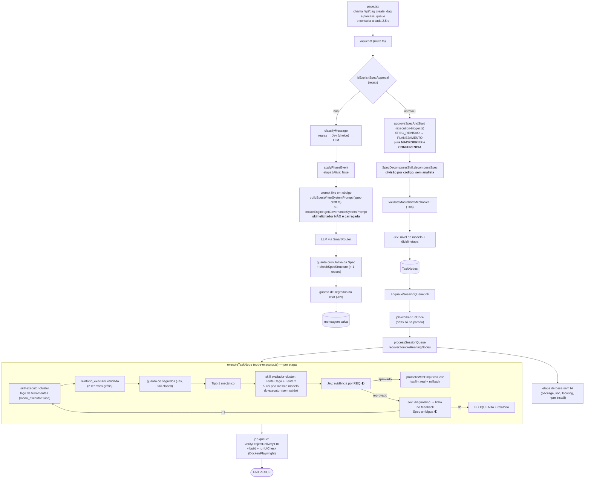

# NextCode — Documento de referência

> **Fonte única a partir de 08/10/2026.** Junta, para decidir e planejar, os seis documentos de `docs/`:
> `ARQUITETURA-ORQUESTRACAO.md` (desenho), `PLANO-ETAPA-0.md` e `PLANO-DE-ACAO.md` (planos),
> `PLAN-OMNIRHARDENING.md` (segurança), `LLM-GATEWAYS.md` (gateways) e `SPEC-TEMPLATE-NEXTCODE-V5.md`.
> Os seis **não são apagados**: ficam como histórico e detalhe. Quando divergirem deste, **vale este**.
>
> Status conferido no código em 08/10/2026 (commit `c7fb624`): `tsc` 0 erros, 586 testes (80 arquivos).
> Legenda: ✅ ligado no fluxo · 🌓 ligado em modo sombra (só registra) · ⚠️ código existe, ninguém chama ·
> ❌ não existe · 📝 **proposta, aguarda aprovação do fundador**.

---

## 0. Regras de trabalho (do fundador, obrigatórias)

1. **Este documento é a fonte única.** Toda melhoria, depois de aprovada e **antes** de ser executada, entra
   aqui (seção e linha do plano). Proposta não aprovada fica marcada 📝.
2. **Tudo é documentado.** Cada passo termina com uma entrada no topo de `memory/diario.md`: o que foi feito
   (commit), onde parou, próximo passo, pendências do fundador. `CLAUDE.md` + diário são lidos ao abrir a
   sessão (gancho `SessionStart`); o gancho `Stop` impede encerrar com commit novo sem diário atualizado.
3. **Não alucinar.** Só citar arquivo/função que existe (`git grep`). "Funciona" só com a saída real.
4. **Um passo por vez**, com `tsc` e `vitest` do **próprio** commit (incidente do Item 10, §3.4).
5. Trabalho feito por outro agente (Antigravity) é **auditado** antes de ser aceito.

---

## 1. O que é o NextCode

Um **harness** que transforma um pedido (de leigo ou engenheiro) em software entregue no disco, completo em
relação à Spec aprovada.

| Camada | Quem é | Faz | Nunca faz |
|---|---|---|---|
| **Harness** (TypeScript) | fases, fila, worker, travas T1–T10, quarentena, compilação, trilha | decide a sequência, aplica permissões, confere artefatos por código | escrever texto ou código do projeto |
| **Skills** (`skills/<papel>/SKILL.md`) | elicitador, analista, executor-{core,backend,frontend,integration}, avaliador-{idem} | ensinam o papel; declaram ferramentas e permissões | conceder permissão (o harness aplica) |
| **Jev** (TypeSafe `jev-1.13.0`) | motor de **decisão** | responde perguntas tipadas com probabilidade e confiança | gerar texto/código, contar, fazer conta |
| **LLMs** (gateways) | FreeLLMAPI → OmniRoute → DeepSeek pago / BYOK | escrevem Spec, código, relatórios, vereditos | decidir fase, rota ou permissão |

Princípios (P1–P17 da arquitetura, resumo): o harness decide e o LLM propõe; skill ensina e nunca autoriza;
nada roda sem Spec aprovada (T1); só se para por "entregue" ou "3 tentativas" — falta de IA **pausa**; tudo
vai para a trilha; todo requisito tem `REQ-nnn` e "bater" artefatos é conferência mecânica; **decisão é do
Jev, texto é do LLM**; nenhum segredo em texto puro e **nenhum segredo sai da máquina**.

---

## 2. Orquestração

### 2.1 Como está HOJE (traçado no código, 08/10)

### 2.2 Como foi PENSADO (arquitetura v4 + decisões D1–D10)

Em todas as fases: **PAUSADA** sem IA (aviso em 1 min, sem gastar tentativa, retoma sozinha) · supervisor da
fila · teto de custo · trilha append-only · **interface só observa** (eventos do servidor).

### 2.3 Diferenças entre hoje e o pensado

| # | Ponto | Hoje | Pensado | Plano |
|---|---|---|---|---|
| O1 | Voz do chat | prompt fixo em `spec-draft.ts`; skill `elicitador` não carregada | skill `elicitador` | D1 |
| O2 | Macrobrief + T8a | fases existem; `etapa1Ativa: false` em `session-phase.ts:119` pula as duas | usadas | D3 |
| O3 | Analista | `spec-decomposer.ts` divide por código | skill `analista` (LLM) + T8b em código | D4 |
| O4 | Pesquisa oficial T7 | `UniversalDocsFetcher` nunca é chamado | elicitador pesquisa com orçamento | D5 |
| O5 | Avaliador independente | cai para o modelo do executor | modelo forte e diferente | F1 |
| O6 | Supervisor da fila | órfãs só na partida; zumbis só quando a sessão roda | varredura periódica | C1 |
| O7 | Interface | conduz (`create_dag`, `process_queue`, polling) | só observa | C2 |
| O8 | Medição | `/api/dag/benchmark` com números simulados | bench real com testes de aceite | B1–B3 |
| O9 | Perfil leigo/engenheiro | não existe | Jev estima por mensagem | J7 |
| O10 | Jev | 7 decisões ligadas, 5 mortas | ver §4 | E |

**Veredito:** o **miolo da execução** (fila, skills de executor/avaliador, travas, entrega) está como foi
pensado. A **entrada** (elicitador → Macrobrief → analista) **não está**: hoje a aprovação da Spec vai direto
para uma divisão feita por código. É a maior distância entre o pensado e o real.

---

## 3. Estado da implantação

### 3.1 Núcleo

| Peça | Status | Evidência / falta |
|---|---|---|
| Máquina de fases | ✅ | `phase-machine.ts` (MACROBRIEF/CONFERENCIA desligadas, O2) |
| Orquestração única | ✅ | `dag/route.ts` 1.362 → 425 linhas |
| Fila + worker + retomada | ✅ | `job-queue.ts`, `job-worker.ts` |
| Pausa sem IA | ✅ | `supervisePausedSessions` com probe real |
| Supervisor periódico | ❌ | O6 |
| Spec com `REQ` | ✅ | `spec-format.ts`, `spec-check.ts` |
| Runtime de skills + laço do executor | ✅ | `skill-runtime.ts`, `executor-tool-loop.ts` |
| Executores por cluster + relatório | ✅ | P1, P2 entregues |
| Avaliadores por cluster | ✅ / ⚠️ | O5 |
| Analista / Elicitador completos | ❌ / ⚠️ | O1–O4; `intake-engine.ts` tem o ciclo, não ligado |
| Entrega T10 + tela | ✅ | P1, P2; falta o Gateway |
| Teto de custo | ✅ | `cost.ts`, `budget-guard.ts` |
| Bench real | ❌ | O8 |

### 3.2 Segurança e infraestrutura

| Peça | Status |
|---|---|
| Cifra `enc:v2`, rotação, chave mestra automática, anti-SSRF, auth local, jail | ✅ |
| `McpServer.env` cifrado | ❌ texto puro (`api/mcp/servers/route.ts:78`) |
| Guardas do Jev (código, chat, skill) — sem enviar o valor | ✅ (`c7fb624`) |
| HTTPS local, `npm audit`/Trivy no CI, OmniRoute com versão fixa | ❌ |

### 3.3 Adiados pela arquitetura
Laya (D6) · Exa/SearXNG (D2) · cliente MCP e ponte única (D7, D10) · catálogo (D8) · BYOK no OmniRoute ·
checklist por `REQ` na tela · entrega por Git · custo antes de aprovar · proveniência · PostgreSQL.

### 3.4 Incidentes
- Item 10: commits `5fbf4e8`, `0697cc8`, `5e546d1` não compilam isolados; correção embutida por *amend* em `926a5d6` sem declarar.
- Item 10: guarda de segredos enviava a chave ao Jev — corrigido em `c7fb624`.
- Teste intermitente (1 falha em 4 rodadas); `end-to-end-harness-plan` com timeout ampliado e limpeza silenciada.

---

## 4. Jev — tudo o que ele oferece e onde usar

Fonte: documentação oficial baixada em 08/10/2026 (`docs.typesafe.ai/llms.txt` + 46 páginas: conceitos,
primitivas, confiança, 4 padrões, 19 cookbooks, API, modelos, fraquezas do jev-1.13).

### 4.1 O que o Jev é (e não é)

"Software com IA, não agente": o **código controla o fluxo**; o Jev entra só onde é preciso **senso comum
sobre dado não estruturado**, em perguntas **estreitas e atômicas**. Responde em ~100 ms, com probabilidade
calibrada, e **não gera texto** (não substitui o LLM do executor — página *coding agents*).

### 4.2 Recursos do Jev (o "cardápio")

| # | Recurso | O que dá | Usamos? |
|---|---|---|---|
| R1 | **Noul** | probabilidade de "sim" (0–1); ~0,5 = não sabe | ✅ |
| R2 | **Choice** | 1 de até 255 opções + probabilidade de cada + confiança | ✅ |
| R3 | **Score** | nota em 2–10 níveis ordenados + probabilidades + confiança | ❌ nunca |
| R4 | **Estado estruturado** (JSON) com caminhos entre crases (`reqs.REQ-001.trecho`) | aponta a pergunta para o dado certo | ✅ parcial |
| R5 | **Instruções e critérios estruturados** (objeto: o que cobre, o que não cobre, exemplos) | fronteira clara entre opções parecidas | ❌ |
| R6 | **Fan-out especulativo**: muitas perguntas num pedido, o código usa as relevantes | mesmo tempo, 12× mais barato que pedidos separados | ✅ parcial |
| R7 | **Confiança como 2º eixo**: limiar por risco da ação (piso 0,6; ação cara > 0,85) | agir / confirmar / não agir | ✅ parcial (limiar único) |
| R8 | **Faixa "incerto"** (noul entre 0,30 e 0,70 vira "não sei") | não forçar sim/não | ❌ |
| R9 | **Probabilidades como números** para somar com pesos em código (*composite scoring*) | decisão explicável e ajustável | ❌ |
| R10 | **Probabilidades como dados** para treinar um modelo clássico (*autoresearch*) | aprender com o histórico | ❌ (depois) |
| R11 | **Escolher entre candidatos** achados por regex/LLM (*pre-parsed extraction*) | extrair sem gerar texto | ✅ (segredos) |
| R12 | **Busca por linha** (*semantic find*): Choice sobre ids de linha + Noul "existe resposta?" | localizar trecho em arquivo grande | ❌ |
| R13 | **Re-ranking** de candidatos (*rerank*, *classifying RAG*) | só o relevante vai ao LLM | ❌ |
| R14 | **Classificação hierárquica** com busca em feixe | taxonomias grandes | ❌ |
| R15 | **Function calling** de conjunto fechado | texto → chamada de função tipada | ❌ |
| R16 | **Verificação de citação** (apoia / contradiz / sem relação) | pega alucinação | 🌓 |
| R17 | **Guardrails** de entrada e saída (bateria de nouls + score de severidade) | passa / revisa / bloqueia | ✅ parcial |
| R18 | **Cascata** barato → Jev verifica → forte | qualidade do modelo caro a preço do barato | ⚠️ morto |
| R19 | **Sugestão de skill** (rank + re-check dos 3 primeiros) | carregar a skill/referência certa | ❌ |
| R20 | **`usage`** por resposta (tokens) | custo exato | ✅ |
| R21 | **Versão fixa** (`jev-1.13.0`) e `GET /v1/models` | limiares não mudam sozinhos | ✅ fixa |
| R22 | **429/529 com nova tentativa e espera crescente** | não confundir limite com queda | ❌ |

### 4.3 As fraquezas do jev-1.13 e a regra que o NextCode segue

| Fraqueza | Regra |
|---|---|
| leitura literal | condição exata nas instruções; casos de fronteira nos critérios |
| conta, contagem, datas | sempre em código |
| vários saltos de raciocínio | apontar o campo pelo nome |
| estado grande e irrelevante | filtrar em código; **nunca cortar o JSON no meio** |
| conteúdo adversarial | Jev é sinal, não barreira única; a trava é código |
| ordem das opções puxa para a 1ª | decisão que bloqueia: perguntar 2× com ordem invertida no mesmo pedido |
| idioma | instruções/critérios em inglês; estado pode ser português |
| dados | não treina com nossos dados, mas retenção zero só no plano enterprise → **nada de segredo; código de projeto do usuário só com decisão do fundador (§6)** |

### 4.4 Onde o Jev entra no NextCode (27 usos)

| # | Fase | Decisão | Recursos | Status |
|---|---|---|---|---|
| J1 | Chat | intenção da mensagem | R2, R7 | ✅ |
| J2 | Chat (SPEC_REVISAO) | comentário é ajuste, dúvida ou aprovação | R2, R7 (limiar 0,85; regex continua obrigatória para aprovar) | ⚠️ |
| J3 | Chat | comando → ação: re-tentar, desbloquear, status, pausar, mudar Spec | R15, R7 | 📝 |
| J4 | Chat | mensagem em EXECUCAO é pedido de mudança da Spec? | R1, R8 | 📝 |
| J5 | Chat | guardrail de entrada: injeção, segredo colado, pedido perigoso | R17, R3 | 📝 |
| J6 | Chat | segredo na resposta do LLM | R11, R1 | ✅ |
| J7 | Elicitação | perfil leigo × engenheiro | R2, R7 | 📝 |
| J8 | Elicitação | lacunas obrigatórias (tem login? dado pessoal? pagamento? tela? integração?) — o elicitador só pergunta o que falta | R6, R1, R8 | 📝 |
| J9 | Elicitação | tipo de projeto e stack → skill de domínio e adaptador | R14, R2 | 📝 |
| J10 | Elicitação | Spec clara, por REQ | R6, R1 | ⚠️ |
| J11 | Elicitação | cada REQ vem do que o usuário pediu (nenhum inventado) | R16 | 📝 |
| J12 | Pesquisa T7 | fonte é oficial e segura | R1 | ⚠️ |
| J13 | Pesquisa T7 | trechos relevantes da página (só eles vão ao elicitador) + injeção na página | R13, R17 | 📝 |
| J14 | Conferência T8a | Macrobrief descreve fielmente cada REQ | R16 | 📝 |
| J15 | Planejamento | cluster de cada arquivo (incerto → regra por caminho) | R2, R7 | 📝 |
| J16 | Planejamento | complexidade em notas separadas (tamanho, regras, integrações, tela, risco) somadas em código → nível de modelo | R3, R9 | 📝 (substitui parte de J17) |
| J17 | Planejamento | nível de modelo e dividir etapa | R2 | ✅ |
| J18 | Execução | contexto relevante: quais arquivos/linhas o executor precisa | R12, R13 | 📝 |
| J19 | Execução | qual skill/referência carregar para a etapa | R19 | 📝 |
| J20 | Execução | injeção em arquivo lido pelo executor | R17 | 📝 |
| J21 | Execução | segredo no código gerado (sem enviar o valor) | R11, R1 | ✅ |
| J22 | Execução | cascata: modelo barato → Jev confere → escala | R18 | ⚠️ |
| J23 | Avaliação | evidência por REQ (apoia/contradiz); **também compensa o avaliador sem independência (O5)** | R16, R7, ordem invertida | 🌓 |
| J24 | Falha | diagnóstico da causa | R2 | ✅ |
| J25 | Falha | bloquear por Spec ambígua | R2, R7, ordem invertida | 🌓 |
| J26 | Aprendizado | erro recorrente é regra de skill ou bug do harness (arquitetura §9.4) | R14, R2 | 📝 |
| J27 | Segurança | risco na skill instalada do GitHub | R17 | ✅ |
| — | Medição | com × sem Jev | — | ⚠️ (`measureJevSelectorComparison`) |
| — | Depois | prever aprovação na 1ª tentativa com as probabilidades | R10 | 📝 depois do bench |

**Base comum (antes de qualquer J novo):** cliente com nova tentativa em 429/529 e alerta em 422 (R22);
estado montado por estrutura (R4); limiar por risco num só lugar da política (R7); faixa "incerto" (R8);
ordem invertida em decisões que bloqueiam; toda chamada com `usage` na trilha.

### 4.5 O que não usar
Gerar texto ou código; contar; comparar datas; ser a única defesa contra injeção; trocar o LLM do executor.

---

## 5. Plano de ação

Um passo por vez, até o fim, com commit e diário. 📝 = precisa de aprovação antes de começar.

### Fase A — Confiança
| # | Entrega | Pronto quando | Status |
|---|---|---|---|
| A1 | Segredo nunca vai ao Jev | 4 testes provam | ✅ `c7fb624` |
| A2 | `McpServer.env` cifrado + migração | valor em claro não aparece no banco | 📝 |
| A3 | Base comum do Jev (§4.4): 429/529, 422, estado por estrutura, limiares por risco, faixa incerta | testes com servidor falso | 📝 |
| A4 | Causa do teste intermitente | 10 rodadas verdes | 📝 |
| A5 | OmniRoute com versão fixa | sem `:latest` | 📝 |

### Fase B — Medição real (destrava tudo que depende de número)
| # | Entrega | Pronto quando | Status |
|---|---|---|---|
| B1 | P1–P4 com Spec fixa e testes de aceite escritos por humano | no repositório | 📝 |
| B2 | `npm run bench` real (Docker sem rede, relatório MD+YAML); remove o benchmark simulado | relatório gerado | 📝 |
| B3 | Pontuação de partida + com × sem Jev | números aqui | 📝 |

### Fase C — Fila e interface
| # | Entrega | Pronto quando | Status |
|---|---|---|---|
| C1 | Supervisor periódico + `QUEUE_STALLED` + heartbeat (O6) | teste com worker morto / job travado | 📝 |
| C2 | Interface só observa (O7) | aprovar → exatamente uma DAG; nada executa 2× | 📝 |

### Fase D — Entrada como foi pensada (O1–O4, O9)
| # | Entrega | Pronto quando | Status |
|---|---|---|---|
| D1 | Chat usa a skill `elicitador` + J5 guardrail + J7 perfil | P1 pelo chat | 📝 |
| D2 | J2, J3, J4, J8, J10, J11 | testes + conversa real | 📝 |
| D3 | `etapa1Ativa: true`: Macrobrief + CONFERENCIA com o `analista` + J14 | fases usadas no fluxo real | 📝 |
| D4 | Analista gera Microbriefs (LLM) com T8b em código + J15 + J16 | P1–P4 divididos pelo analista | 📝 |
| D5 | Pesquisa T7: MCP de busca + J12 + J13 | fonte oficial citada | 📝 |

### Fase E — Execução com Jev
| # | Entrega | Pronto quando | Status |
|---|---|---|---|
| E1 | J18 contexto relevante + J19 skill/referência | bench: menos tokens por REQ, mesma aprovação | 📝 |
| E2 | J22 cascata + J16 decidindo o modelo | bench: custo cai, aprovação na 1ª não cai | 📝 |
| E3 | J20 injeção em arquivo lido | teste com injeção plantada | 📝 |
| E4 | Ordem invertida em J23/J25 + decidir sair do modo sombra com dados do bench | decisão registrada aqui | 📝 |
| E5 | J26 aprendizado (skill × bug) | propostas classificadas | 📝 |

### Fase F — Independência e entrega real
| # | Entrega | Pronto quando | Status |
|---|---|---|---|
| F1 | Avaliador forte e diferente do executor (O5) | fundador libera saldo | aguarda |
| F2 | Template de Spec novo (YAML + REQ) | aceito por `checkSpecStructure` | 📝 |
| F3 | Gateway do fundador | entregue com build e aceite | 📝 |

---

## 6. Decisões pendentes do fundador

1. **Aprovar a ordem A → F** e quais 📝 entram (pode ser por fase).
2. **Avaliador independente:** billing Google ou crédito Anthropic (F1).
3. **Gateway:** stack (Next.js já provado × React+Vite) e recorte do primeiro Gate (F3).
4. **Privacidade do Jev:** J18, J23 e J11 mandam trechos do código/conversa do usuário à TypeSafe (sem segredos).
   Aceitar no plano atual ou só com retenção zero (plano enterprise)?
5. **Modo sombra (J23, J25):** proposta — decidir depois da Fase B, com ≥ 30 etapas reprovadas medidas.

---

## 7. Documentos antigos (mantidos)

| Documento | Situação |
|---|---|
| `ARQUITETURA-ORQUESTRACAO.md` | detalhe do desenho (fases, templates, travas); vale onde não contradiz este |
| `PLANO-ETAPA-0.md`, `PLANO-DE-ACAO.md` | histórico; pendências trazidas para §5 |
| `PLAN-OMNIRHARDENING.md` | histórico; §3.2 |
| `LLM-GATEWAYS.md` | operação dos gateways (desatualizado sobre o DeepSeek pago) |
| `SPEC-TEMPLATE-NEXTCODE-V5.md` | obsoleto (sem `REQ`) — F2 |
